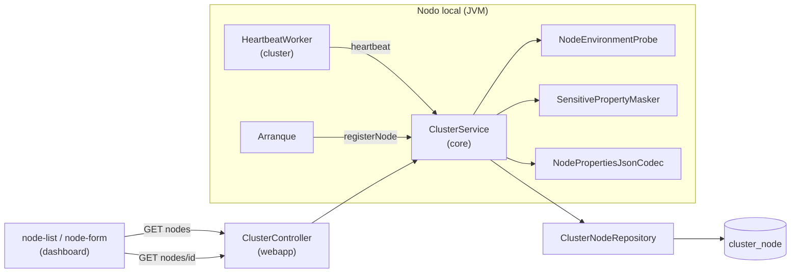
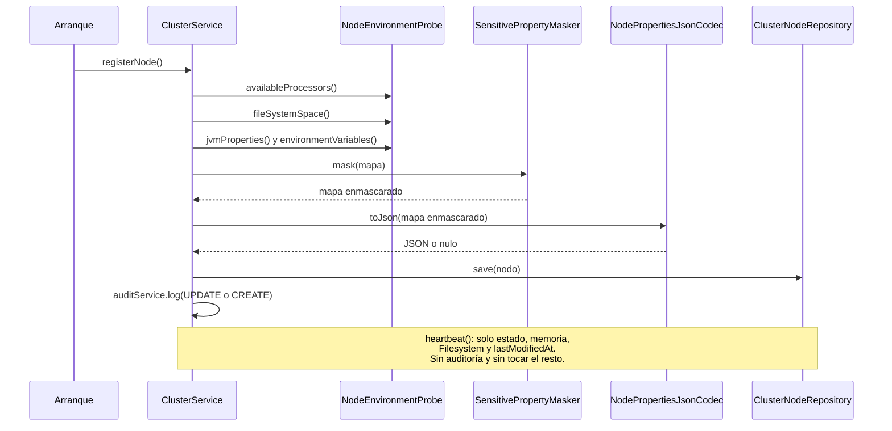

# Documento de Diseño: cluster-node-extended-info

## Overview

La funcionalidad añade tres grupos de datos a `ClusterNode` (tabla `cluster_node`): número de procesadores, espacio del Filesystem y propiedades de la JVM y del entorno. Los datos se recogen en el nodo local, se persisten y se muestran únicamente en el formulario de detalle del dashboard. Los valores de claves sensibles se enmascaran antes de persistirse.

### Estado actual investigado

| Elemento | Ubicación | Situación actual |
|----------|-----------|------------------|
| `ClusterNode` | `domain/.../entity/ClusterNode.java` | Entidad JPA con `@Getter/@Setter` (Lombok), secuencia `cluster_node_seq`. Campos: `id`, `status`, `hostname`, `ip`, `master`, `usedMemory`, `freeMemory`, `totalMemory`, `startedAt`, `lastModifiedAt`. |
| `ClusterNodeDTO` | `domain/.../dto/ClusterNodeDTO.java` | `record` con los mismos 10 campos. No usa MapStruct: la conversión es manual. |
| `ClusterService` | `core/.../service/ClusterService.java` | `registerNode()` (alta o re-registro por `hostname`, con auditoría `CREATE`/`UPDATE`), `heartbeat()` (actualiza estado, memoria y `lastModifiedAt`, sin auditoría), `toNodeDTO` privado usado por `findAllNodes`, `findNodeById` y `setMaster`. Los datos de memoria se leen con métodos privados `getUsedMemory()`, etc. |
| `ClusterController` | `webapp/.../controller/ClusterController.java` | `GET /api/v1/administration/cluster/nodes` y `GET /api/v1/administration/cluster/nodes/{id}`, ambos devuelven `ClusterNodeDTO`. |
| Liquibase | `domain/src/main/resources/db/changelog` | Tabla creada en `migrations/v1.0.0/20250112-create-cluster-node-table.xml`. Cambios posteriores usan `addColumn` con `schemaName="${schemaName}"` y `<rollback>` (ejemplo: `v2.0.0/20261101-add-user-locked-flag.xml`). |
| Dashboard | `dashboard/src/app/features/cluster` | `node-list` selecciona una fila de la lista y abre `node-form` pasándole el `ClusterNode` de la lista (`input.required<ClusterNode>()`). `node-form` es de solo lectura, `OnPush`, standalone, y renderiza memoria con `DecimalPipe`. El modelo está en `core/models/cluster.model.ts` y el servicio en `core/services/cluster.service.ts`. |
| Pruebas | `core`, `dashboard` | `core` ya incluye jqwik (`ClusterServiceSingleMasterPropertyTest`); el dashboard incluye `fast-check` y Vitest. |

### Decisiones de diseño

| # | Decisión | Motivo |
|---|----------|--------|
| D1 | Las propiedades JVM/entorno se guardan como JSON en columnas `TEXT` y se exponen en el DTO como `Map<String,String>`. | Lo exige el requisito 3. Evita una tabla hija para datos de solo lectura y sin consultas por clave. |
| D2 | Se introduce la interfaz `NodeEnvironmentProbe` (módulo `core`) con una implementación por defecto que lee `Runtime`, `File` y `System`. | Permite inyectar lecturas aleatorias, fallos y valores `< 1` en las pruebas de propiedades. Hoy `ClusterService` llama directamente a `Runtime`, lo que impide probar los requisitos 1.5, 2.4 y 2.5. |
| D3 | El enmascaramiento y la conversión JSON se aíslan en dos clases puras sin estado: `SensitivePropertyMasker` y `NodePropertiesJsonCodec`. | Son funciones puras, aptas para PBT (requisito 9.3), y mantienen `ClusterService` sin lógica de formato. |
| D4 | `NodePropertiesJsonCodec` usa una instancia propia de `com.fasterxml.jackson.databind.ObjectMapper`, no un bean. | `core/pom.xml` declara `jackson-databind` 2.x, mientras que Spring Boot 4 registra por defecto Jackson 3 (`tools.jackson`). Una instancia propia evita depender de qué `ObjectMapper` exponga el contexto. |
| D5 | La lista y el detalle usan dos conversiones distintas: `toNodeSummaryDTO` (campos nuevos en nulo) y `toNodeDetailDTO` (campos nuevos informados). `findAllNodes` y `setMaster` usan el resumen, `findNodeById` usa el detalle. | Cumple los requisitos 5.1 a 5.3 con un único `record`. El front ya ignora la respuesta de `setMaster` para los campos nuevos (la lista no los muestra). |
| D6 | `node-form` obtiene el detalle con `GET /nodes/{id}` al abrirse (requisito 7.8), porque la fila que recibe de la lista no contiene los campos nuevos. | Hoy `node-form` no hace llamadas HTTP; se añade `ClusterService.findNodeById` (o se reutiliza si ya existe) y un estado de carga. |
| D7 | Los formateadores genéricos (`BYTES_PER_GB`, `NO_VALUE`, `formatGb`, `formatFreePercent`, `formatInteger`) son funciones puras en `shared/utils/format.util.ts`, reutilizables por cualquier feature. La lógica de ordenación y filtrado de propiedades vive junto a su componente, en `shared/components/property-table/property-table.util.ts` (D9). | Hace testeable con `fast-check` lo que el requisito 7 define con reglas numéricas exactas. |
| D8 | El valor enmascarado es la constante `******`. La detección usa subcadenas sin distinguir mayúsculas (`Locale.ROOT`). | Requisito 4.1. `Locale.ROOT` evita fallos con configuraciones regionales como la turca (`I`/`ı`). |
| D9 | Las secciones de propiedades JVM y de entorno se renderizan con un componente compartido `tp-property-table` (`shared/components/property-table/`), no con dos bloques duplicados. Las funciones puras `toSortedRows`, `filterRows` y el tipo `PropertyRow` pasan a `shared/components/property-table/property-table.util.ts`. | `angular.md` exige reutilización y responsabilidad única, y ambas secciones solo difieren en título, etiqueta del filtro y prefijo de `data-testid`. Un componente compartido no puede importar de `features/`, por eso las funciones genéricas se mueven con él. Los formateadores de recursos (`formatGb`, `formatFreePercent`, `formatInteger`) están en `shared/utils/format.util.ts`. |

## Architecture



Reglas de capas (AGENTS.md): `domain` solo añade campos a la entidad y al DTO (sin Spring), `core` contiene toda la lógica, `webapp` no cambia código y el `dashboard` consume el contrato.

### Flujo de registro y de heartbeat



## Components and Interfaces

### Módulo `domain`

`ClusterNode` añade seis campos:

```java
@Column(name = "processors")
private Integer processors;

@Column(name = "fs_total_space")
private Long fsTotalSpace;

@Column(name = "fs_free_space")
private Long fsFreeSpace;

@Column(name = "fs_usable_space")
private Long fsUsableSpace;

@Column(name = "jvm_properties", columnDefinition = "TEXT")
private String jvmProperties;

@Column(name = "environment_properties", columnDefinition = "TEXT")
private String environmentProperties;
```

No se usa `@Lob`: en PostgreSQL Hibernate lo mapea a `oid`, no a `TEXT`. `domain` sigue sin dependencias de Spring.

`ClusterNodeDTO` añade al final del `record` (los diez campos existentes conservan nombre, tipo y orden):

```java
Integer processors,
Long fsTotalSpace,
Long fsFreeSpace,
Long fsUsableSpace,
Map<String, String> jvmProperties,
Map<String, String> environmentProperties
```

Los usos existentes del constructor del `record` (en `ClusterService` y en pruebas) se actualizan. El campo `Map` en nulo se serializa como `null` en la lista, y el cliente lo trata como ausente.

### Módulo `core`

#### `NodeEnvironmentProbe` (interfaz) y `DefaultNodeEnvironmentProbe` (`@Component`)

```java
public interface NodeEnvironmentProbe {
    int availableProcessors();                 // Runtime.availableProcessors()
    FileSystemSpace fileSystemSpace();         // puede lanzar RuntimeException
    Map<String, String> jvmProperties();       // System.getProperties(), claves y valores como texto
    Map<String, String> environmentVariables();// System.getenv()

    record FileSystemSpace(long total, long free, long usable) { }
}
```

`DefaultNodeEnvironmentProbe.fileSystemSpace()` lee `getTotalSpace()`, `getFreeSpace()` y `getUsableSpace()` de `Path.of("").toAbsolutePath().toFile()`, que es la partición del directorio de trabajo (requisito 2.2). `jvmProperties()` recorre `System.getProperties().stringPropertyNames()` y usa `getProperty`, con lo que todas las entradas son de tipo texto aunque alguien haya añadido un valor que no lo sea.

#### `SensitivePropertyMasker` (clase final, métodos estáticos)

```java
public static final String MASKED_VALUE = "******";
private static final List<String> SENSITIVE_FRAGMENTS =
    List.of("password", "passwd", "secret", "token", "key", "credential", "jwt");

public static boolean isSensitive(String key);
public static Map<String, String> mask(Map<String, String> properties);
```

`mask` devuelve un `LinkedHashMap` nuevo con las mismas claves. Para cada entrada, si `isSensitive(key)` el valor es `MASKED_VALUE` (también cuando el valor original es nulo o vacío), y en caso contrario se copia sin cambios. Nunca modifica el mapa de entrada. Una clave nula se trata como no sensible y se conserva.

Idempotencia: `MASKED_VALUE` no depende del valor original y las claves no cambian, por lo que `mask(mask(m))` es igual a `mask(m)`.

#### `NodePropertiesJsonCodec` (clase final)

```java
public static final int MAX_JSON_LENGTH = 1_048_576;

public static Optional<String> toJson(Map<String, String> properties);   // vacío si falla o supera MAX_JSON_LENGTH
public static Map<String, String> fromJson(String json);                 // mapa vacío si nulo o JSON no válido
```

`toJson` usa `ObjectMapper` con claves ordenadas (`ORDER_MAP_ENTRIES_BY_KEYS`) para que el JSON sea determinista. `fromJson` captura `JsonProcessingException` y `RuntimeException` y devuelve `Map.of()`, y descarta un JSON que no sea un objeto con valores de tipo texto.

#### Cambios en `ClusterService`

El constructor recibe además `NodeEnvironmentProbe`. Spring lo resuelve por constructor, y las pruebas existentes que hacen `new ClusterService(...)` se actualizan con un doble del probe.

`registerNode()` (para nodo nuevo y existente) llama a un método privado `applyExtendedInfo(ClusterNode node, boolean includeStatic)`:

1. **Procesadores** (solo registro): se lee `probe.availableProcessors()`. Si es `>= 1`, se asigna. Si es `< 1` y el nodo ya tiene valor, se conserva el existente. Si es `< 1` y el nodo no tiene valor, se lanza `IllegalStateException("Invalid processor count: " + n)` antes de `save`, y la transacción hace rollback sin persistir cambios (requisito 1.5).
2. **Filesystem** (registro y heartbeat): `readFileSystem(node, context)` llama a `probe.fileSystemSpace()`. Si lanza una excepción, escribe `log.warn("Unable to read filesystem space: hostname={}, cause={}", hostname, e.toString())` y asigna nulo a los tres valores.
3. **Propiedades** (solo registro): `storeProperties(label, supplier)` obtiene el mapa, lo enmascara, lo serializa y asigna el JSON o nulo.
   - Si `mask` lanza una excepción, se hace `log.error("Unable to mask {} properties for hostname={}", label, hostname)` sin incluir valores, la columna queda en nulo y no se serializa el mapa original (requisito 4.6).
   - Si `toJson` falla o supera `MAX_JSON_LENGTH`, se hace `log.warn` con la etiqueta (`JVM_Properties` o `Environment_Properties`) y la columna queda en nulo (requisitos 3.6 y 3.7).
   - Cada conjunto se trata de forma independiente: el fallo de uno no afecta al otro ni al resto del nodo.

La asignación en un nodo existente sustituye íntegramente el valor (requisito 3.3) porque no se fusiona con el JSON anterior.

`heartbeat()` solo añade la lectura de Filesystem (paso 2). No toca `processors`, `jvmProperties` ni `environmentProperties`, y sigue sin llamar a `auditService`. Un fallo del Filesystem no impide `node.setLastModifiedAt(...)` ni el `save` (requisito 2.5).

Conversión a DTO:

```java
private ClusterNodeDTO toNodeSummaryDTO(ClusterNode n)  // 10 campos existentes + 6 nuevos en null
private ClusterNodeDTO toNodeDetailDTO(ClusterNode n)   // 10 campos existentes + 6 nuevos informados
```

`toNodeDetailDTO` aplica `NodePropertiesJsonCodec.fromJson` a las dos columnas, por lo que una columna nula o un JSON no válido producen un mapa vacío. Para `processors` y `fs*` copia el valor tal cual, incluido el nulo (requisitos 1.6 y 5.5).

La auditoría de `registerNode` mantiene los mismos mensajes y operaciones. No se incluyen propiedades ni valores de entorno en el texto de auditoría ni en ningún log.

### Módulo `webapp`

`ClusterController` no cambia, y `SecurityConfig` tampoco. Los endpoints conservan sus rutas, sus reglas de autorización y su error 404 por `EntityNotFoundException`. El contrato cambia solo por los campos añadidos al DTO.

Consideración de seguridad: el detalle expone variables de entorno, aunque enmascaradas. El enmascaramiento se basa en el nombre de la clave, por lo que no protege valores secretos guardados bajo claves sin esas subcadenas (por ejemplo, una URL con credenciales embebidas en una variable `DB_URL`). Se acepta como riesgo residual, y la autorización del detalle es la ya existente para el módulo de cluster.

### Módulo `dashboard`

#### Modelo y servicio

`cluster.model.ts` añade a `ClusterNode` los campos opcionales:

```ts
processors?: number | null;
fsTotalSpace?: number | null;
fsFreeSpace?: number | null;
fsUsableSpace?: number | null;
jvmProperties?: Record<string, string> | null;
environmentProperties?: Record<string, string> | null;
```

`ClusterService` expone `findNodeById(id: number): Observable<ClusterNode>` (`GET {apiUrl}/administration/cluster/nodes/{id}`), que se reutiliza si ya existe.

#### `format.util.ts` y `property-table.util.ts` (funciones puras)

```ts
export const BYTES_PER_GB = 1_073_741_824;
export const NO_VALUE = '-';

export function formatGb(bytes: number | null | undefined): string;          // 2 decimales o '-'
export function formatFreePercent(total, free): string;                      // 1 decimal, 0.0..100.0, o '-' si total nulo o 0
export function formatInteger(value: number | null | undefined): string;     // entero o '-'
export interface PropertyRow { key: string; value: string; }
export function toSortedRows(props: Record<string, string> | null | undefined): PropertyRow[];
export function filterRows(rows: PropertyRow[], text: string): PropertyRow[];
```

`formatFreePercent` acota el resultado al intervalo `[0, 100]` para tolerar lecturas inconsistentes (`free > total`). `toSortedRows` ordena por clave con `localeCompare(..., undefined, { sensitivity: 'base' })` sobre claves en minúsculas, y `filterRows` compara clave y valor en minúsculas con `includes`.

#### `PropertyTableComponent` (`tp-property-table`)

Componente standalone `OnPush` en `shared/components/property-table/` que muestra un mapa clave/valor de solo lectura con filtro de texto.

| Input | Tipo | Descripción |
|-------|------|-------------|
| `properties` | `Record<string, string> \| null \| undefined` (requerido) | Mapa a mostrar |
| `heading` | `string` (requerido) | Clave i18n del título de la sección |
| `filterLabel` | `string` (requerido) | Clave i18n de la etiqueta del filtro |
| `testId` | `string` (requerido) | Prefijo de los `data-testid` y de los `id` |

- Estado interno: señal `filter` y `computed` de filas ordenadas (`toSortedRows`) y filtradas (`filterRows`). Cada instancia tiene su propio filtro, por lo que son independientes (requisito 7.4).
- Con propiedades: título, etiqueta asociada con `for`, campo de filtro y tabla con `<th scope="col">`. Sin coincidencias: mensaje `role="status"` y el filtro conserva su texto (7.4, 7.5). Sin propiedades (nulo o vacío): solo el mensaje "sin propiedades", sin filtro ni tabla (7.7).
- `data-testid` derivados del prefijo, que conservan los valores anteriores: `{testId}-section`, `{testId}-filter`, `{testId}-table`, `{testId}-row`, `{testId}-no-matches` y `{testId}-empty`. Los `id` pasan a `{testId}-heading` y `{testId}-filter`.
- Usa `translate` para los textos comunes (`form.columnKey`, `form.columnValue`, `form.filterPlaceholder`, `form.noMatches`, `form.noProperties`). No cambian las claves i18n.

#### `NodeFormComponent`

- Mantiene `node = input.required<ClusterNode>()` y `back`, y añade el estado `detail = signal<ClusterNode | null>(null)` y `loadState = signal<'loading' | 'loaded' | 'error'>('loading')`.
- Un `effect` (o `toObservable(node)` con `switchMap`) llama a `findNodeById(node().id)` con `timeout(30000)`. En error o timeout fija `loadState = 'error'` y descarta `detail`, de modo que las secciones nuevas no muestran valores parciales ni obsoletos (requisito 7.9).
- Delega las secciones de propiedades en dos instancias de `tp-property-table` (`testId="node-form-jvm"` y `testId="node-form-env"`), que se renderizan solo si `loadState() === 'loaded'`. El componente ya no tiene señales ni `computed` de filtro propios.
- Las secciones nuevas se añaden bajo la sección "Datos del nodo": **Recursos** (procesadores, Filesystem total y libre en GB, % libre), **Propiedades de la JVM** y **Variables de entorno**.
- Los campos de texto de solo lectura siguen el patrón actual (`<label for>` + `<input readonly disabled>`), y se asocian programáticamente a su etiqueta (WCAG 2.2 AA).

#### Textos i18n

Se añaden las mismas claves en `assets/i18n/es.json` y `en.json`, bajo `cluster.nodes`:

| Claves | Contenido |
|--------|-----------|
| `fields.processors`, `fields.fsTotalGb`, `fields.fsFreeGb`, `fields.fsFreePercent` | Etiquetas de recursos |
| `form.sectionResources`, `form.sectionJvm`, `form.sectionEnvironment` | Títulos de sección |
| `form.filterPlaceholder`, `form.filterLabelJvm`, `form.filterLabelEnv` | Filtros |
| `form.columnKey`, `form.columnValue` | Cabeceras de tabla |
| `form.noMatches`, `form.noProperties`, `form.loadError` | Mensajes de estado |

#### `node-list`

No se modifica. La interfaz con campos opcionales no altera sus columnas y la lista ignora los campos adicionales de la respuesta (requisitos 8.1 a 8.5).

## Data Models

### Esquema (Liquibase)

Fichero nuevo `domain/src/main/resources/db/changelog/migrations/v1.0.0/20250112-add-cluster-node-extended-info.xml`, incluido en `db.changelog-master.xml` justo después de `20250112-create-cluster-node-table.xml`.

Contiene seis `changeSet` (uno por columna, con `labels="v1.0.0"`, `author="template"`), cada uno con `<comment>`, `<preConditions onFail="MARK_RAN">` con `not` + `columnExists`, un `addColumn` y su `<rollback>` con `dropColumn`. Un changeset por columna hace que la precondición del requisito 6.4 se evalúe columna a columna: si una ya existe se omite solo esa.

```xml
<changeSet id="20250112-add-cluster-node-processors" author="template" labels="v1.0.0">
    <comment>Añade el número de procesadores del nodo</comment>
    <preConditions onFail="MARK_RAN">
        <not>
            <columnExists schemaName="${schemaName}" tableName="cluster_node" columnName="processors"/>
        </not>
    </preConditions>
    <addColumn schemaName="${schemaName}" tableName="cluster_node">
        <column name="processors" type="INTEGER"/>
    </addColumn>
    <rollback>
        <dropColumn schemaName="${schemaName}" tableName="cluster_node" columnName="processors"/>
    </rollback>
</changeSet>
```

| Columna | Tipo | Nulo | Valor por defecto |
|---------|------|------|-------------------|
| `processors` | `INTEGER` | Sí | Ninguno |
| `fs_total_space` | `BIGINT` | Sí | Ninguno |
| `fs_free_space` | `BIGINT` | Sí | Ninguno |
| `fs_usable_space` | `BIGINT` | Sí | Ninguno |
| `jvm_properties` | `TEXT` | Sí | Ninguno |
| `environment_properties` | `TEXT` | Sí | Ninguno |

Las filas existentes quedan con las seis columnas en nulo y los demás valores intactos. El mínimo de 1 procesador lo garantiza el servicio, no una restricción de base de datos, para no bloquear la migración de filas previas. No se modifica la semilla `20250118-seed-local-cluster-node.xml` (un changeset ya aplicado es inmutable); el nodo local se rellena en el siguiente arranque. No se necesitan índices, tablespaces ni secuencias, porque solo se añaden columnas.

### Resumen de campos

| Campo entidad | Columna | DTO | En lista | En detalle |
|---------------|---------|-----|----------|------------|
| `processors` | `processors` | `Integer processors` | `null` | valor almacenado |
| `fsTotalSpace` | `fs_total_space` | `Long fsTotalSpace` | `null` | valor almacenado |
| `fsFreeSpace` | `fs_free_space` | `Long fsFreeSpace` | `null` | valor almacenado |
| `fsUsableSpace` | `fs_usable_space` | `Long fsUsableSpace` | `null` | valor almacenado |
| `jvmProperties` (JSON) | `jvm_properties` | `Map<String,String>` | `null` | mapa (vacío si nulo o inválido) |
| `environmentProperties` (JSON) | `environment_properties` | `Map<String,String>` | `null` | mapa (vacío si nulo o inválido) |

Política de actualización:

| Dato | `registerNode()` | `heartbeat()` |
|------|------------------|---------------|
| `processors` | Se recalcula y persiste | Se conserva |
| Filesystem | Se lee y persiste | Se lee y persiste |
| JVM y entorno | Se recalculan, enmascaran y sustituyen | Se conservan |

## Correctness Properties

*A property is a characteristic or behavior that should hold true across all valid executions of a system-essentially, a formal statement about what the system should do. Properties serve as the bridge between human-readable specifications and machine-verifiable correctness guarantees.*

Tras el análisis previo, los criterios de esquema (6.x), de interfaz de usuario puramente visual (7.1, 7.5, 7.7 a 7.11), de seguridad sin cambios (5.4, 5.7) y de existencia de pruebas (9.x) se cubren con pruebas de ejemplo, integración o humo, y no con propiedades. Se han consolidado los criterios redundantes (por ejemplo, 4.1, 4.2, 4.3, 4.4 y 4.8 forman una sola propiedad de enmascaramiento, y 1.3, 2.3, 3.4, 9.2, 9.6 y 9.7 forman una sola propiedad de heartbeat).

### Property 1: El enmascaramiento oculta solo las claves sensibles y conserva la estructura

*For any* mapa de propiedades (incluido el vacío, con claves en cualquier combinación de mayúsculas y minúsculas y con valores nulos, vacíos o arbitrarios), el resultado de `mask` tiene exactamente el mismo conjunto de claves, carácter a carácter, que el mapa de entrada; toda entrada cuya clave contiene `password`, `passwd`, `secret`, `token`, `key`, `credential` o `jwt` (sin distinguir mayúsculas) tiene el valor `******`; y toda entrada cuya clave no contiene ninguna de ellas conserva su valor original.

**Validates: Requirements 4.1, 4.2, 4.3, 4.4, 4.8, 9.3**

### Property 2: El enmascaramiento es idempotente

*For any* mapa de propiedades `m`, `mask(mask(m))` es igual a `mask(m)`.

**Validates: Requirements 4.7, 9.3**

### Property 3: Ida y vuelta JSON de las propiedades

*For any* mapa `Map<String,String>` cuyo JSON no supere 1 MiB, `fromJson(toJson(m))` produce un mapa igual a `m`.

**Validates: Requirements 3.1, 3.5**

### Property 4: La lectura de JSON es tolerante

*For any* cadena arbitraria, incluidos `null`, la cadena vacía y JSON no válido o que no sea un objeto de valores de texto, `fromJson` no lanza ninguna excepción y devuelve un mapa (vacío cuando la entrada no es un objeto válido).

**Validates: Requirements 3.8**

### Property 5: Límite de tamaño del JSON

*For any* mapa `m`, `toJson(m)` devuelve un valor presente si y solo si la longitud del JSON serializado es menor o igual que 1.048.576 caracteres, y vacío en caso contrario.

**Validates: Requirements 3.7**

### Property 6: El registro persiste datos enmascarados y sustituye los anteriores

*For any* nodo (nuevo o existente, con cualquier JSON previo en `jvm_properties` y `environment_properties`), cualquier lectura de Filesystem y cualquier par de mapas de JVM y entorno que devuelva el probe, tras `registerNode()` las columnas de propiedades contienen exactamente `toJson(mask(mapa actual))` (sin claves del valor anterior que no existan ahora), `processors` y los tres valores de Filesystem coinciden con el probe, y el JSON persistido no contiene el valor original de ninguna clave sensible.

**Validates: Requirements 1.2, 2.2, 3.2, 3.3, 4.5**

### Property 7: Un número de procesadores inválido no altera el nodo

*For any* valor `n < 1` devuelto por `availableProcessors()`, `registerNode()` conserva el `processors` previo del nodo si lo tiene, y si no lo tiene lanza un error que indica que el número de procesadores no es válido y no persiste ningún cambio.

**Validates: Requirements 1.5**

### Property 8: El heartbeat actualiza solo el Filesystem y no audita

*For any* estado almacenado del nodo local (con cualquier `processors`, JSON de propiedades y valores nulos incluidos) y cualquier lectura de Filesystem, tras `heartbeat()` los tres valores de Filesystem son los de la lectura, `processors`, `jvm_properties` y `environment_properties` son idénticos a los de antes, y `auditService` no recibe ninguna llamada. Tras 10 heartbeats consecutivos el número de entradas de auditoría no cambia.

**Validates: Requirements 1.3, 2.3, 3.4, 9.2, 9.6, 9.7**

### Property 9: El DTO de detalle refleja el nodo almacenado

*For any* entidad `ClusterNode` (con campos nuevos nulos o informados, JSON válido, nulo o no válido), `findNodeById` devuelve un DTO cuyos diez campos existentes son iguales a los de la entidad, cuyos `processors` y `fs*` son iguales a los almacenados (nulo si no hay valor), y cuyas propiedades son el mapa que resulta de `fromJson` (vacío si la columna es nula o inválida).

**Validates: Requirements 1.4, 1.6, 2.6, 3.5, 3.8, 5.1, 5.5, 5.6**

### Property 10: La lista no incluye los campos nuevos

*For any* lista de entidades `ClusterNode`, `findAllNodes` devuelve un DTO por entidad con `processors`, `fsTotalSpace`, `fsFreeSpace`, `fsUsableSpace`, `jvmProperties` y `environmentProperties` en nulo, y con los diez campos existentes iguales a los de la entidad.

**Validates: Requirements 5.2, 5.3, 5.6**

### Property 11: Formato de espacio y porcentaje en el formulario

*For any* `total` entero mayor que 0 y `free` entre 0 y `total`, `formatGb(total)` es `total / 1.073.741.824` con exactamente dos decimales y `formatFreePercent(total, free)` es un número con exactamente un decimal dentro de `[0,0 ; 100,0]`. *For any* valor nulo, `formatGb` y `formatInteger` devuelven `-`, y `formatFreePercent` devuelve `-` cuando `total` es nulo o 0.

**Validates: Requirements 7.2, 7.6**

### Property 12: Orden y filtro de propiedades

*For any* mapa de propiedades y cualquier texto de filtro, `toSortedRows` devuelve todas las entradas ordenadas ascendentemente por clave sin distinguir mayúsculas, y `filterRows` devuelve exactamente las filas cuya clave o valor contiene el texto sin distinguir mayúsculas, conservando el orden y sin modificar las filas de la otra sección.

**Validates: Requirements 7.3, 7.4**

## Error Handling

| Situación | Comportamiento | Requisito |
|-----------|----------------|-----------|
| `availableProcessors() < 1` en registro | Se conserva el valor previo; sin valor previo se lanza `IllegalStateException` y no se persiste nada | 1.5 |
| Excepción al leer el Filesystem (registro) | `WARN` con hostname y causa, tres valores en nulo, el registro continúa | 2.4 |
| Excepción al leer el Filesystem (heartbeat) | `WARN` con hostname y causa, tres valores en nulo, se actualiza `lastModifiedAt` y se guarda | 2.5 |
| Fallo al serializar un conjunto de propiedades | `WARN` con la etiqueta del conjunto, solo esa columna en nulo | 3.6 |
| JSON de más de 1 MiB | `WARN` con la etiqueta, solo esa columna en nulo | 3.7 |
| Fallo del enmascaramiento | `ERROR` sin valores de propiedades, ese conjunto no se almacena (columna en nulo) | 4.6 |
| Columna nula o JSON no válido al leer | Mapa vacío en el DTO, sin excepción | 3.8 |
| Columnas nuevas nulas en un nodo existente | Campo nulo en el DTO de detalle, respuesta correcta | 1.6, 5.5 |
| Identificador de nodo inexistente | `EntityNotFoundException` (404), igual que antes | 5.4 |
| Error o timeout (30 s) del detalle en el dashboard | Mensaje de error y secciones nuevas sin datos | 7.9 |
| Columna ya existente al migrar | Changeset omitido con `MARK_RAN` | 6.4 |

Ningún mensaje de log incluye valores de propiedades. Un fallo al recoger información extendida nunca debe impedir el registro del nodo, salvo el caso 1.5, donde el nodo no tiene un número de procesadores válido que persistir.

## Testing Strategy

### Aplicabilidad de PBT

Se aplica PBT a la lógica pura y a la lógica de servicio con dependencias simuladas: enmascaramiento, codec JSON, registro y heartbeat con un probe controlado, conversión a DTO y funciones de formato y filtro del dashboard. No se aplica PBT a la migración Liquibase, al renderizado de plantillas Angular, a la seguridad ni a la existencia de pruebas, que usan pruebas de ejemplo, integración o humo.

### Backend (`core`, `webapp`, `domain`)

Se usa **jqwik 1.9.2** (ya configurado en el proyecto) con JUnit 5, Mockito y AssertJ, siguiendo la guía de testing del proyecto.

- Cada propiedad (1 a 10) se implementa con un único `@Property(tries = 100)` como mínimo, con la etiqueta en un comentario: `Feature: cluster-node-extended-info, Property {n}: {texto}`.
- Ubicación: `SensitivePropertyMaskerPropertyTest` y `NodePropertiesJsonCodecPropertyTest` (propiedades 1 a 5), `ClusterServiceExtendedInfoPropertyTest` (propiedades 6 a 10), junto a `ClusterServiceSingleMasterPropertyTest`.
- Generadores: claves que combinan fragmentos sensibles con cambios aleatorios de mayúsculas, valores nulos, vacíos y arbitrarios, mapas vacíos, y mapas cercanos al límite de 1 MiB para la propiedad 5. Para la propiedad 6 los valores de las claves sensibles son cadenas únicas aleatorias, para poder comprobar que no aparecen en el JSON persistido.
- `ClusterNodeRepository`, `AuditService` y `NodeEnvironmentProbe` se simulan con Mockito, y un `ArgumentCaptor<ClusterNode>` captura lo guardado.

Pruebas de ejemplo (JUnit 5):

- `ClusterServiceTest`: registro de nodo nuevo y existente carga los cuatro atributos (9.1); fallos del probe en registro y heartbeat (2.4, 2.5); fallo del serializador y del enmascarador (3.6, 4.6) con aserción de que solo se anula la columna afectada y de que el log no contiene valores.
- `ClusterControllerTest` (MockMvc): la lista no contiene los campos nuevos con valor y el detalle los contiene todos (9.4); el 404 y la autorización no cambian.
- Se actualizan las pruebas existentes que construyen `ClusterNodeDTO` o `ClusterService` para el nuevo constructor.
- ArchUnit: se mantiene la regla de que `domain` no depende de Spring.

Integración (`*IT`, Testcontainers PostgreSQL 18, ejecutadas por failsafe): aplicar el changelog sobre una tabla con filas y comprobar tipos de columna y valores nulos (6.1, 6.6, 6.7), segunda ejecución con columnas ya existentes (6.4), y `rollbackCount` de los seis changesets (6.5). El arranque con el perfil `local` sobre H2 comprueba que la migración no falla en ese motor (6.7), sin usar H2 como base de pruebas de integración.

### Frontend (`dashboard`)

Se usa **fast-check** (ya presente) con Vitest, con `numRuns` de 100 como mínimo.

- `shared/utils/format.util.spec.ts` (propiedad 11) y `shared/components/property-table/property-table.util.spec.ts` (propiedad 12), con la etiqueta `Feature: cluster-node-extended-info, Property {n}: {texto}`.
- `node-form.component.spec.ts` (pruebas de ejemplo con `HttpTestingController`): muestra cada campo nuevo con valor informado; filtra cada sección sin afectar a la otra; los valores nulos o ausentes no provocan error de renderizado; mensajes de "sin coincidencias" (conserva el texto del filtro) y "sin propiedades"; error HTTP y timeout de 30 s con `fakeAsync`; la petición va a `GET /nodes/{id}`; etiquetas asociadas y `th scope="col"` (7.11).
- Prueba de paridad de claves entre `es.json` y `en.json` (7.10).
- `node-list.component.spec.ts` y `node-list.component.behavior.spec.ts`: se añade un caso con y sin los campos nuevos que verifica filas idénticas y ausencia de errores en consola (8.4, 8.5).
- E2E Playwright (`e2e/tests/administration/cluster-nodes.spec.ts`): abrir el detalle de un nodo y comprobar las secciones nuevas con `data-testid`.

### Documentación

Según las reglas del proyecto, se actualiza la documentación funcional del cluster en `template-docs/02-functional/administration/cluster/` con las secciones `1. Requisitos`, `2. Parte funcional`, `3. Parte técnica` y `4. Pruebas`, y se actualiza la versión de los casos de prueba modificados.
