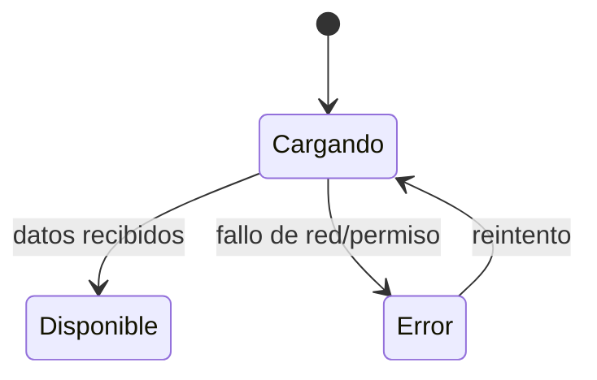

# Estadísticas del Dashboard — Diseño

> Estado: Borrador (pendiente de implementar)
> Feature: `dashboard-stats`

## 1. Resumen

Se sustituyen los datos hardcodeados de tres stat-cards (usuarios, interfaces,
informes) por datos reales. Se propone un endpoint de resumen en backend
(`GET /dashboard/stats`) consumido por un `DashboardStatsService` en frontend.
Se contempla una alternativa de primera iteración que reutiliza los
`countByCriteria` existentes sin endpoint nuevo.

## 2. Opción recomendada: endpoint de resumen

### 2.1 Backend

Nuevo endpoint que agrega los conteos en una sola respuesta:

```
GET /dashboard/stats
```

Respuesta (DTO `DashboardStatsDTO`):

```json
{
  "users":      { "total": 148, "active": 148, "trend": null },
  "interfaces": { "total": 12, "withError": 1 },
  "reports":    { "generated": 56, "period": "2026-10" }
}
```

- `trend` es opcional: solo se incluye si el backend puede calcular una
  comparación real con un periodo anterior; si es `null`, el frontend no muestra
  indicador de tendencia (RF-1).
- `period` identifica el periodo de "informes generados" (RF-3).
- La capa web delega en `core` (servicios de negocio); no se añade lógica en el
  controlador (coherente con la arquitectura del proyecto).

### 2.2 Seguridad

- Regla en `SecurityConfig` para `/dashboard/stats` accesible con `DASHBOARD_READ`.
- Cada bloque del DTO se calcula solo si el usuario tiene el permiso de la entidad
  (users → `USER_READ`, interfaces → `INTERFACES_READ`, reports → `REPORT_EXECUTE`);
  los bloques sin permiso se omiten o se devuelven como no disponibles.

### 2.3 Frontend

```typescript
export interface DashboardStats {
  users?: { total: number; active: number; trend: number | null };
  interfaces?: { total: number; withError: number };
  reports?: { generated: number; period: string };
}
```

- `DashboardStatsService.getStats(): Observable<DashboardStats>` → `GET /dashboard/stats`.
- `DashboardComponent` consume el servicio y expone signals por tarjeta
  (`usersLoading/usersError/users`, etc.), replicando el patrón que ya usa la
  tarjeta de nodos del cluster.

## 3. Alternativa (primera iteración sin backend nuevo)

Si no se quiere añadir endpoint de inmediato, el `DashboardComponent` puede
obtener los agregados reutilizando lo existente:

| Tarjeta        | Fuente reutilizable                                             |
|----------------|----------------------------------------------------------------|
| Usuarios       | `UserService.countByCriteria({})` → total                      |
| Interfaces     | conteo de configuraciones + conteo de las que están en error   |
| Informes       | servicio de informes (conteo del periodo)                      |

- Lanzar las llamadas en paralelo (`forkJoin`) con estados por tarjeta.
- Inconveniente: varias peticiones y falta de dato de tendencia real (se omite).
- Esta alternativa es un puente; la opción recomendada (endpoint único) es el
  objetivo final.

## 4. Estados de las tarjetas

Replicar el patrón existente de la tarjeta de nodos:



Cada tarjeta: spinner mientras carga, valor `-` + mensaje en error, valor real
cuando hay datos. Indicadores con icono + texto (coherente con la mejora de
accesibilidad ya aplicada: el estado no depende solo del color).

## 5. Impacto

- **Backend**: nuevo endpoint `/dashboard/stats` + DTO + servicio de negocio en
  `core` (opción recomendada). Ninguno si se usa la alternativa.
- **Frontend**: `DashboardStatsService` + modelo + refactor de
  `DashboardComponent` para consumir datos reales y gestionar estados.
- **Base de datos**: ninguno (solo lecturas agregadas).
- **Dependencias**: ninguna nueva.

## 6. Riesgos

- **Tendencia sin dato real**: no inventar; omitir el indicador si el backend no
  lo provee (RF-1).
- **N peticiones (alternativa)**: mitigable migrando al endpoint único.
- **Permisos**: el agregado debe respetar exactamente los permisos por entidad.
