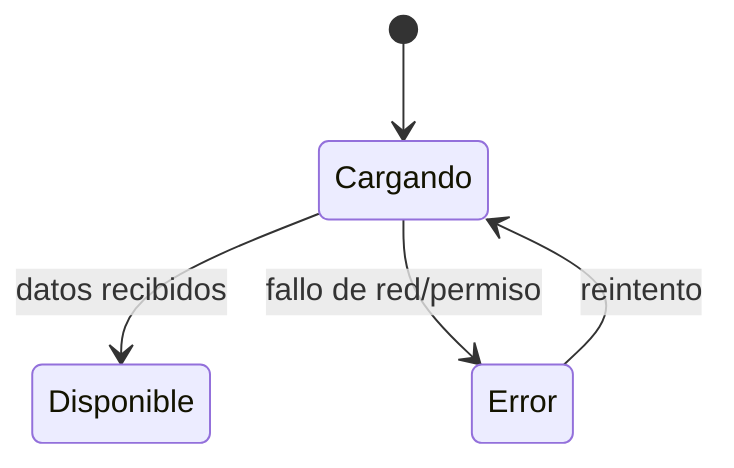

# Estadísticas del Dashboard — Diseño

> Estado: Borrador (pendiente de implementar)
> Feature: `dashboard-stats`

## Overview

## 1. Resumen

El rediseño reorienta el dashboard a su rol real: **overview de salud del sistema
para el administrador/operador**. Cubre dos frentes:

1. **Datos reales en lugar de hardcodeados**: stat-cards (usuarios, interfaces,
   informes), panel "Estado del sistema" (entorno, máster, uptime) y cabecera
   ("último acceso").
2. **Rediseño de dashboard como instrumento de decisión**: jerarquía que prioriza
   las señales de salud, excepciones navegables al detalle, y frescura/recarga.

En backend se propone un endpoint de resumen (`GET /dashboard/stats`) consumido
por un `DashboardStatsService` en frontend. Se contempla una alternativa de
primera iteración que reutiliza los `countByCriteria` / lecturas existentes sin
endpoint nuevo. La tarjeta de nodos del cluster es el patrón de referencia para
estados de carga/error y para el uso de color con significado.

## 2. Inventario de datos: disponible vs. requiere backend

Clave para distinguir lo que se arregla solo con frontend de lo que necesita
backend nuevo.

| Dato                       | ¿Disponible hoy? | Fuente                                                        |
|----------------------------|------------------|---------------------------------------------------------------|
| Total de usuarios          | Sí               | `UserService.countByCriteria({})`                             |
| Tendencia de usuarios      | No               | Requiere comparación de periodos en backend (omitir, RF-1)    |
| Interfaces configuradas    | Sí               | `InterfaceService.findAllConfigurations()` (longitud)         |
| Interfaces en error        | Sí               | `findAllConfigurations()` filtrando `status === 'ERROR'`      |
| Nodos activos / total      | Sí               | `ClusterService.findAllNodes()` (ya consumido)                |
| Nodo máster                | Sí               | `findAllNodes()` → nodo con `master === true`                 |
| Uptime del máster          | Sí               | `ClusterNode.startedAt` (derivar duración)                    |
| Entorno                    | Sí               | `environment.ts` (`profile`)                                  |
| Versión de la aplicación   | Depende          | Solo si hay fuente real; si no, retirar (no inventar)         |
| "Informes generados / mes" | **No**           | `ReportService` es catálogo, no histórico de ejecuciones      |
| Último acceso del usuario  | Depende          | Perfil/sesión (`AuthService`) o retirar de la cabecera        |

## Architecture

La arquitectura respeta la separación por capas del proyecto: la capa web
(`webapp`) expone el endpoint y delega la agregación en servicios de negocio de
`core`, que a su vez reutilizan los servicios/lecturas existentes (`UserService`,
`InterfaceService`, `ClusterService`). El frontend consume un único endpoint de
resumen a través de `DashboardStatsService` y renderiza por bloques con estados
de carga/error independientes (patrón de la tarjeta de nodos del cluster). Las
secciones §3 (opción recomendada: endpoint de resumen), §4 (alternativa sin
backend nuevo), §6 (layout y jerarquía) y §8 (impacto) detallan la arquitectura
de la solución.

## 3. Opción recomendada: endpoint de resumen

### 3.1 Backend

Nuevo endpoint que agrega los conteos y metadatos de estado en una sola respuesta:

```
GET /dashboard/stats
```

Respuesta (DTO `DashboardStatsDTO`):

```json
{
  "users":      { "total": 148, "active": 148, "trend": null },
  "interfaces": { "total": 12, "withError": 1 },
  "reports":    { "generated": 56, "period": "2026-10" },
  "system":     { "environment": "LOCAL", "version": "1.0.0", "masterNode": "node-01", "masterStartedAt": "2026-08-04T19:15:00Z" },
  "generatedAt": "2026-10-19T10:30:00Z"
}
```

- `trend` es opcional: solo se incluye si el backend puede calcular una
  comparación real con un periodo anterior; si es `null`, el frontend no muestra
  indicador de tendencia (RF-1).
- `reports` es opcional: se incluye solo si existe el histórico de ejecuciones
  (RF-3); mientras no exista, se omite el bloque y el frontend no muestra tarjeta
  de informes.
- `system` agrupa los datos del panel "Estado del sistema" (RF-6). `version` solo
  si hay fuente real.
- `generatedAt` da la **frescura** de los datos para el indicador "actualizado
  hace X" (RF-8).
- La capa web delega en `core` (servicios de negocio); no se añade lógica en el
  controlador (coherente con la arquitectura del proyecto).

### 3.2 Seguridad

- Regla en `SecurityConfig` para `/dashboard/stats` accesible con `DASHBOARD_READ`.
- Cada bloque del DTO se calcula solo si el usuario tiene el permiso de la entidad
  (users → `USER_READ`, interfaces → `INTERFACES_READ`, reports → `REPORT_EXECUTE`,
  system/cluster → `CLUSTER_NODE_READ`); los bloques sin permiso se omiten o se
  devuelven como no disponibles.

## Components and Interfaces

Componentes e interfaces principales de la solución:

- **Backend / `webapp`**: `DashboardController` expone `GET /dashboard/stats` y
  delega en `core` sin lógica de negocio propia (§3.1).
- **Backend / `core`**: servicio de negocio de resumen que agrega conteos y
  metadatos de estado reutilizando `UserService`, `InterfaceService` y
  `ClusterService`, respetando los permisos por entidad (§3.2).
- **Frontend / servicio**: `DashboardStatsService.getStats(): Observable<DashboardStats>`
  consume `GET /dashboard/stats` (§3.3).
- **Frontend / componente**: `DashboardComponent` orquesta los bloques con
  signals por bloque (`usersLoading/usersError/users`, `systemLoading/...`) y
  gestiona recarga y frescura (§3.3, §5, §6).

Las subsecciones §3.1, §3.3 y §4 detallan las firmas e interfaces concretas.

### 3.3 Frontend

```typescript
export interface DashboardStats {
  users?: { total: number; active: number; trend: number | null };
  interfaces?: { total: number; withError: number };
  reports?: { generated: number; period: string };
  system?: { environment: string; version: string | null; masterNode: string; masterStartedAt: string };
  generatedAt: string;
}
```

- `DashboardStatsService.getStats(): Observable<DashboardStats>` → `GET /dashboard/stats`.
- `DashboardComponent` consume el servicio y expone signals por bloque
  (`usersLoading/usersError/users`, `systemLoading/...`, etc.), replicando el
  patrón que ya usa la tarjeta de nodos del cluster.

## Data Models

Los modelos de datos de la feature son el DTO de respuesta del backend y su
interfaz equivalente en frontend:

- **`DashboardStatsDTO`** (backend): estructura de respuesta de
  `GET /dashboard/stats` con los bloques `users`, `interfaces`, `reports`,
  `system` y la marca de frescura `generatedAt`. El ejemplo JSON completo y la
  semántica de cada campo (incluidos los opcionales `trend` y `reports`) están en
  §3.1.
- **`DashboardStats`** (frontend): interfaz TypeScript espejo del DTO, con los
  bloques marcados como opcionales para reflejar su posible ausencia por permisos
  o por falta de fuente de datos; definición en §3.3.

El inventario de datos de origen (disponible hoy vs. requiere backend nuevo) y
sus fuentes está en §2.

## 4. Alternativa (primera iteración sin backend nuevo)

Si no se quiere añadir endpoint de inmediato, el `DashboardComponent` puede
obtener los agregados reutilizando lo existente:

| Bloque               | Fuente reutilizable                                             |
|----------------------|----------------------------------------------------------------|
| Usuarios             | `UserService.countByCriteria({})` → total                      |
| Interfaces           | `InterfaceService.findAllConfigurations()` → total + en error  |
| Nodos / máster / uptime | `ClusterService.findAllNodes()` (ya consumido)              |
| Entorno              | `environment.ts`                                               |
| Informes             | **No disponible** (se omite la tarjeta, ver §2 y RF-3)         |

- Lanzar las llamadas en paralelo (`forkJoin`) con estados por bloque.
- Frescura: usar el instante de la respuesta en frontend (`Date.now()` al
  completar `forkJoin`) hasta que exista `generatedAt` del backend.
- Inconveniente: varias peticiones y falta de dato de tendencia real (se omite).
- Esta alternativa es un puente; la opción recomendada (endpoint único) es el
  objetivo final.

## Error Handling

El manejo de errores se basa en estados independientes por bloque, replicando el
patrón de la tarjeta de nodos del cluster:

- **Fallo de red o de permiso en un bloque**: ese bloque pasa a estado `Error`
  (valor `-` + mensaje), sin degradar el resto del dashboard; los demás bloques
  siguen mostrando sus datos.
- **Bloque no autorizado**: el backend lo omite o lo devuelve como no disponible
  según el permiso de la entidad (§3.2); el frontend no muestra la tarjeta
  correspondiente en lugar de inventar un valor.
- **Dato no calculable** (p. ej. informes sin histórico, tendencia sin
  comparación real): se omite el indicador en vez de mostrar un valor
  hardcodeado (RF-1, RF-3, §2, §9).
- **Reintento**: desde estado `Error` se puede volver a `Cargando` mediante la
  acción de recarga `[↻]` (§6).
- **Indicadores accesibles**: el estado nunca depende solo del color; se refuerza
  con icono + texto (RNF-5).

El diagrama de estados y el detalle visual de cada bloque están en §5.

## 5. Estados de los bloques

Replicar el patrón existente de la tarjeta de nodos:



Cada bloque: spinner mientras carga, valor `-` + mensaje en error, valor real
cuando hay datos. Indicadores con icono + texto (coherente con la mejora de
accesibilidad ya aplicada: el estado no depende solo del color).

## 6. Rediseño de layout y jerarquía

Reorientar el dashboard a overview de salud, con la zona superior reservada a lo
accionable y el resto en silencio salvo excepción.

```
┌───────────────────────────────────────────────────────────────┐
│ Dashboard          Entorno: LOCAL · actualizado hace 30s  [↻]  │  ← cabecera: contexto + frescura
├───────────────────────────────────────────────────────────────┤
│  SALUD DEL SISTEMA  (zona primaria, mayor contraste)            │
│  ┌─────────────────────────┐  ┌──────────────────────────────┐ │
│  │ Nodos del cluster       │  │ Interfaces en error          │ │
│  │ 2/3  · 1 degradado  ⚠   │  │ 1 interfaz → ver detalle  →  │ │  ← excepciones, enlazan al detalle
│  └─────────────────────────┘  └──────────────────────────────┘ │
├───────────────────────────────────────────────────────────────┤
│  CONTEXTO  (secundario, visualmente más discreto)               │
│  Usuarios: 148        Interfaces configuradas: 12               │  ← cifras de contexto, sin alarmismo
├───────────────────────────────────────────────────────────────┤
│  ESTADO DEL SISTEMA            │  ACCESOS RÁPIDOS                │
│  Versión · Entorno · Máster    │  Usuarios · Informes · Config  │  ← chrome subordinado
│  · Uptime (del nodo máster)    │                                │
└───────────────────────────────────────────────────────────────┘
```

Principios aplicados (ver `references/dashboard-design-principles.md`):

- **Zona superior-izquierda = decisión.** Nodos e interfaces-en-error arriba, con
  el mayor contraste; cuando todo está sano, la zona queda **silenciosa** (sin
  rojos) y la excepción destaca por escasez (RF-9).
- **Separación por significado con espacio** (Gestalt: proximidad/similitud)
  antes que más tarjetas: salud ≠ contexto ≠ chrome.
- **Cada excepción es navegable** (RF-7): interfaces-en-error → `/interfaces`
  (prefiltro `status=ERROR` si se añade soporte de query param); nodos → vista de
  cluster (`/administration/cluster`). Datos clicables en vez de banda de botones.
- **Color con semántica estable, reforzado con icono+texto** (RNF-5).
- Accesos rápidos y panel "estado del sistema" descienden a chrome subordinado.

Interacciones:

- `[↻]` recarga; "actualizado hace X" se recalcula con cada carga (RF-8).
- Tarjeta interfaces-error → `/interfaces` (prefiltro `status=ERROR` si hay
  soporte).
- Tarjeta nodos → vista de nodos del cluster.
- Estados por bloque: spinner al cargar, `-` + mensaje en error, valor real con
  dato (patrón nodos).

## 7. Inventario: mantener / modificar / añadir / eliminar

**Mantener**
- **Tarjeta de nodos del cluster**: patrón de referencia (datos reales, estados,
  color con significado reforzado con icono+texto). No tocar su lógica; replicar.
- **Accesos rápidos**: útiles como atajos, pero subordinados visualmente (§6).

**Modificar**
- **Tarjeta de usuarios** → total real (`countByCriteria`); tendencia solo si el
  backend la provee (RF-1).
- **Tarjeta de interfaces** → total real + nº en error, y convertirla en acción:
  enlazar a `/interfaces` (RF-2, RF-7).
- **Panel "Estado del sistema"** → entorno (`environment.ts`), máster y uptime
  (desde `ClusterNode`); versión solo si hay fuente real (RF-6).
- **Cabecera "último acceso"** → de la sesión real o eliminar (RF-10).

**Añadir**
- **Marca de frescura** ("actualizado hace X") + **recargar** (RF-8).
- **Zona de salud del sistema** que agrupe nodos + interfaces en error como
  señales primarias, separada del contexto (RF-9).
- (Opcional, según cadencia) **resumen de errores de interfaces recientes** con
  enlace al detalle, usando `findLogsByCriteria({status:'ERROR'})`.

**Eliminar**
- **"Informes generados este mes"** del overview: no accionable y no calculable
  con el backend actual (§2, RF-3). Si se insiste, requiere modelo de ejecuciones
  (§8).
- Cualquier **porcentaje/tendencia inventado**.

## 8. Impacto

- **Backend**:
  - *Imprescindible*: ninguno (la alternativa §4 usa lecturas existentes).
  - *Recomendable*: nuevo endpoint `/dashboard/stats` + `DashboardStatsDTO` +
    servicio de negocio en `core` (opción §3).
  - *Opcional (coste alto)*: histórico de ejecuciones de informes (entidad +
    migración Liquibase + servicio + endpoint) si se conserva RF-3.
  - *A confirmar*: soporte de filtro por `status` en el listado de
    configuraciones de interfaces, para el prefiltro del drill-down (RF-7).
- **Frontend**: `DashboardStatsService` + modelo + refactor de
  `DashboardComponent` (datos reales, estados por bloque, jerarquía nueva,
  excepciones navegables, frescura/recarga). Actualización de i18n.
- **Base de datos**: ninguno para lo imprescindible/recomendable (solo lecturas
  agregadas). Solo el KPI de informes implicaría esquema nuevo.
- **Dependencias**: ninguna nueva.

## 9. Riesgos

- **Datos falsos vigentes**: el mayor riesgo es dejar datos hardcodeados que
  simulan alertas reales (el "1 con error" de interfaces y el panel de estado).
  Mitigación: retirarlos en la primera fase aunque el dato real aún no esté.
- **Tendencia sin dato real**: no inventar; omitir el indicador si el backend no
  lo provee (RF-1).
- **N peticiones (alternativa)**: mitigable migrando al endpoint único.
- **Permisos**: el agregado debe respetar exactamente los permisos por entidad.
- **Métrica de informes no calculable**: no reintroducirla hardcodeada; eliminar
  hasta que exista modelo de ejecuciones (§2, RF-3).
- **Cadencia desconocida**: decidir auto-refresh vs. recarga manual depende de la
  incertidumbre 1 de requirements.

## Correctness Properties

Propiedades que la solución debe satisfacer para considerarse correcta:

### Property 1: Sin datos inventados

Ningún valor mostrado puede ser hardcodeado ni simulado; si un dato no tiene
fuente real, el indicador se omite (RF-1, RF-3, §2, §9).

**Validates: Requirements 1.1, 1.3** (RF-1, RF-3)

### Property 2: Respeto estricto de permisos

Cada bloque del resumen se calcula y muestra solo si el usuario tiene el permiso
de la entidad correspondiente; los bloques sin permiso se omiten o se devuelven
como no disponibles (§3.2).

**Validates: Requirements 1.5, 2.2** (RF-5, RNF-2)

### Property 3: Aislamiento de fallos entre bloques

El error de un bloque no impide que los demás muestren sus datos (§5, Error
Handling).

**Validates: Requirements 1.4** (RF-4)

### Property 4: Frescura veraz

El indicador "actualizado hace X" refleja el instante real de la última carga
(`generatedAt` del backend o el instante de respuesta en la alternativa
frontend), y se recalcula en cada recarga (RF-8).

**Validates: Requirements 1.8** (RF-8)

### Property 5: Navegabilidad de excepciones

Cada señal de salud en estado de excepción enlaza a su detalle (interfaces en
error → `/interfaces`; nodos → `/administration/cluster`) (RF-7).

**Validates: Requirements 1.7, 1.9** (RF-7, RF-9)

### Property 6: Accesibilidad del estado

El estado de cada bloque es perceptible sin depender solo del color (icono +
texto) (RNF-5).

**Validates: Requirements 2.5** (RNF-5)

### Property 7: Equivalencia de contrato

La alternativa sin backend (§4) produce los mismos valores observables que el
endpoint único (§3) para los bloques que comparten, de modo que migrar entre
ambos no cambie lo mostrado.

**Validates: Requirements 1.2, 1.6, 2.1** (RF-2, RF-6, RNF-1)

## Testing Strategy

La validación sigue la guía de pruebas del proyecto y se centra en el
comportamiento, no solo en la ausencia de errores de compilación:

- **Backend (`core` / `webapp`)**: tests unitarios del servicio de agregación que
  verifican que cada bloque se calcula a partir de los servicios reales y que los
  bloques se omiten cuando falta el permiso de la entidad (§3.2); test del
  controlador que verifica el contrato de `GET /dashboard/stats` (forma del DTO y
  campos opcionales `trend`/`reports`). Ejecutar con
  `mvn test -pl <modulo> -am` sobre los módulos afectados.
- **Frontend (`dashboard`)**: tests de `DashboardStatsService` (mapeo de la
  respuesta a `DashboardStats`) y de `DashboardComponent` (estados por bloque:
  carga → disponible, carga → error, reintento; omisión de tarjetas sin dato;
  recálculo de la marca de frescura en cada recarga). Ejecutar con `ng test`.
- **Casos de borde**: respuesta con bloques ausentes por permisos, bloque en
  error mientras el resto funciona, `trend`/`reports`/`version` nulos (no deben
  renderizar indicador), y navegación de las excepciones a su detalle.
- **No regresión**: la tarjeta de nodos del cluster (patrón de referencia) debe
  seguir comportándose igual tras el refactor.
- **Verificación visual**: comprobar en el navegador la jerarquía del layout
  (§6), que la zona de salud queda silenciosa cuando todo está sano y que la
  excepción destaca (RF-9).
