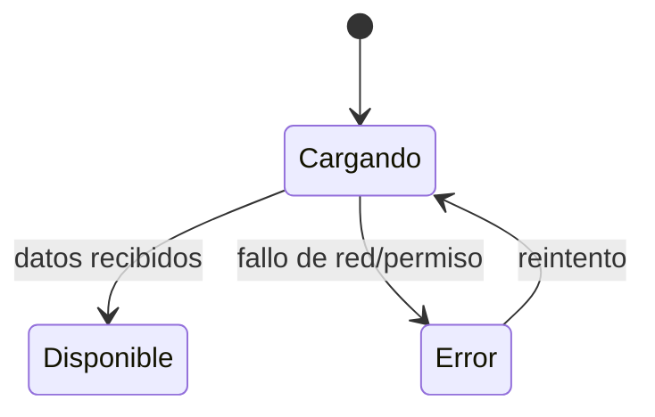

# Estadísticas del Dashboard — Diseño

> Estado: Borrador (pendiente de implementar)
> Feature: `dashboard-stats`

## 1. Resumen

El rediseño reorienta el dashboard a su rol real: **overview de salud del sistema
para el administrador/operador**. Cubre dos frentes:

1. **Datos reales en lugar de hardcodeados**: stat-cards (usuarios, interfaces,
   informes), panel "Estado del sistema" (entorno, máster, uptime) y cabecera
   ("último acceso").
2. **Rediseño de dashboard como instrumento de decisión**: jerarquía que prioriza
   las señales de salud, excepciones navegables al detalle, y frescura/recarga.

En backend se propone un endpoint de resumen (`GET /dashboard/stats`) consumido
por un `DashboardStatsService` en frontend. Se contempla una alternativa de
primera iteración que reutiliza los `countByCriteria` / lecturas existentes sin
endpoint nuevo. La tarjeta de nodos del cluster es el patrón de referencia para
estados de carga/error y para el uso de color con significado.

## 2. Inventario de datos: disponible vs. requiere backend

Clave para distinguir lo que se arregla solo con frontend de lo que necesita
backend nuevo.

| Dato                       | ¿Disponible hoy? | Fuente                                                        |
|----------------------------|------------------|---------------------------------------------------------------|
| Total de usuarios          | Sí               | `UserService.countByCriteria({})`                             |
| Tendencia de usuarios      | No               | Requiere comparación de periodos en backend (omitir, RF-1)    |
| Interfaces configuradas    | Sí               | `InterfaceService.findAllConfigurations()` (longitud)         |
| Interfaces en error        | Sí               | `findAllConfigurations()` filtrando `status === 'ERROR'`      |
| Nodos activos / total      | Sí               | `ClusterService.findAllNodes()` (ya consumido)                |
| Nodo máster                | Sí               | `findAllNodes()` → nodo con `master === true`                 |
| Uptime del máster          | Sí               | `ClusterNode.startedAt` (derivar duración)                    |
| Entorno                    | Sí               | `environment.ts` (`profile`)                                  |
| Versión de la aplicación   | Depende          | Solo si hay fuente real; si no, retirar (no inventar)         |
| "Informes generados / mes" | **No**           | `ReportService` es catálogo, no histórico de ejecuciones      |
| Último acceso del usuario  | Depende          | Perfil/sesión (`AuthService`) o retirar de la cabecera        |

## 3. Opción recomendada: endpoint de resumen

### 3.1 Backend

Nuevo endpoint que agrega los conteos y metadatos de estado en una sola respuesta:

```
GET /dashboard/stats
```

Respuesta (DTO `DashboardStatsDTO`):

```json
{
  "users":      { "total": 148, "active": 148, "trend": null },
  "interfaces": { "total": 12, "withError": 1 },
  "reports":    { "generated": 56, "period": "2026-10" },
  "system":     { "environment": "LOCAL", "version": "1.0.0", "masterNode": "node-01", "masterStartedAt": "2026-08-04T19:15:00Z" },
  "generatedAt": "2026-10-19T10:30:00Z"
}
```

- `trend` es opcional: solo se incluye si el backend puede calcular una
  comparación real con un periodo anterior; si es `null`, el frontend no muestra
  indicador de tendencia (RF-1).
- `reports` es opcional: se incluye solo si existe el histórico de ejecuciones
  (RF-3); mientras no exista, se omite el bloque y el frontend no muestra tarjeta
  de informes.
- `system` agrupa los datos del panel "Estado del sistema" (RF-6). `version` solo
  si hay fuente real.
- `generatedAt` da la **frescura** de los datos para el indicador "actualizado
  hace X" (RF-8).
- La capa web delega en `core` (servicios de negocio); no se añade lógica en el
  controlador (coherente con la arquitectura del proyecto).

### 3.2 Seguridad

- Regla en `SecurityConfig` para `/dashboard/stats` accesible con `DASHBOARD_READ`.
- Cada bloque del DTO se calcula solo si el usuario tiene el permiso de la entidad
  (users → `USER_READ`, interfaces → `INTERFACES_READ`, reports → `REPORT_EXECUTE`,
  system/cluster → `CLUSTER_NODE_READ`); los bloques sin permiso se omiten o se
  devuelven como no disponibles.

### 3.3 Frontend

```typescript
export interface DashboardStats {
  users?: { total: number; active: number; trend: number | null };
  interfaces?: { total: number; withError: number };
  reports?: { generated: number; period: string };
  system?: { environment: string; version: string | null; masterNode: string; masterStartedAt: string };
  generatedAt: string;
}
```

- `DashboardStatsService.getStats(): Observable<DashboardStats>` → `GET /dashboard/stats`.
- `DashboardComponent` consume el servicio y expone signals por bloque
  (`usersLoading/usersError/users`, `systemLoading/...`, etc.), replicando el
  patrón que ya usa la tarjeta de nodos del cluster.

## 4. Alternativa (primera iteración sin backend nuevo)

Si no se quiere añadir endpoint de inmediato, el `DashboardComponent` puede
obtener los agregados reutilizando lo existente:

| Bloque               | Fuente reutilizable                                             |
|----------------------|----------------------------------------------------------------|
| Usuarios             | `UserService.countByCriteria({})` → total                      |
| Interfaces           | `InterfaceService.findAllConfigurations()` → total + en error  |
| Nodos / máster / uptime | `ClusterService.findAllNodes()` (ya consumido)              |
| Entorno              | `environment.ts`                                               |
| Informes             | **No disponible** (se omite la tarjeta, ver §2 y RF-3)         |

- Lanzar las llamadas en paralelo (`forkJoin`) con estados por bloque.
- Frescura: usar el instante de la respuesta en frontend (`Date.now()` al
  completar `forkJoin`) hasta que exista `generatedAt` del backend.
- Inconveniente: varias peticiones y falta de dato de tendencia real (se omite).
- Esta alternativa es un puente; la opción recomendada (endpoint único) es el
  objetivo final.

## 5. Estados de los bloques

Replicar el patrón existente de la tarjeta de nodos:



Cada bloque: spinner mientras carga, valor `-` + mensaje en error, valor real
cuando hay datos. Indicadores con icono + texto (coherente con la mejora de
accesibilidad ya aplicada: el estado no depende solo del color).

## 6. Rediseño de layout y jerarquía

Reorientar el dashboard a overview de salud, con la zona superior reservada a lo
accionable y el resto en silencio salvo excepción.

```
┌───────────────────────────────────────────────────────────────┐
│ Dashboard          Entorno: LOCAL · actualizado hace 30s  [↻]  │  ← cabecera: contexto + frescura
├───────────────────────────────────────────────────────────────┤
│  SALUD DEL SISTEMA  (zona primaria, mayor contraste)            │
│  ┌─────────────────────────┐  ┌──────────────────────────────┐ │
│  │ Nodos del cluster       │  │ Interfaces en error          │ │
│  │ 2/3  · 1 degradado  ⚠   │  │ 1 interfaz → ver detalle  →  │ │  ← excepciones, enlazan al detalle
│  └─────────────────────────┘  └──────────────────────────────┘ │
├───────────────────────────────────────────────────────────────┤
│  CONTEXTO  (secundario, visualmente más discreto)               │
│  Usuarios: 148        Interfaces configuradas: 12               │  ← cifras de contexto, sin alarmismo
├───────────────────────────────────────────────────────────────┤
│  ESTADO DEL SISTEMA            │  ACCESOS RÁPIDOS                │
│  Versión · Entorno · Máster    │  Usuarios · Informes · Config  │  ← chrome subordinado
│  · Uptime (del nodo máster)    │                                │
└───────────────────────────────────────────────────────────────┘
```

Principios aplicados (ver `references/dashboard-design-principles.md`):

- **Zona superior-izquierda = decisión.** Nodos e interfaces-en-error arriba, con
  el mayor contraste; cuando todo está sano, la zona queda **silenciosa** (sin
  rojos) y la excepción destaca por escasez (RF-9).
- **Separación por significado con espacio** (Gestalt: proximidad/similitud)
  antes que más tarjetas: salud ≠ contexto ≠ chrome.
- **Cada excepción es navegable** (RF-7): interfaces-en-error → `/interfaces`
  (prefiltro `status=ERROR` si se añade soporte de query param); nodos → vista de
  cluster (`/administration/cluster`). Datos clicables en vez de banda de botones.
- **Color con semántica estable, reforzado con icono+texto** (RNF-5).
- Accesos rápidos y panel "estado del sistema" descienden a chrome subordinado.

Interacciones:

- `[↻]` recarga; "actualizado hace X" se recalcula con cada carga (RF-8).
- Tarjeta interfaces-error → `/interfaces` (prefiltro `status=ERROR` si hay
  soporte).
- Tarjeta nodos → vista de nodos del cluster.
- Estados por bloque: spinner al cargar, `-` + mensaje en error, valor real con
  dato (patrón nodos).

## 7. Inventario: mantener / modificar / añadir / eliminar

**Mantener**
- **Tarjeta de nodos del cluster**: patrón de referencia (datos reales, estados,
  color con significado reforzado con icono+texto). No tocar su lógica; replicar.
- **Accesos rápidos**: útiles como atajos, pero subordinados visualmente (§6).

**Modificar**
- **Tarjeta de usuarios** → total real (`countByCriteria`); tendencia solo si el
  backend la provee (RF-1).
- **Tarjeta de interfaces** → total real + nº en error, y convertirla en acción:
  enlazar a `/interfaces` (RF-2, RF-7).
- **Panel "Estado del sistema"** → entorno (`environment.ts`), máster y uptime
  (desde `ClusterNode`); versión solo si hay fuente real (RF-6).
- **Cabecera "último acceso"** → de la sesión real o eliminar (RF-10).

**Añadir**
- **Marca de frescura** ("actualizado hace X") + **recargar** (RF-8).
- **Zona de salud del sistema** que agrupe nodos + interfaces en error como
  señales primarias, separada del contexto (RF-9).
- (Opcional, según cadencia) **resumen de errores de interfaces recientes** con
  enlace al detalle, usando `findLogsByCriteria({status:'ERROR'})`.

**Eliminar**
- **"Informes generados este mes"** del overview: no accionable y no calculable
  con el backend actual (§2, RF-3). Si se insiste, requiere modelo de ejecuciones
  (§8).
- Cualquier **porcentaje/tendencia inventado**.

## 8. Impacto

- **Backend**:
  - *Imprescindible*: ninguno (la alternativa §4 usa lecturas existentes).
  - *Recomendable*: nuevo endpoint `/dashboard/stats` + `DashboardStatsDTO` +
    servicio de negocio en `core` (opción §3).
  - *Opcional (coste alto)*: histórico de ejecuciones de informes (entidad +
    migración Liquibase + servicio + endpoint) si se conserva RF-3.
  - *A confirmar*: soporte de filtro por `status` en el listado de
    configuraciones de interfaces, para el prefiltro del drill-down (RF-7).
- **Frontend**: `DashboardStatsService` + modelo + refactor de
  `DashboardComponent` (datos reales, estados por bloque, jerarquía nueva,
  excepciones navegables, frescura/recarga). Actualización de i18n.
- **Base de datos**: ninguno para lo imprescindible/recomendable (solo lecturas
  agregadas). Solo el KPI de informes implicaría esquema nuevo.
- **Dependencias**: ninguna nueva.

## 9. Riesgos

- **Datos falsos vigentes**: el mayor riesgo es dejar datos hardcodeados que
  simulan alertas reales (el "1 con error" de interfaces y el panel de estado).
  Mitigación: retirarlos en la primera fase aunque el dato real aún no esté.
- **Tendencia sin dato real**: no inventar; omitir el indicador si el backend no
  lo provee (RF-1).
- **N peticiones (alternativa)**: mitigable migrando al endpoint único.
- **Permisos**: el agregado debe respetar exactamente los permisos por entidad.
- **Métrica de informes no calculable**: no reintroducirla hardcodeada; eliminar
  hasta que exista modelo de ejecuciones (§2, RF-3).
- **Cadencia desconocida**: decidir auto-refresh vs. recarga manual depende de la
  incertidumbre 1 de requirements.
