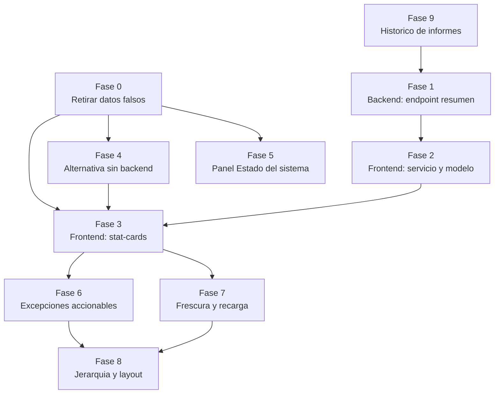

# Implementation Plan

> Estado: Borrador (pendiente de implementar)
> Feature: `dashboard-stats`
> Cada tarea referencia los requisitos (RF/RNF) y el diseño (§) que cubre.

## Overview

Este plan de implementación aborda la retirada de los datos falsos del dashboard
y su sustitución progresiva por datos reales del backend o de `environment.ts`,
siguiendo como patrón de referencia la tarjeta de nodos del cluster (estados de
carga/error y color con significado).

El trabajo se organiza en fases incrementales priorizadas por impacto y coste:
los puntos 1–3 son todos frontend de bajo coste y cubren la mayor parte del
valor; el backend (Fase 1) es una optimización, no un bloqueo. Ver §7 de diseño.

Orden recomendado (impacto / coste):

1. Retirar los datos falsos (Fase 0).
2. Conectar datos ya disponibles (Fases 3/4 con fuentes reales).
3. Hacer accionables las excepciones + frescura (Fases 6 y 7).
4. Reorganizar jerarquía (Fase 8).
5. Endpoint de resumen (Fase 1/2).

## Tasks

### Fase 0 — Frenar el daño: retirar datos falsos (frontend, bajo coste, alto impacto)

- [ ] 0.1 Eliminar del template los valores hardcodeados que simulan datos reales:
      "1 con error" de interfaces, `148`/`+12%` de usuarios, `56` de informes.
      (RF-1, RF-2, RF-3)
- [ ] 0.2 Eliminar del template el panel "Estado del sistema" hardcodeado
      (`1.0.0`, `LOCAL`, `node-01`, `14d 6h 32m`). (RF-6)
- [ ] 0.3 Eliminar la constante `lastAccess` hardcodeada del componente. (RF-10)
- [ ] 0.4 Sustituir provisionalmente por estado de carga/placeholder honesto hasta
      conectar el dato real (no dejar cifras inventadas). (RF-4)

### Fase 1 — Backend: endpoint de resumen (opción recomendada)

- [ ] 1.1 Definir `DashboardStatsDTO` (users, interfaces, reports, system,
      generatedAt) con campos/bloques opcionales y `trend`/`period`. (Diseño §3.1)
- [ ] 1.2 Servicio de negocio en `core` que agrega los conteos y metadatos
      reutilizando los repositorios/consultas existentes. (RNF-1)
- [ ] 1.3 Endpoint `GET /dashboard/stats` en la capa web que delega en `core`
      (sin lógica en el controlador). (Diseño §3.1)
- [ ] 1.4 Regla en `SecurityConfig`: `/dashboard/stats` con `DASHBOARD_READ`;
      cada bloque calculado según el permiso de su entidad
      (users/interfaces/reports/cluster). (RF-5, RNF-2, Diseño §3.2)
- [ ] 1.5 Tests backend: unitario del servicio de agregación y de controlador
      (MockMvc) con y sin permisos. (coding-testing)

### Fase 2 — Frontend: servicio y modelo

- [ ] 2.1 `DashboardStats` (modelo) en `core/models`, con bloque `system` y
      `generatedAt`. (Diseño §3.3)
- [ ] 2.2 `DashboardStatsService.getStats()` → `GET /dashboard/stats`,
      con `catchError`. (RF-4)
- [ ] 2.3 Tests del servicio (`HttpTestingController`). (coding-angular)

### Fase 3 — Frontend: consumo de stat-cards

- [ ] 3.1 Refactor de `DashboardComponent`: signals por bloque
      (loading/error/valor) replicando el patrón de la tarjeta de nodos. (RF-4)
- [ ] 3.2 Usuarios: mostrar total real; mostrar tendencia SOLO si llega `trend`
      no nulo. (RF-1)
- [ ] 3.3 Interfaces: total real + número en error. (RF-2)
- [ ] 3.4 Informes: mostrar solo si el backend provee el bloque `reports`; si no,
      **no renderizar la tarjeta** (no hardcodear). (RF-3)
- [ ] 3.5 Estados con icono + texto (no solo color), coherente con la mejora de
      accesibilidad ya aplicada. (RF-4, RNF-5)
- [ ] 3.6 i18n del periodo y textos auxiliares en es.json/en.json simétricas;
      verificar con `translation-completeness.property.spec.ts`. (RNF-3)
- [ ] 3.7 Actualizar/crear tests de `DashboardComponent` para los bloques
      (carga/error/dato) sin datos hardcodeados. (coding-angular)

### Fase 4 — Alternativa (si no se aborda el backend de inmediato)

- [ ] 4.1 En su lugar, `DashboardComponent` reutiliza las lecturas existentes en
      paralelo (`forkJoin`): `UserService.countByCriteria`,
      `InterfaceService.findAllConfigurations`, `ClusterService.findAllNodes`;
      omitiendo tendencia e informes. (Diseño §4)
- [ ] 4.2 Frescura provisional desde el instante de respuesta del `forkJoin`
      hasta que exista `generatedAt`. (RF-8)
- [ ] 4.3 Marcar en el código que es un puente hasta el endpoint `/dashboard/stats`.

### Fase 5 — Panel "Estado del sistema" con datos reales

- [ ] 5.1 Entorno desde `environment.ts` (`profile`). (RF-6)
- [ ] 5.2 Nodo máster desde `ClusterService.findAllNodes()` (nodo `master===true`). (RF-6)
- [ ] 5.3 Uptime derivado de `startedAt` del nodo máster (formateo legible). (RF-6)
- [ ] 5.4 Versión solo si hay fuente real; si no, retirar o marcar no disponible. (RF-6)
- [ ] 5.5 Tests del panel (estados y datos derivados). (coding-angular)

### Fase 6 — Excepciones accionables y navegables

- [ ] 6.1 Tarjeta de interfaces en error → enlace a `/interfaces` (prefiltro
      `status=ERROR` si hay soporte de query param). (RF-7)
- [ ] 6.2 Tarjeta de nodos → enlace a la vista de nodos del cluster
      (`/administration/cluster`). (RF-7)
- [ ] 6.3 (Backend, a confirmar) soporte de filtro por `status` en el listado de
      configuraciones de interfaces para el prefiltro del drill-down. (RF-7, Diseño §8)
- [ ] 6.4 Tests de navegación/enlaces. (coding-angular)

### Fase 7 — Frescura y recarga

- [ ] 7.1 Indicador "actualizado hace X" basado en `generatedAt` (o instante de
      respuesta en la alternativa). (RF-8)
- [ ] 7.2 Acción de recargar que relanza la carga y recalcula la frescura. (RF-8)
- [ ] 7.3 "Último acceso" real desde sesión/perfil o retirado de la cabecera. (RF-10)
- [ ] 7.4 Tests de frescura/recarga. (coding-angular)

### Fase 8 — Jerarquía y reorganización del layout

- [ ] 8.1 Zona primaria "Salud del sistema" (nodos + interfaces en error) con
      mayor contraste, superior-izquierda. (RF-9, Diseño §6)
- [ ] 8.2 Zona secundaria de contexto (usuarios, interfaces configuradas) más
      discreta. (RF-9)
- [ ] 8.3 Panel "Estado del sistema" y "Accesos rápidos" como chrome subordinado. (RF-9)
- [ ] 8.4 Estado "todo sano" silencioso (sin colores de alarma); la excepción
      destaca por escasez. (RF-9)
- [ ] 8.5 Verificación visual/responsive con el MCP de Playwright
      (desktop + móvil). (coding-angular)

### Fase 9 — (Opcional, coste alto) Histórico de ejecuciones de informes

> Solo si "informes generados" se confirma como requisito de negocio
> (incertidumbre 2 de requirements). Fuera de alcance de esta spec salvo decisión
> explícita.

- [ ] 9.1 Entidad de ejecución de informe (fecha, usuario, informe) + migración
      Liquibase (XML, en `domain`). (RF-3, coding-liquibase)
- [ ] 9.2 Servicio en `core` + endpoint de conteo por periodo. (RF-3)
- [ ] 9.3 Integrar en `DashboardStatsDTO` el bloque `reports` real. (RF-3)
- [ ] 9.4 Tests backend y frontend. (coding-testing, coding-angular)

### Criterios de aceptación

- CA-1: Ninguna cifra del dashboard está hardcodeada en el template/componente;
      todo valor procede del backend o de `environment.ts`. (RF-1..RF-3, RF-6, RF-10)
- CA-2: Cada bloque con datos del backend gestiona los tres estados
      (cargando / error con `-` + mensaje / dato), igual que la tarjeta de nodos. (RF-4)
- CA-3: No se muestra ninguna tendencia/porcentaje sin dato de comparación
      real. (RF-1)
- CA-4: Toda señal de excepción (interfaz en error, nodo degradado) enlaza a
      su detalle y permite actuar sin búsqueda manual. (RF-7)
- CA-5: El dashboard indica la frescura de los datos y permite recargar. (RF-8)
- CA-6: La zona superior prioriza la salud del sistema; con todo sano no hay
      colores de alarma; la excepción destaca por contraste. (RF-9)
- CA-7: Los textos nuevos tienen claves i18n simétricas en `es.json`/`en.json`
      (verificable con `translation-completeness.property.spec.ts`). (RNF-3)
- CA-8: Sin dependencias nuevas; se respeta la arquitectura (sin lógica de
      negocio en `webapp`, agregados en `core` si se hace el endpoint). (RNF-4)
- CA-9: Ninguna métrica mostrada depende de datos inexistentes en backend; si
      "informes generados" se conserva, existe su modelo de ejecuciones. (RF-3)

## Task Dependency Graph

El grafo refleja las dependencias entre fases. La Fase 0 (retirar datos falsos)
no bloquea a las demás, pero debe hacerse primero por impacto. Las fases backend
(1, 9) habilitan versiones completas de las fases frontend, que tienen una
alternativa de bajo coste (Fase 4) cuando el backend no está disponible.

Olas de ejecución (cada ola depende de las anteriores):

```json
{
  "waves": [
    { "wave": 1, "tasks": ["Fase 0", "Fase 9"], "dependsOn": [] },
    { "wave": 2, "tasks": ["Fase 1", "Fase 4", "Fase 5"], "dependsOn": ["Fase 0", "Fase 9"] },
    { "wave": 3, "tasks": ["Fase 2"], "dependsOn": ["Fase 1"] },
    { "wave": 4, "tasks": ["Fase 3"], "dependsOn": ["Fase 2", "Fase 4"] },
    { "wave": 5, "tasks": ["Fase 6", "Fase 7"], "dependsOn": ["Fase 3"] },
    { "wave": 6, "tasks": ["Fase 8"], "dependsOn": ["Fase 6", "Fase 7"] }
  ]
}
```

Representación visual del mismo grafo:



## Notes

### Dependencias y notas

- La tarjeta de nodos del cluster ya consume datos reales y es el **patrón de
  referencia** para estados de carga/error y color con significado (icono+texto).
- **No** reintroducir datos hardcodeados ni claves i18n de ejemplo (se eliminaron
  al retirar la tabla 'Recent activity').
- La visualización de tendencia (sparkline) queda **fuera de alcance** hasta que
  existan datos reales (ver requirements, Fuera de alcance).
- **Decisiones pendientes** (bloquean el diseño final de algunas fases):
  cadencia/usuario objetivo (auto-refresh vs. recarga manual) y si "informes
  generados" es requisito real. Ver incertidumbres en requirements.
- Sin dependencias nuevas (RNF-4).
