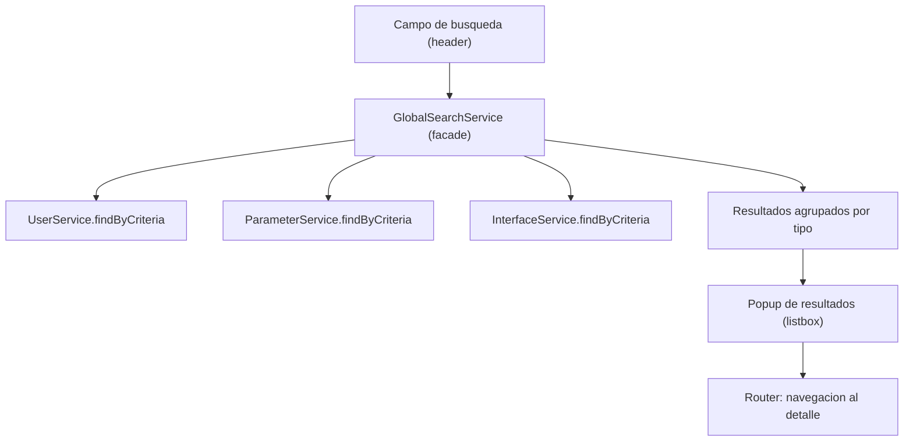
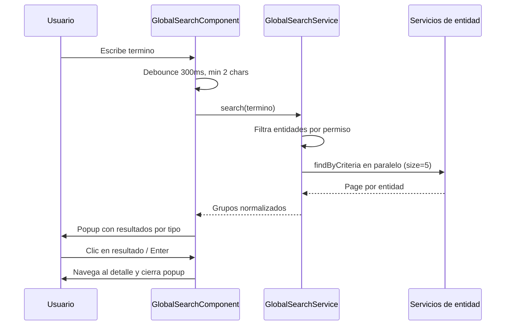

# Buscador Global — Diseño

> Estado: Borrador (pendiente de implementar)
> Feature: `global-search`

## Overview

## 1. Resumen

Se implementa un buscador global en el header que, al escribir, consulta en
paralelo varias entidades (usuarios, parámetros, interfaces) reutilizando los
servicios `*.Service.findByCriteria` existentes, y muestra los resultados en un
popup agrupados por tipo de entidad, con navegación al detalle.

La iteración inicial **no requiere un endpoint de backend nuevo**: orquesta las
búsquedas desde el frontend. En el apartado 7 se describe la alternativa de un
endpoint unificado para una evolución posterior.

## Architecture

## 2. Arquitectura de componentes



## Components and Interfaces

### 2.1 Componentes a crear

| Componente / artefacto                  | Ubicación propuesta                                      | Responsabilidad |
|-----------------------------------------|----------------------------------------------------------|-----------------|
| `GlobalSearchComponent`                 | `core/layout/global-search/`                             | Campo + popup, interacción de teclado, estados visibles |
| `GlobalSearchService`                   | `core/services/global-search.service.ts`                | Orquesta las búsquedas por entidad, aplica permisos, mapea a un modelo común |
| Modelos de resultado                    | `core/models/global-search.model.ts`                     | `SearchResultGroup`, `SearchResultItem` |

El `GlobalSearchComponent` se integra en `layout.component.html` sustituyendo el
bloque `.header-search` actual (el input `data-testid="input-global-search"`).

### 2.2 Separación de responsabilidades

- El **componente** solo gestiona la vista: input, debounce, popup, teclado,
  estados (carga/vacío/error) y navegación. No llama a `HttpClient` directamente.
- El **servicio facade** concentra la lógica: decide qué entidades consultar según
  permisos, lanza las peticiones en paralelo y normaliza los resultados.
- Los **servicios de entidad existentes** no se modifican; se reutiliza su
  `findByCriteria`.

## Data Models

## 3. Modelo de datos (frontend)

```typescript
/** Tipos de entidad soportados por el buscador global. */
export type SearchEntityType = 'user' | 'parameter' | 'interface';

/** Un resultado individual, normalizado e independiente de la entidad origen. */
export interface SearchResultItem {
  type: SearchEntityType;
  id: number;
  /** Texto principal mostrado (p. ej. username, code, name). */
  primary: string;
  /** Texto secundario de contexto (p. ej. perfil, tipo, protocolo). */
  secondary?: string;
  /** Ruta de navegación al detalle. */
  route: string;
}

/** Grupo de resultados de una misma entidad. */
export interface SearchResultGroup {
  type: SearchEntityType;
  /** Clave i18n del encabezado del grupo. */
  labelKey: string;
  items: SearchResultItem[];
  /** Total de coincidencias en backend (para decidir "Ver todos"). */
  totalMatches: number;
  /** Ruta al listado con el filtro aplicado (acción "Ver todos"). */
  seeAllRoute: string;
  /** Query params para preseleccionar el filtro en el listado destino. */
  seeAllQueryParams: Record<string, string>;
}
```

## 4. Mapeo por entidad

| Entidad    | Campo de criteria | `primary`        | `secondary`         | Ruta detalle                                   | Permiso                 |
|------------|-------------------|------------------|---------------------|------------------------------------------------|-------------------------|
| Usuarios   | `username`        | `username`       | `profileName`       | `/administration/security/users` (+ seleccion) | `USER_READ`             |
| Parámetros | `code`            | `code`           | `type`              | `/administration/parameters`                   | `SYSTEM_PARAMETER_READ` |
| Interfaces | `name`            | `name`           | `protocol`/`status` | `/interfaces`                                  | `INTERFACES_READ`       |

> Nota: si el detalle de una entidad no es direccionable por URL (hoy el detalle
> vive en `viewMode` por signals, ver auditoría #13), la navegación llevará al
> listado con el filtro aplicado hasta que exista deep-linking. Esto conecta con
> la mejora #13 de la auditoría.

## 5. Flujo de búsqueda



### 5.1 RxJS

- `toObservable(termSignal)` o `valueChanges` → `debounceTime(300)` →
  `distinctUntilChanged()` → `filter(len >= 2)` → `switchMap(term => facade.search(term))`.
- Dentro del facade: `forkJoin` de las entidades permitidas, cada una con
  `catchError` que devuelve un grupo vacío marcado como "con error" para no
  tumbar el resto (degradación elegante, RF-5).

## Correctness Properties

Propiedades que la implementación debe cumplir y que sirven de base para la verificación:

- **Permisos respetados**: el facade solo consulta las entidades cuyo permiso
  (`USER_READ`, `SYSTEM_PARAMETER_READ`, `INTERFACES_READ`) tiene el usuario. Un
  usuario sin permiso sobre una entidad nunca recibe resultados de esa entidad.
- **Mínimo de caracteres y debounce**: no se dispara ninguna búsqueda con menos de
  2 caracteres ni antes de 300 ms de inactividad tras la última pulsación.
- **Cancelación de peticiones obsoletas**: con `switchMap`, solo los resultados del
  último término introducido llegan a la vista; las respuestas de términos previos
  se descartan.
- **Degradación elegante**: el fallo de una entidad (ver Error Handling) no impide
  mostrar los resultados de las demás; el popup muestra los grupos que sí respondieron.
- **Normalización coherente**: todo `SearchResultItem` expuesto a la vista tiene
  `type`, `id`, `primary` y `route` definidos, con independencia de la entidad origen.
- **Determinismo de agrupación**: cada resultado pertenece a exactamente un
  `SearchResultGroup`, correspondiente a su `SearchEntityType`.

## Error Handling

- **Error por entidad**: cada llamada `findByCriteria` del `forkJoin` se envuelve en
  `catchError`, que devuelve un grupo vacío marcado como "con error" en lugar de
  propagar el fallo. Así un error en una entidad no tumba el resto (RF-5).
- **Indicación al usuario**: un grupo con error se muestra con la clave i18n
  `globalSearch.groupError` ("No se pudo buscar en {{group}}"), diferenciándolo de
  un grupo sin coincidencias.
- **Sin resultados**: si todos los grupos vuelven vacíos (sin error), el popup
  muestra `globalSearch.empty` ("Sin resultados para «{{term}}»").
- **Estado de carga**: mientras las peticiones están en vuelo se muestra
  `globalSearch.loading` en una región `aria-live="polite"`.
- **Entrada inválida**: términos por debajo del mínimo (2 caracteres) no generan
  petición ni mensaje de error; simplemente no se abre el popup.

## Testing Strategy

- **Unitarias del facade (`GlobalSearchService`)**: verifican el filtrado por
  permisos, el lanzamiento en paralelo, la normalización a `SearchResultGroup` /
  `SearchResultItem` y el comportamiento de `catchError` ante el fallo de una
  entidad (degradación elegante).
- **Unitarias del componente (`GlobalSearchComponent`)**: verifican debounce,
  mínimo de caracteres, cancelación con `switchMap`, estados (carga/vacío/error) y
  la navegación al seleccionar un resultado.
- **Accesibilidad**: comprobación de atributos ARIA (`role="combobox"`,
  `aria-expanded`, `aria-activedescendant`, `role="listbox"`, `role="option"`) y de
  la navegación por teclado (↑/↓, Enter, Escape y devolución de foco).
- **Integración ligera**: con servicios de entidad simulados (mocks), validar el
  flujo completo término → grupos → popup.
- **Comando de referencia**: `ng test` para el módulo `dashboard`, siguiendo la
  guía de `testing-verification`.

## 6. Accesibilidad (combobox ARIA)

- Campo: `role="combobox"`, `aria-expanded`, `aria-controls="global-search-popup"`,
  `aria-autocomplete="list"`, `aria-activedescendant` = id de la opción resaltada.
- Popup: `id="global-search-popup"`, `role="listbox"`.
- Resultados: `role="option"`, `id` único, `aria-selected` en el resaltado.
- Teclado: ↑/↓ mueven el resaltado, `Enter` abre, `Escape` cierra y devuelve foco.
- Estado de carga: región `aria-live="polite"`.
- Reutilizar el patrón de foco y cierre de los modales ya presentes en el proyecto.

## 7. Alternativa futura: endpoint unificado

Para evitar N peticiones desde el frontend, se puede añadir en backend un endpoint
`GET /search?q=...` que devuelva resultados agrupados por tipo. Ventajas: una sola
petición, ranking centralizado, control de permisos en servidor. Queda **fuera del
alcance inicial**; el diseño del frontend (facade + modelo normalizado) permite
sustituir las N llamadas por esta única sin tocar el componente.

## 8. Internacionalización

Claves nuevas (en `es.json` y `en.json`, simétricas):

| Clave                              | ES (ejemplo)                      |
|------------------------------------|-----------------------------------|
| `globalSearch.placeholder`         | Buscar...                         |
| `globalSearch.groups.user`         | Usuarios                          |
| `globalSearch.groups.parameter`    | Parámetros                        |
| `globalSearch.groups.interface`    | Interfaces                        |
| `globalSearch.seeAll`              | Ver todos ({{count}})             |
| `globalSearch.empty`               | Sin resultados para «{{term}}»    |
| `globalSearch.loading`             | Buscando...                       |
| `globalSearch.groupError`          | No se pudo buscar en {{group}}    |

## 9. Impacto

- **Frontend**: nuevo componente + servicio + modelo; modificación de
  `layout.component.html` (y su `.ts` si procede) para integrar el componente.
- **Backend**: ninguno en la iteración inicial (reutiliza endpoints existentes).
- **Base de datos**: ninguno.
- **Dependencias**: ninguna nueva.

## 10. Riesgos

- **N peticiones por búsqueda**: mitigado con debounce, `switchMap` (cancela la
  anterior) y `size` reducido; evolucionable al endpoint unificado (apartado 7).
- **Navegación al detalle sin deep-linking**: depende de la mejora #13; mientras
  tanto se navega al listado filtrado.
- **Consistencia de permisos**: el facade debe respetar exactamente los mismos
  permisos que `actionGuard`; cualquier cambio de permisos debe reflejarse aquí.
