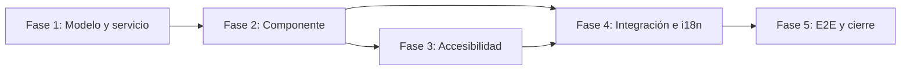

# Implementation Plan

> Estado: Borrador (pendiente de implementar)
> Feature: `global-search`
> Cada tarea referencia los requisitos (RF/RNF) que cubre.

## Overview

Buscador global en el header que consulta en paralelo las entidades permitidas
(usuarios, parámetros, interfaces...) a través de un servicio facade, agrupa los
resultados por tipo y permite navegar al detalle o al listado filtrado. El plan
se organiza en cinco fases: modelo y servicio facade, componente de búsqueda,
accesibilidad, integración e i18n, y E2E/cierre.

## Tasks

### Fase 0 — Endpoint de interfaces (completada)

- [x] 0.1 Backend: `InterfaceCriteria`, `InterfaceRepository` con
      `JpaSpecificationExecutor`, `InterfaceService.findByCriteria` y
      `GET /api/v1/interfaces/configuration/search`. (Diseño §1.1)
- [x] 0.2 Tests backend: `InterfaceServiceTest` y `InterfaceControllerTest`
      (pendiente de ejecutar: `mvn test -pl core,webapp -am`).
- [x] 0.3 Frontend: `InterfaceService.findConfigurationsByCriteria`,
      `InterfaceConfigCriteria` y su test en `interface.service.spec.ts`
      (pendiente de ejecutar con `ng test`).

### Fase 1 — Modelo y servicio facade

- [x] 1.1 Crear `core/models/global-search.model.ts` con `SearchEntityType`,
      `SearchResultItem` y `SearchResultGroup`. (Diseño §3)
- [x] 1.2 Crear `GlobalSearchService` en `core/services/global-search.service.ts`:
  - [x] 1.2.1 Inyectar `UserService`, `ParameterService`, `InterfaceService`,
        `AuthService`. (RF-2, RNF-3)
  - [x] 1.2.2 Método `search(term: string)` que filtra entidades por permiso
        (`AuthService.hasAction`, cualquiera de las acciones de la ruta, incluidas
        `*_WRITE`), lanza `findByCriteria` (en interfaces,
        `findConfigurationsByCriteria`) en paralelo con
        `forkJoin`, `size = 5`, y normaliza a `SearchResultGroup[]`. (RF-2, RNF-2)
  - [x] 1.2.3 `catchError` por entidad para degradación elegante (grupo marcado
        con error, no rompe el resto). (RF-5)
  - [x] 1.2.4 Mapear cada entidad según la tabla de Diseño §4 (primary/secondary/
        route/seeAll). (RF-3, RF-4)
- [x] 1.3 Tests unitarios del servicio (`global-search.service.spec.ts`):
      permisos respetados, paralelismo, normalización, error parcial. (RNF-3, RF-5)

### Fase 2 — Componente de búsqueda

- [x] 2.1 Crear `GlobalSearchComponent` (standalone, OnPush) en
      `core/layout/global-search/`. (Diseño §2.1)
- [x] 2.2 Campo de entrada con debounce 300 ms, mínimo 2 caracteres,
      `switchMap` + `distinctUntilChanged`. (RF-1, RNF-2)
- [x] 2.3 Popup de resultados agrupados por tipo, con encabezado y contador por
      grupo, texto primario/secundario por resultado, y acción "Ver todos". (RF-3)
- [x] 2.4 Navegación al detalle / listado filtrado al activar un resultado; cerrar
      popup tras navegar. (RF-4, RF-6)
- [x] 2.5 Estados visibles: carga (spinner), vacío, error parcial. (RF-5)
- [x] 2.6 Cierre del popup con Escape, clic fuera y campo vacío. (RF-6)
- [x] 2.7 `data-testid` en campo, popup, grupos, resultados y "Ver todos" para
      tests de componente y E2E. (coding-angular)
- [x] 2.8 Tests de componente (`.spec.ts`): debounce, render de grupos, estados,
      navegación, cierre. (coding-angular: obligatoriedad de tests)

### Fase 3 — Accesibilidad

- [x] 3.1 Patrón combobox ARIA en el campo: `role`, `aria-expanded`,
      `aria-controls`, `aria-autocomplete`, `aria-activedescendant`. (RNF-1)
- [x] 3.2 Popup `role="listbox"`, resultados `role="option"` con `aria-selected`.
      (RNF-1)
- [x] 3.3 Navegación por teclado: ↑/↓, Enter, Escape; foco de vuelta al campo al
      cerrar. (RNF-1)
- [x] 3.4 Región `aria-live="polite"` para el estado de carga. (RNF-1)

### Fase 4 — Integración e i18n

- [x] 4.1 Integrar `GlobalSearchComponent` en `layout.component.html`,
      reemplazando el bloque `.header-search` actual
      (`data-testid="input-global-search"`). (Diseño §9)
- [x] 4.2 Añadir claves i18n `globalSearch.*` en `es.json` y `en.json`
      (simétricas); verificar con `translation-completeness.property.spec.ts`.
      (RNF-4)
- [x] 4.3 Verificar que la búsqueda respeta permisos con usuarios de distinto
      perfil (sin permiso → entidad no aparece). (RNF-3)
- [x] 4.4 Hacer que los listados de usuarios, parámetros e interfaces lean el
      filtro desde query params para soportar "Ver todos" (o descartar esa
      acción filtrada y enlazar solo al listado). (RF-3)

### Fase 5 — E2E y cierre

- [x] 5.1 Test E2E Playwright del flujo: escribir término, ver resultados
      agrupados, navegar a un detalle. (coding-testing)
- [x] 5.2 Verificar accesibilidad con el snapshot del MCP de Playwright (roles,
      aria, foco). (RNF-1)
- [x] 5.3 Actualizar documentación funcional/técnica del header si procede
      (`template-docs/`). (coding-docs)

## Task Dependency Graph

```json
{
  "waves": [
    { "wave": 1, "tasks": ["1.1", "1.2", "1.3"], "dependsOn": [] },
    { "wave": 2, "tasks": ["2.1", "2.2", "2.3", "2.4", "2.5", "2.6", "2.7", "2.8"], "dependsOn": [1] },
    { "wave": 3, "tasks": ["3.1", "3.2", "3.3", "3.4"], "dependsOn": [2] },
    { "wave": 4, "tasks": ["4.1", "4.2", "4.3"], "dependsOn": [2, 3] },
    { "wave": 5, "tasks": ["5.1", "5.2", "5.3"], "dependsOn": [4] }
  ]
}
```



## Notes

- El deep-linking de detalle (mejora #13) **ya está implementado**: la navegación
  va directa al detalle con `view`/`id` (o `code` en parámetros). Ver Diseño §4.
- **No** añadir dependencias nuevas (RNF-5).
- **Evolución** posible a endpoint unificado `GET /search?q=` sin cambios en el
  componente (Diseño §7).
- Ampliar entidades (perfiles, acciones, nodos, informes) es incremental: añadir
  el mapeo en el facade y una clave i18n de grupo.
