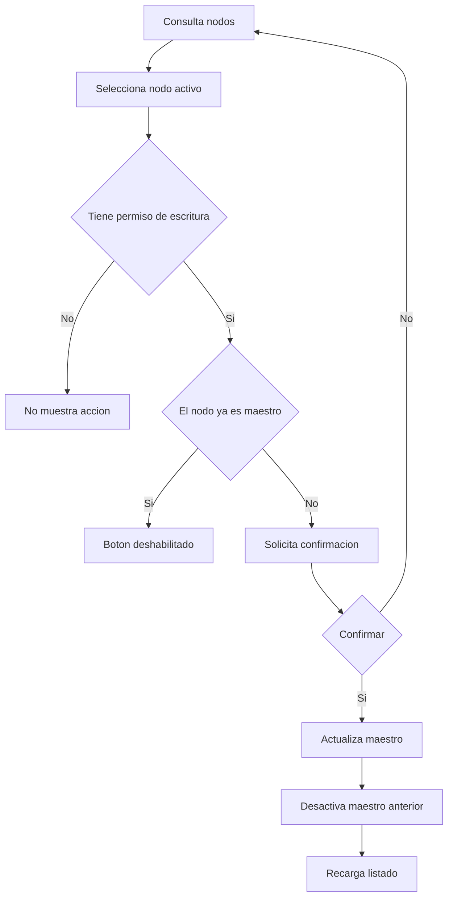
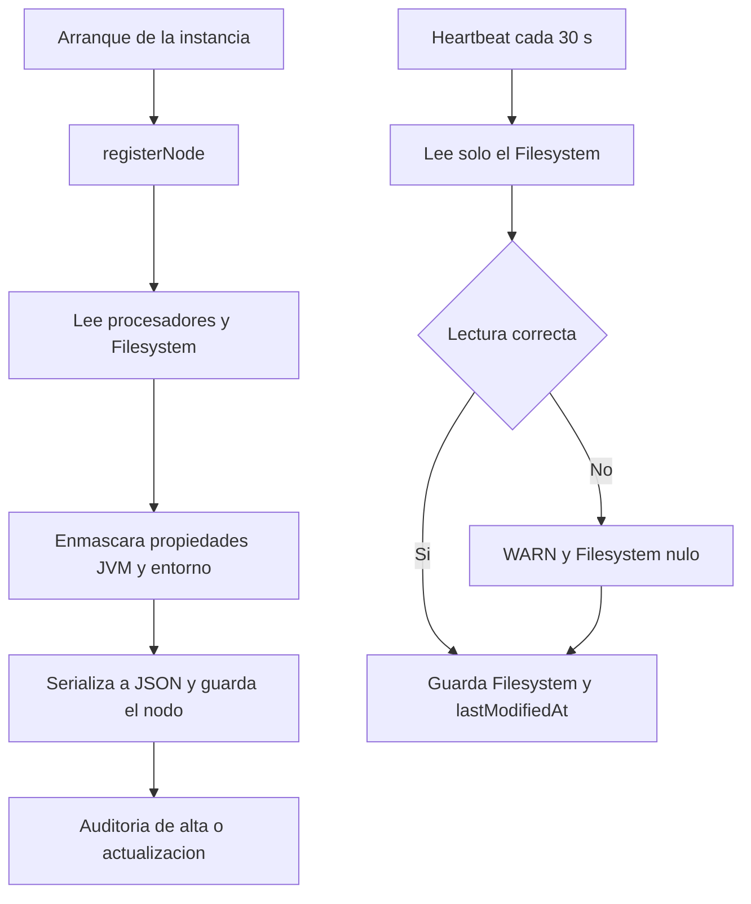
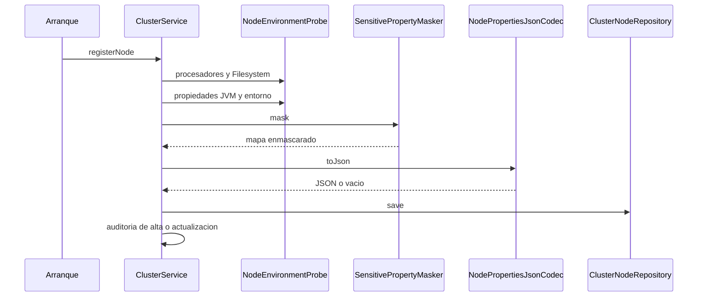

# Nodos del Cluster

Documentación funcional y técnica de la pantalla de administración de nodos del cluster, dentro de Administración > Cluster. Permite consultar el estado de las instancias de la aplicación, filtrar y exportar la información, consultar su detalle y designar de forma controlada el nodo maestro.

- **Ruta frontend:** `/administration/cluster/nodes`
- **Componentes:** `NodeListComponent` (listado) y `NodeFormComponent` (detalle de solo lectura)
- **Endpoint backend base:** `/api/v1/administration/cluster/nodes` (`ClusterController`)
- **Acceso:** requiere sesión y `CLUSTER_NODE_READ` o `CLUSTER_NODE_WRITE`; designar maestro requiere `CLUSTER_NODE_WRITE`

---

## 1. Requisitos

Identificadores locales de este documento: `RF-CLN-*` (requisitos funcionales) y `RNF-CLN-*` (requisitos no funcionales).

### 1.1. Requisitos funcionales

#### RF-CLN-1: Consulta de nodos

**Descripción:** el sistema debe permitir consultar los nodos registrados en el cluster en un listado ordenable y paginado.

**Criterios de aceptación:**

- AC1.1: El listado muestra hostname, IP, estado, indicador de maestro, fechas de arranque y última actualización, y métricas de memoria.
- AC1.2: Las columnas permiten ordenar ascendente o descendentemente.
- AC1.3: La paginación permite elegir 5, 10, 20 o 50 nodos por página.

#### RF-CLN-2: Búsqueda y filtrado

**Descripción:** el sistema debe permitir filtrar los nodos por hostname, estado y condición de maestro.

**Criterios de aceptación:**

- AC2.1: El hostname se filtra por coincidencia parcial sin distinguir mayúsculas de minúsculas.
- AC2.2: El estado permite seleccionar todos, `ACTIVE` o `INACTIVE`.
- AC2.3: El filtro de maestro permite seleccionar todos, sí o no.
- AC2.4: Al aplicar o limpiar filtros, se vuelve a la primera página y se elimina la selección actual.

#### RF-CLN-3: Consulta de detalle

**Descripción:** el sistema debe permitir consultar un nodo en modo de solo lectura.

**Criterios de aceptación:**

- AC3.1: El detalle se abre seleccionando una fila y pulsando el botón *Detalle* (`btn-detail`), que solo está habilitado cuando hay una fila seleccionada, o mediante doble clic sobre la fila.
- AC3.2: El detalle muestra los mismos datos operativos y métricas que el listado, más los recursos y propiedades del nodo (RF-CLN-7 y RF-CLN-8).
- AC3.3: La acción Volver retorna al listado sin modificar el nodo.

#### RF-CLN-4: Designación de nodo maestro

**Descripción:** un usuario con permiso de escritura debe poder designar un nodo activo que no sea maestro como nuevo maestro del cluster.

**Criterios de aceptación:**

- AC4.1: La acción solo está disponible para usuarios con `CLUSTER_NODE_WRITE`.
- AC4.2: El botón se habilita únicamente cuando hay un nodo seleccionado, activo y no maestro.
- AC4.3: La operación solicita confirmación e identifica el hostname que será designado.
- AC4.4: Tras confirmarla, el nodo elegido pasa a ser maestro y el listado se recarga.
- AC4.5: Al designar un maestro se desactiva el indicador de maestro de cualquier nodo anterior.

#### RF-CLN-5: Exportación CSV

**Descripción:** el sistema debe permitir exportar todos los nodos que cumplen los filtros activos.

**Criterios de aceptación:**

- AC5.1: La exportación incluye todos los resultados filtrados, no solo la página visible.
- AC5.2: El fichero se descarga con el patrón `cluster-nodes_YYYY-MM-DD.csv`.
- AC5.3: El CSV incluye las columnas visibles del listado y las métricas de memoria expresadas en GB y porcentaje.

#### RF-CLN-6: Registro y eliminación controlados por el sistema

**Descripción:** los nodos no se crean ni se eliminan manualmente desde la pantalla ni mediante la API pública.

**Criterios de aceptación:**

- AC6.1: Al iniciarse, cada instancia se registra o actualiza automáticamente mediante el servicio de cluster.
- AC6.2: La interfaz no muestra acciones para crear o eliminar nodos.
- AC6.3: Los intentos de crear o eliminar nodos por API se rechazan con `405 Method Not Allowed`.

#### RF-CLN-7: Información extendida de recursos del nodo

**Descripción:** el sistema debe almacenar y mostrar, solo en el detalle del nodo, el número de procesadores y el espacio del Filesystem de cada instancia.

**Criterios de aceptación:**

- AC7.1: El registro del nodo (`registerNode()`) persiste el número de procesadores (`Runtime.availableProcessors()`, entero mayor o igual que 1) en la columna `processors`.
- AC7.2: El registro y cada heartbeat persisten el espacio total, libre y utilizable (bytes) de la partición del directorio de trabajo en `fs_total_space`, `fs_free_space` y `fs_usable_space`.
- AC7.3: El heartbeat no recalcula ni reescribe `processors`.
- AC7.4: Si `availableProcessors()` devuelve un valor menor que 1, se conserva el valor previo; si no existe valor previo, el registro se rechaza con un error y no se persiste ningún cambio.
- AC7.5: Si la lectura del Filesystem falla, se registra un `WARN` con el nodo y la causa, los tres valores quedan nulos y el registro o heartbeat se completa (incluida la actualización de `lastModifiedAt`).
- AC7.6: El detalle muestra el número de procesadores, el espacio total y libre en GB (dos decimales, 1 GB = 1.073.741.824 bytes) y el porcentaje libre (un decimal, entre 0,0 % y 100,0 %). Un valor nulo se muestra como `-`; con total nulo o 0 el porcentaje también se muestra como `-`.

#### RF-CLN-8: Propiedades de la JVM y variables de entorno

**Descripción:** el sistema debe almacenar y mostrar, solo en el detalle del nodo, las propiedades de la JVM y las variables de entorno del proceso, protegiendo los valores sensibles.

**Criterios de aceptación:**

- AC8.1: El registro persiste las propiedades de la JVM (`System.getProperties()`) y las variables de entorno (`System.getenv()`) como JSON (objeto clave-valor de texto) en `jvm_properties` y `environment_properties`, con capacidad de al menos 1 MiB (1.048.576 caracteres) cada una.
- AC8.2: En un nodo ya existente (mismo `hostname`) el registro sustituye íntegramente ambos conjuntos, sin conservar claves anteriores que ya no existan.
- AC8.3: El heartbeat conserva ambos conjuntos sin recalcularlos.
- AC8.4: Si la serialización falla o el JSON supera 1 MiB, se registra un `WARN` que identifica el conjunto afectado, solo esa columna queda nula y el registro continúa.
- AC8.5: Al leer una columna nula o con JSON no válido, el detalle devuelve un mapa vacío sin error.
- AC8.6: El detalle muestra cada conjunto en una sección independiente, como tabla clave-valor ordenada por clave sin distinguir mayúsculas, con filtro propio (máximo 300 ms) por clave o valor.
- AC8.7: Si el filtro no coincide se muestra un mensaje de sin coincidencias conservando el texto del filtro; si el conjunto es nulo o vacío se muestra un mensaje de sin propiedades, sin tabla ni filtro.

#### RF-CLN-9: Enmascaramiento de valores sensibles

**Descripción:** el sistema no debe persistir ni exponer el valor original de las propiedades cuya clave sea sensible.

**Criterios de aceptación:**

- AC9.1: Toda propiedad cuya clave contenga, sin distinguir mayúsculas, `password`, `passwd`, `secret`, `token`, `key`, `credential` o `jwt` (Sensitive_Key) se almacena con el valor `******` (Masked_Value), también si su valor es nulo o vacío.
- AC9.2: La clave se conserva idéntica carácter a carácter y las propiedades no sensibles conservan su valor.
- AC9.3: El enmascaramiento es idempotente y conserva el número de claves (incluido el conjunto vacío).
- AC9.4: Si el enmascaramiento falla, el conjunto no se almacena (columna nula), no se persiste ningún valor original y el error registrado no incluye valores de propiedades.

#### RF-CLN-10: Contrato de la API y exclusión del listado

**Descripción:** los datos extendidos solo se devuelven en el detalle; el listado conserva su contenido y aspecto.

**Criterios de aceptación:**

- AC10.1: `GET /nodes/{id}` devuelve `processors`, `fsTotalSpace`, `fsFreeSpace`, `fsUsableSpace`, `jvmProperties` y `environmentProperties` con los valores almacenados; los no informados se devuelven como nulos.
- AC10.2: `GET /nodes` devuelve esos seis campos en nulo en cada nodo.
- AC10.3: Los campos existentes del DTO, el error 404 por identificador inexistente y las reglas de autorización no cambian.
- AC10.4: `NodeListComponent` mantiene las mismas columnas, orden y filtros, con o sin los campos nuevos en la respuesta, sin errores en consola.
- AC10.5: La interfaz TypeScript `ClusterNode` declara los seis campos como opcionales.

#### RF-CLN-11: Migración del esquema

**Descripción:** el cambio de esquema se versiona con Liquibase.

**Criterios de aceptación:**

- AC11.1: Un único fichero XML en `domain/.../db/changelog/migrations/v1.0.0` añade a `cluster_node` las columnas `processors` (INTEGER), `fs_total_space`, `fs_free_space`, `fs_usable_space` (BIGINT), `jvm_properties` y `environment_properties` (TEXT), nulables y sin valor por defecto.
- AC11.2: El fichero se incluye en `db.changelog-master.xml` inmediatamente después de `20250112-create-cluster-node-table.xml` y declara `schemaName="${schemaName}"` en cada cambio.
- AC11.3: Cada columna tiene su propio changeset con precondición `onFail="MARK_RAN"`; si la columna existe se omite sin alterar datos.
- AC11.4: El `rollback` elimina las seis columnas; las filas existentes se conservan con las columnas nuevas a `NULL`.

### 1.2. Requisitos no funcionales

- **RNF-CLN-1 (Autorización):** la consulta requiere `CLUSTER_NODE_READ` o `CLUSTER_NODE_WRITE`; el cambio de maestro requiere exclusivamente `CLUSTER_NODE_WRITE`.
- **RNF-CLN-2 (Alta disponibilidad):** el sistema mantiene el invariante de un único nodo maestro, desactivando los maestros previos antes de guardar el nuevo.
- **RNF-CLN-3 (Estado):** el heartbeat actualiza estado, memoria, espacio del Filesystem y última actualización del nodo propio; los nodos activos sin actualización durante más de cinco minutos pasan a `INACTIVE`.
- **RNF-CLN-4 (Trazabilidad):** los eventos de alta, re-registro e inactivación automática de nodos se registran en auditoría bajo la sección `CLUSTER`.
- **RNF-CLN-5 (Idioma):** todos los textos se resuelven mediante las claves i18n `cluster.nodes.*`.
- **RNF-CLN-6 (Feedback):** la carga y el cambio de maestro informan del progreso, éxito o error mediante notificaciones.
- **RNF-CLN-7 (Seguridad de datos):** ningún valor original de una Sensitive_Key se persiste, se registra en logs ni en auditoría; los logs de fallos no incluyen valores de propiedades.
- **RNF-CLN-8 (Auditoría):** el registro del nodo mantiene la auditoría existente y el heartbeat no genera entradas de auditoría (tampoco tras 10 heartbeats consecutivos).
- **RNF-CLN-9 (Accesibilidad):** las nuevas secciones del detalle cumplen WCAG 2.2 AA: etiqueta asociada a cada campo, `th` con ámbito de columna y contraste mínimo 4,5:1.
- **RNF-CLN-10 (Idioma):** las etiquetas y mensajes nuevos existen en español e inglés con las mismas claves en `es.json` y `en.json`.
- **RNF-CLN-11 (Robustez):** un fallo al recoger información extendida nunca impide el registro del nodo ni el heartbeat, salvo el caso AC7.4 sin valor previo.

---

## 2. Parte funcional

### 2.1. Objetivo

Ofrecer a los administradores visibilidad y control seguro del cluster:

- Consultar las instancias registradas y su salud operativa.
- Identificar el maestro, los nodos activos y los inactivos.
- Revisar métricas de memoria y marcas temporales de cada instancia.
- Cambiar el maestro con confirmación explícita cuando sea necesario.
- Exportar la vista filtrada para análisis o soporte.

### 2.2. Vistas de la pantalla

La funcionalidad usa dos modos de vista dentro de `NodeListComponent`:

| Modo     | Descripción                                                                   |
|----------|-------------------------------------------------------------------------------|
| `list`   | Listado de nodos con filtros, ordenación, selección, paginación y exportación |
| `detail` | Vista no editable del nodo seleccionado                                       |

### 2.3. Patrón visual reutilizable y wireframes

La estructura visual base se define en [layout.md](../../../03-technical/frontend/layout.md). La pantalla usa `List screen` para la consulta y una variante de `Form screen` solo lectura para el detalle; el cambio de maestro utiliza un modal de confirmación.

| Tipo de pantalla           | Uso en nodos       | Estructura base                                          |
|----------------------------|--------------------|----------------------------------------------------------|
| `List screen`              | Consulta principal | Cabecera, filtros, barra de acciones, tabla y paginación |
| `Form screen` solo lectura | Detalle del nodo   | Encabezado, datos operativos y acción Volver             |
| `Confirmation modal`       | Designar maestro   | Nombre del nodo y acciones cancelar / confirmar          |

#### 2.3.1. Wireframe del `List screen`

```text
+--------------------------------------------------------------------------------+
| Nodos del Cluster                                                              |
+--------------------------------------------------------------------------------+
| Hostname | Estado | Maestro | [Filtrar] [Limpiar]                              |
+--------------------------------------------------------------------------------+
| [Detalle] [Designar maestro]                                 [Exportar CSV]    |
+--------------------------------------------------------------------------------+
| Hostname | IP | Estado | Maestro | Inicio | Ultima actualizacion | Memoria     |
|----------|----|--------|---------|--------|----------------------|-------------|
| ...                                                                            |
+--------------------------------------------------------------------------------+
| < 1 2 3 > | Nodos por pagina: 5 / 10 / 20 / 50                                 |
+--------------------------------------------------------------------------------+
```

#### 2.3.2. Wireframe del detalle

```text
+------------------------------------------------------------------+
| Detalle del nodo                                      [Volver]   |
+------------------------------------------------------------------+
| Hostname | node-01        | IP | 10.0.0.10                       |
| Estado   | ACTIVE         | Maestro | MASTER                     |
| Inicio   | fecha/hora     | Ultima actualizacion | fecha/hora    |
| Memoria usada | 1.25 GB   | Memoria total | 4.00 GB              |
| Memoria libre | 68.8 %                                           |
+------------------------------------------------------------------+
| Recursos                                                         |
| Procesadores | 8 | FS total | 465.63 GB | FS libre | 210.40 GB   |
| FS libre (%) | 45.2 %                                            |
+------------------------------------------------------------------+
| Propiedades de la JVM          [ Filtrar ______ ]                |
| Clave                  | Valor                                   |
| java.version           | 21.0.3                                  |
+------------------------------------------------------------------+
| Variables de entorno           [ Filtrar ______ ]                |
| Clave                  | Valor                                   |
| DB_PASSWORD            | ******                                  |
+------------------------------------------------------------------+
```

### 2.4. Listado

**Columnas de la tabla:**

| Columna              | Clave i18n                               | Notas                                                  |
|----------------------|------------------------------------------|--------------------------------------------------------|
| Hostname             | `cluster.nodes.fields.hostname`          | Identificador de la instancia                          |
| IP                   | `cluster.nodes.fields.ip`                | Dirección IP conocida del nodo                         |
| Estado               | `cluster.nodes.fields.status`            | `ACTIVE` o `INACTIVE`, mostrado como etiqueta          |
| Maestro              | `cluster.nodes.fields.master`            | Muestra `MASTER` cuando el indicador es verdadero      |
| Inicio               | `cluster.nodes.fields.startedAt`         | Fecha/hora de arranque, formateada localmente          |
| Última actualización | `cluster.nodes.fields.lastModifiedAt`    | Marca temporal del último heartbeat o cambio           |
| Memoria usada        | `cluster.nodes.fields.usedMemoryGb`      | Conversión de bytes a GB                               |
| Memoria total        | `cluster.nodes.fields.totalMemoryGb`     | Conversión de bytes a GB                               |
| Memoria libre        | `cluster.nodes.fields.freeMemoryPercent` | Porcentaje calculado a partir de memoria usada y total |

**Filtros disponibles:**

| Filtro   | Tipo      | Regla                    | `data-testid`     |
|----------|-----------|--------------------------|-------------------|
| Hostname | Texto     | Coincidencia parcial     | `filter-hostname` |
| Estado   | Selección | Todos, activo o inactivo | `filter-status`   |
| Maestro  | Selección | Todos, sí o no           | `filter-master`   |

**Barra de acciones:**

| Acción           | Condición de disponibilidad                               | `data-testid`       |
|------------------|-----------------------------------------------------------|---------------------|
| Filtrar          | Siempre disponible                                        | `btn-filter-search` |
| Limpiar          | Siempre disponible                                        | `btn-filter-clear`  |
| Detalle          | Requiere una fila seleccionada                            | `btn-detail`        |
| Designar maestro | `CLUSTER_NODE_WRITE`, fila activa no maestra seleccionada | `btn-set-master`    |
| Exportar CSV     | Siempre disponible cuando existen resultados filtrados    | `btn-export`        |

- Un clic selecciona o deselecciona la fila.
- El detalle se abre pulsando el botón *Detalle* con una fila seleccionada o mediante doble clic sobre la fila.
- El filtrado, la ordenación y la paginación se resuelven en cliente sobre la colección de nodos recuperada del backend.

### 2.4. Identificadores para pruebas (`data-testid`)

| Elemento               | `data-testid`               |
|------------------------|-----------------------------|
| Formulario de filtros  | `cluster-nodes-filter-form` |
| Filtro de hostname     | `filter-hostname`           |
| Filtro de estado       | `filter-status`             |
| Filtro de maestro      | `filter-master`             |
| Tabla de nodos         | `cluster-nodes-table`       |
| Botón Filtrar          | `btn-filter-search`         |
| Botón Limpiar          | `btn-filter-clear`          |
| Botón Detalle          | `btn-detail`                |
| Botón Designar maestro | `btn-set-master`            |
| Botón Exportar CSV     | `btn-export`                |

### 2.5. Detalle y designación de maestro

El detalle es exclusivamente informativo. Muestra hostname, IP, estado, condición de maestro, fechas, métricas de memoria y, tras la carga del detalle desde el backend, las secciones de recursos, propiedades de la JVM y variables de entorno, sin controles de edición.

Para designar maestro, el usuario selecciona un nodo activo que no sea ya maestro y pulsa **Designar maestro**. El modal solicita confirmación; al aceptar, se realiza la actualización, se limpia la selección y se recarga la lista. Cancelar o cerrar el modal no modifica ningún nodo.

### 2.6. Diagramas

#### 2.6.1. Flujo de cambio de maestro



### 2.7. Información extendida del nodo (solo en el detalle)

Los siguientes campos se muestran únicamente en `NodeFormComponent`. El listado (`NodeListComponent`) no los incluye en columnas, tarjetas, filtros ni en la exportación CSV.

| Campo                      | Clave i18n (`cluster.nodes.*`) | Formato                                                          | `data-testid` |
|----------------------------|--------------------------------|------------------------------------------------------------------|---------------|
| Procesadores               | `fields.processors`            | Entero mayor o igual que 1, o `-`                                | `node-form-processors` |
| Filesystem total           | `fields.fsTotalGb`             | GB con dos decimales (1 GB = 1.073.741.824 bytes), o `-`         | `node-form-fs-total` |
| Filesystem libre           | `fields.fsFreeGb`              | GB con dos decimales, o `-`                                      | `node-form-fs-free` |
| Filesystem libre (%)       | `fields.fsFreePercent`         | Un decimal, acotado a 0,0 %-100,0 %; `-` si el total es nulo o 0 | `node-form-fs-free-percent` |
| Propiedades de la JVM      | `form.sectionJvm`              | Tabla clave-valor ordenada por clave, con filtro                 | `node-form-jvm-section` |
| Variables de entorno       | `form.sectionEnvironment`      | Tabla clave-valor ordenada por clave, con filtro                 | `node-form-env-section` |

Las dos secciones de propiedades se renderizan con el componente compartido `tp-property-table`. Además de `<testId>-section`, exponen `<testId>-filter`, `<testId>-table`, `<testId>-row`, `<testId>-no-matches` y `<testId>-empty`, donde `<testId>` es `node-form-jvm` o `node-form-env`.

El espacio utilizable (`fsUsableSpace`) se almacena y se devuelve por la API, pero el detalle no lo muestra.

Comportamiento de las secciones de propiedades:

- La ordenación es ascendente por clave sin distinguir mayúsculas.
- Cada sección tiene su propio filtro, que busca el texto en clave o valor sin distinguir mayúsculas y no altera la otra sección.
- Sin coincidencias: mensaje `form.noMatches`, conservando el texto del filtro.
- Conjunto nulo o vacío: mensaje `form.noProperties`, sin tabla ni filtro.

### 2.8. Enmascaramiento de valores sensibles

| Regla                  | Descripción                                                                                                  |
|------------------------|--------------------------------------------------------------------------------------------------------------|
| Clave sensible         | Contiene, sin distinguir mayúsculas, `password`, `passwd`, `secret`, `token`, `key`, `credential` o `jwt`    |
| Valor mostrado         | `******` (Masked_Value), también cuando el valor original es nulo o vacío                                    |
| Clave                  | Se conserva idéntica, con sus mayúsculas y minúsculas                                                        |
| Propiedades no sensibles | Conservan su valor                                                                                         |
| Momento                | Antes de serializar y persistir; la base de datos nunca contiene el valor original de una Sensitive_Key      |

Ejemplo: `DB_PASSWORD=abc123` se almacena y muestra como `DB_PASSWORD=******`; `java.version=21.0.3` no cambia.

Riesgo residual: el enmascaramiento se basa solo en el nombre de la clave. Un secreto guardado bajo una clave sin esas subcadenas (por ejemplo, una URL con credenciales embebidas en `DB_URL`) no se enmascara. Se acepta este riesgo; el acceso al detalle queda limitado por `CLUSTER_NODE_READ` o `CLUSTER_NODE_WRITE`.

### 2.9. Política de actualización: registro frente a heartbeat

| Dato                          | `registerNode()` (arranque)             | `heartbeat()` (cada 30 s) |
|-------------------------------|-----------------------------------------|---------------------------|
| Procesadores                  | Se recalcula y persiste                 | Se conserva               |
| Filesystem (total/libre/utilizable) | Se lee y persiste                 | Se lee y persiste         |
| Propiedades de la JVM         | Se recalculan, enmascaran y sustituyen  | Se conservan              |
| Variables de entorno          | Se recalculan, enmascaran y sustituyen  | Se conservan              |
| Auditoría                     | Misma que antes del cambio              | No genera entradas        |

Los nodos creados antes de este cambio tienen las columnas nuevas nulas hasta que la instancia se reinicie y ejecute `registerNode()`; mientras tanto el detalle muestra `-` o los mensajes de sin propiedades.

### 2.10. Mensajes de estado

| Situación                                         | Mensaje o clave i18n                 | Dónde                       |
|---------------------------------------------------|--------------------------------------|-----------------------------|
| Detalle cargando                                  | Estado `loading` de `loadState`      | Detalle del nodo            |
| Error HTTP o sin respuesta en 30 s del detalle    | `cluster.nodes.form.loadError`       | Detalle; sin valores en las secciones nuevas |
| Filtro sin coincidencias                          | `cluster.nodes.form.noMatches`       | Secciones JVM y entorno     |
| Conjunto nulo o vacío                             | `cluster.nodes.form.noProperties`    | Secciones JVM y entorno     |
| Valor nulo de procesadores o Filesystem           | `-`                                  | Sección Recursos            |
| Fallo de lectura del Filesystem                   | `WARN` con hostname y causa          | Log del backend             |
| Fallo de serialización o JSON mayor de 1 MiB      | `WARN` con `JVM_Properties` o `Environment_Properties` | Log del backend |
| Fallo de enmascaramiento                          | `ERROR` sin valores de propiedades   | Log del backend             |
| Procesadores menores que 1 sin valor previo       | `IllegalStateException` (registro rechazado) | Log del backend     |

### 2.11. Flujo de registro y heartbeat



---

## 3. Parte técnica

### 3.1. Componentes afectados

| Capa     | Elemento                        | Responsabilidad                                                                   |
|----------|---------------------------------|-----------------------------------------------------------------------------------|
| Frontend | `NodeListComponent`             | Consulta, filtros cliente, ordenación, paginación, selección y cambio de maestro. |
| Frontend | `NodeFormComponent`             | Presentación de solo lectura del nodo.                                            |
| Frontend | `ClusterService`                | Llamadas REST de nodos y actualización del liderazgo.                             |
| Frontend | `TpDataTableComponent`          | Tabla reutilizable para ordenación, selección y paginación.                       |
| Frontend | `PropertyTableComponent`        | Tabla clave-valor de solo lectura con filtro propio (`tp-property-table`, en `shared/components/property-table/`). |
| Backend  | `ClusterController`             | Endpoints REST de lectura de nodos y actualización del maestro.                   |
| Backend  | `ClusterService`                | Consulta, heartbeat, detección de inactivos y elección de maestro.                |
| Domain   | `ClusterNode`                   | Entidad JPA que representa el estado live de cada nodo del clúster.               |
| Domain   | `ClusterNodeDTO` y `NodeStatus` | Transporte y estado del nodo en el frontend y backend.                            |
| Security | `SecurityConfig`                | Reglas de autorización y protección del módulo de clúster.                        |

### 3.2. Modelos de datos

#### Frontend (TypeScript)

```typescript
type NodeStatus = 'ACTIVE' | 'INACTIVE';

interface ClusterNode {
  id: number;
  hostname: string;
  ip: string;
  status: NodeStatus;
  master: boolean;
  freeMemory: number;
  totalMemory: number;
  usedMemory: number;
  startedAt: string;
  lastModifiedAt: string;
  // Solo informados en el detalle (GET /nodes/{id})
  processors?: number | null;
  fsTotalSpace?: number | null;
  fsFreeSpace?: number | null;
  fsUsableSpace?: number | null;
  jvmProperties?: Record<string, string> | null;
  environmentProperties?: Record<string, string> | null;
}
```

#### Backend DTOs (Java)

```java
public record ClusterNodeDTO(
    Long id,
    String hostname,
    String ip,
    NodeStatus status,
    boolean master,
    Long totalMemory,
    Long usedMemory,
    OffsetDateTime startedAt,
    OffsetDateTime lastModifiedAt,
    Integer processors,
    Long fsTotalSpace,
    Long fsFreeSpace,
    Long fsUsableSpace,
    Map<String, String> jvmProperties,
    Map<String, String> environmentProperties
) {}
```

#### Entidades JPA

```java
@Entity
@Table(name = "cluster_node")
public class ClusterNode extends BaseEntity {
    @Column(nullable = false)
    private String hostname;

    @Column(nullable = false)
    private String ip;

    @Enumerated(EnumType.STRING)
    @Column(nullable = false)
    private NodeStatus status;

    @Column(nullable = false)
    private boolean master;

    @Column(nullable = false)
    private Long totalMemory;

    @Column(nullable = false)
    private Long usedMemory;

    @Column(name = "processors")
    private Integer processors;

    @Column(name = "fs_total_space")
    private Long fsTotalSpace;

    @Column(name = "fs_free_space")
    private Long fsFreeSpace;

    @Column(name = "fs_usable_space")
    private Long fsUsableSpace;

    @Column(name = "jvm_properties", columnDefinition = "TEXT")
    private String jvmProperties;          // JSON enmascarado

    @Column(name = "environment_properties", columnDefinition = "TEXT")
    private String environmentProperties;  // JSON enmascarado
}
```

Las métricas de memoria se almacenan en bytes. La pantalla calcula la memoria libre como `(totalMemory - usedMemory) / totalMemory * 100`; en el detalle, el cálculo y el formato (GB con dos decimales, porcentaje con un decimal acotado a 0-100, separador decimal `.`) usan `formatGb` y `formatFreePercent`; cuando el total es cero el detalle muestra `-`. El listado conserva su formato actual (`0%` con total cero).

### 3.3. Endpoints

Ruta base: `/api/v1/administration/cluster/nodes`.

| Método y ruta  | Descripción                                                         | Respuesta                            |
|----------------|---------------------------------------------------------------------|--------------------------------------|
| `GET /`        | Obtiene todos los nodos registrados (campos extendidos en `null`)   | 200 OK con lista de nodos            |
| `GET /{id}`    | Obtiene un nodo por identificador, con los campos extendidos        | 200 OK con el nodo; 404 si no existe |
| `PATCH /{id}`  | Designa el nodo como maestro; el cliente envía `{ "master": true }` | 200 OK con el nodo actualizado       |
| `POST /`       | Creación manual no permitida                                        | 405 Method Not Allowed               |
| `DELETE /{id}` | Eliminación no permitida                                            | 405 Method Not Allowed               |

El controlador delega la designación en `ClusterService.setMaster(id)`: el valor del cuerpo de petición no habilita otros cambios y la operación establece el indicador de maestro a verdadero.

### 3.4. Validaciones

- El hostname, el estado y la condición de maestro deben ser consistentes con el ciclo de vida del nodo; si un nodo está inactivo durante más de cinco minutos, se marca como `INACTIVE` y ya no puede seguir siendo seleccionado como maestro.
- La operación de designación de maestro exige `CLUSTER_NODE_WRITE` y solo se habilita cuando el nodo está activo y no es el maestro actual.
- El sistema garantiza la unicidad del maestro: si se elige un nuevo nodo, el anterior pierde el indicador de maestro de forma transaccional.
- La exportación se ejecuta con los filtros activos y no con una página parcial, para que el CSV refleje el subconjunto visible en la UI.

### 3.5. Exportación

- El botón de exportación funciona igual que en el resto de pantallas del módulo: está siempre disponible y exporta la totalidad de registros que cumplen los filtros activos.
- Para construir el CSV se reutiliza la misma consulta del listado contra el mismo método backend (`GET /api/v1/administration/cluster/nodes`) con los filtros activos.
- La exportación incluye **todos los registros que cumplen los filtros activos**, no solo la página visible en pantalla.
- Si no existen filas coincidentes, la UI informa del caso y evita generar un archivo vacío.

### 3.6. Paginación, orden y filtros

- La consulta de nodos envía `page`, `size` y `sort` cuando el usuario aplica ordenación o paginación.
- Los filtros de estado y maestro se resuelven por igualdad exacta, mientras que el filtro de hostname aplica coincidencia parcial.
- Si el usuario limpia los filtros, la pantalla vuelve a mostrar el conjunto completo de nodos activos e inactivos registrados en ese momento.

### 3.7. Seguridad y permisos

- El acceso a la pantalla y la operación de designación de maestro requiere la acción `CLUSTER_NODE_READ` para consulta y `CLUSTER_NODE_WRITE` para la activación del maestro.
- El backend no permite la creación ni eliminación manual de nodos; estos se registran automáticamente con el ciclo de vida de la instancia.
- Cualquier intento de alterar la entidad fuera del flujo autorizado queda bloqueado por la política de seguridad del módulo.

### 3.8. Reglas de comportamiento relevantes

- Un nodo no puede ser maestro si está marcado como `INACTIVE` o si no ha emitido `heartbeat` dentro del umbral de vigencia aceptado.
- El cambio de maestro es una operación de negocio crítica y debe realizarse de forma transaccional para evitar múltiples nodos maestros activos.
- La vista se actualiza tras la operación y la tabla refleja de inmediato el nuevo estado del nodo designado.

### 3.9. Gestión de estado y maestro

- `registerNode()` se ejecuta al arrancar una instancia; crea el nodo si su hostname no existe o actualiza sus datos si ya estaba registrado.
- `heartbeat()` actualiza estado, métricas de memoria, espacio del Filesystem y `lastModifiedAt` del nodo propio; no toca `processors` ni las propiedades y no audita.
- `detectDeadNodes()` marca `INACTIVE` los nodos `ACTIVE` sin actualización durante más de cinco minutos.
- `electMaster()` elige el primer nodo `ACTIVE` por identificador cuando no existe maestro activo.
- `setMaster(id)` desactiva todos los maestros y guarda el nodo elegido como maestro, garantizando un único maestro.

### 3.10. Información extendida: columnas y migración Liquibase

Fichero: `template/domain/src/main/resources/db/changelog/migrations/v1.0.0/20250112-add-cluster-node-extended-info.xml`, incluido en `db.changelog-master.xml` justo después de `20250112-create-cluster-node-table.xml`. No se modifica la semilla `20250118-seed-local-cluster-node.xml`: el nodo local se rellena en el siguiente arranque.

| Columna                  | Tipo      | Nulo | Defecto | Campo de entidad        |
|--------------------------|-----------|------|---------|-------------------------|
| `processors`             | `INTEGER` | Sí   | Ninguno | `processors`            |
| `fs_total_space`         | `BIGINT`  | Sí   | Ninguno | `fsTotalSpace`          |
| `fs_free_space`          | `BIGINT`  | Sí   | Ninguno | `fsFreeSpace`           |
| `fs_usable_space`        | `BIGINT`  | Sí   | Ninguno | `fsUsableSpace`         |
| `jvm_properties`         | `TEXT`    | Sí   | Ninguno | `jvmProperties`         |
| `environment_properties` | `TEXT`    | Sí   | Ninguno | `environmentProperties` |

- Seis `changeSet` (uno por columna) con `labels="v1.0.0"`, `author="template"`, `<comment>`, `preConditions onFail="MARK_RAN"` (`not` + `columnExists`), `addColumn` y `<rollback>` con `dropColumn`; todos con `schemaName="${schemaName}"`.
- Las columnas de texto no usan `@Lob` (en PostgreSQL se mapearía a `oid`).
- El mínimo de 1 procesador lo garantiza el servicio, no una restricción de base de datos, para no bloquear la migración de filas previas.
- No se requieren índices ni secuencias.

### 3.11. DTO y conversión

`ClusterNodeDTO` conserva los diez campos existentes y añade al final `processors`, `fsTotalSpace`, `fsFreeSpace`, `fsUsableSpace`, `jvmProperties` y `environmentProperties`.

| Método                | Uso                                 | Campos nuevos                                                                     |
|-----------------------|-------------------------------------|-----------------------------------------------------------------------------------|
| `toNodeSummaryDTO`    | `findAllNodes()` y `setMaster(id)`  | Siempre `null`                                                                    |
| `toNodeDetailDTO`     | `findNodeById(id)`                  | Valores almacenados; las propiedades se leen con `NodePropertiesJsonCodec.fromJson` (mapa vacío si la columna es nula o inválida) |

### 3.12. `NodeEnvironmentProbe`

Interfaz del módulo `core` que aísla las lecturas del entorno y permite sustituirlas en pruebas. `ClusterService` la recibe por constructor.

| Método                    | Fuente en `DefaultNodeEnvironmentProbe` (`@Component`)                                   |
|---------------------------|-------------------------------------------------------------------------------------------|
| `availableProcessors()`   | `Runtime.getRuntime().availableProcessors()`                                              |
| `fileSystemSpace()`       | `getTotalSpace()`, `getFreeSpace()` y `getUsableSpace()` de `Path.of("").toAbsolutePath().toFile()` (partición del directorio de trabajo); devuelve `FileSystemSpace(total, free, usable)` y puede lanzar excepción |
| `jvmProperties()`         | `System.getProperties().stringPropertyNames()` con `getProperty` (todo en texto)          |
| `environmentVariables()`  | `System.getenv()`                                                                         |

### 3.13. `SensitivePropertyMasker`

Clase final sin estado en `core`.

- `MASKED_VALUE = "******"`.
- `isSensitive(String key)`: comprueba las subcadenas `password`, `passwd`, `secret`, `token`, `key`, `credential` y `jwt` con `Locale.ROOT`; una clave nula se considera no sensible.
- `mask(Map<String,String>)`: devuelve un `LinkedHashMap` nuevo con las mismas claves; sustituye el valor de las claves sensibles (también nulo o vacío) y copia el resto. No modifica la entrada. Es idempotente.

### 3.14. `NodePropertiesJsonCodec`

Clase final sin estado en `core`. Usa una instancia propia de `com.fasterxml.jackson.databind.ObjectMapper` (no un bean, porque Spring Boot 4 registra por defecto Jackson 3) con `ORDER_MAP_ENTRIES_BY_KEYS`, de modo que el JSON es determinista.

- `MAX_JSON_LENGTH = 1_048_576`.
- `toJson(Map)`: devuelve `Optional<String>`; vacío si falla la serialización o el JSON supera el límite.
- `fromJson(String)`: devuelve un mapa vacío si la entrada es nula, no es JSON válido o no es un objeto de valores de texto; nunca lanza excepción.

### 3.15. Lógica de `ClusterService`

`registerNode()` (nodo nuevo y existente) aplica `applyExtendedInfo`:

1. **Procesadores:** si el valor es mayor o igual que 1 se asigna; si es menor que 1 se conserva el valor previo o, sin valor previo, se lanza `IllegalStateException` antes de `save` (la transacción no persiste cambios).
2. **Filesystem:** ante excepción, `WARN` con hostname y causa y tres valores nulos.
3. **Propiedades JVM y entorno** (cada conjunto es independiente): `mask` y después `toJson`, sustituyendo el valor anterior. Fallo de `mask`: `ERROR` sin valores, columna nula y sin serializar el original. Fallo o exceso de tamaño de `toJson`: `WARN` con `JVM_Properties` o `Environment_Properties`, columna nula.

`heartbeat()` solo lee el Filesystem (con `WARN` y nulos ante excepción, sin impedir `lastModifiedAt` ni `save`). Los mensajes y operaciones de auditoría de `registerNode()` no cambian y ningún log ni auditoría incluye valores de propiedades.



### 3.16. Frontend

- `ClusterService` (frontend) expone `findNodeById(id)` con `GET /api/v1/administration/cluster/nodes/{id}`.
- `NodeFormComponent` (`OnPush`) carga el detalle al abrirse con `timeout(30000)` y las señales `detail` y `loadState` (`loading`, `loaded`, `error`); ante error o timeout descarta el detalle y muestra `form.loadError`. Delega las secciones de propiedades en dos instancias del componente compartido `tp-property-table` (`testId="node-form-jvm"` y `testId="node-form-env"`), dentro de `@if (loadState() === 'loaded')`; el estado de filtro de cada sección vive en su instancia y `NodeFormComponent` ya no mantiene filtros, filas ni indicadores de propiedades.
- `PropertyTableComponent` (`tp-property-table`, `shared/components/property-table/`, `OnPush`) recibe `properties`, `heading`, `filterLabel` y `testId`, y gestiona el orden, el filtro y los mensajes de sin coincidencias y sin propiedades. Su documentación está en el [catálogo de componentes](../../../03-technical/frontend/components.md#tabla-de-propiedades-tp-property-table).
- Las funciones puras `PropertyRow`, `toSortedRows` y `filterRows` se movieron, sin cambios de comportamiento, de `node-extended-info.util.ts` a `shared/components/property-table/property-table.util.ts`.
- Los formateadores genéricos `formatGb`, `formatFreePercent` y `formatInteger`, con las constantes `BYTES_PER_GB = 1_073_741_824` y `NO_VALUE = '-'`, se movieron, sin cambios de comportamiento ni de nombres, de `features/cluster/pages/node-form/node-extended-info.util.ts` (eliminado) a `shared/utils/format.util.ts`. `NodeFormComponent` los importa desde ahí. `formatFreePercent` acota el resultado a 0..100. Los criterios de ubicación de `shared/utils/` están en el [catálogo de componentes](../../../03-technical/frontend/components.md#utilidades-compartidas-sharedutils).
- Los `data-testid` e `id` de cada sección se derivan de `testId`: `<testId>-section`, `<testId>-heading` (id), `<testId>-filter`, `<testId>-table`, `<testId>-row`, `<testId>-no-matches` y `<testId>-empty`. Con `node-form-jvm` y `node-form-env` se conservan los identificadores existentes (por ejemplo `node-form-jvm-section`).
- Las claves i18n nuevas (`fields.processors`, `fields.fsTotalGb`, `fields.fsFreeGb`, `fields.fsFreePercent`, `form.sectionResources`, `form.sectionJvm`, `form.sectionEnvironment`, `form.filterPlaceholder`, `form.filterLabelJvm`, `form.filterLabelEnv`, `form.columnKey`, `form.columnValue`, `form.noMatches`, `form.noProperties`, `form.loadError`) existen con las mismas claves en `es.json` y `en.json`.
- `NodeListComponent` no se modifica.

### 3.17. Seguridad y riesgo residual

- `ClusterController` y `SecurityConfig` no cambian: rutas, autorización y 404 se mantienen.
- El detalle expone variables de entorno ya enmascaradas. El enmascaramiento se basa en el nombre de la clave y no protege secretos guardados bajo claves sin las subcadenas sensibles (por ejemplo, credenciales dentro del valor de `DB_URL`). Riesgo aceptado; mitigado por la autorización existente del módulo y por no registrar valores en logs ni auditoría.
- Desplegar con una revisión previa de las variables de entorno del servidor: no deben contener secretos bajo nombres que no incluyan las subcadenas sensibles.

---

## 4. Pruebas

### 4.1. Cobertura unitaria (backend)

| Ubicación                                                                                                 | Alcance                                                            |
|-----------------------------------------------------------------------------------------------------------|--------------------------------------------------------------------|
| `core/src/test/java/org/myorganization/template/core/service/ClusterServiceTest.java`                     | Consulta de nodos, designación de maestro y operaciones de cluster |
| `core/src/test/java/org/myorganization/template/core/service/ClusterServiceSingleMasterPropertyTest.java` | Propiedad de un único maestro tras secuencias de cambios           |
| `webapp/src/test/java/org/myorganization/template/webapp/controller/ClusterControllerTest.java`           | Contrato de los endpoints de nodos                                 |
| `webapp/src/test/java/org/myorganization/template/webapp/integration/AuditAndClusterIntegrationTest.java` | Invariante de maestro único en integración                         |
| `core/src/test/java/org/myorganization/template/core/service/SensitivePropertyMaskerPropertyTest.java`    | Propiedades 1 y 2: enmascaramiento de claves sensibles e idempotencia (jqwik) |
| `core/src/test/java/org/myorganization/template/core/service/NodePropertiesJsonCodecPropertyTest.java`    | Propiedades 3 a 5: ida y vuelta JSON, lectura tolerante y límite de 1 MiB (jqwik) |
| `core/src/test/java/org/myorganization/template/core/service/ClusterServiceExtendedInfoPropertyTest.java` | Propiedades 6 a 10: registro, procesadores inválidos, heartbeat y conversión a DTO (jqwik) |
| `domain/src/test/java/org/myorganization/template/domain/migration/ClusterNodeExtendedInfoMigrationIT.java` (Testcontainers PostgreSQL 18) | Migración Liquibase: tipos, filas existentes, `MARK_RAN` y `rollbackCount` de seis changesets |

### 4.2. Cobertura unitaria (frontend)

| Ubicación                                                 | Alcance                                                                        |
|-----------------------------------------------------------|--------------------------------------------------------------------------------|
| `dashboard/src/app/core/services/cluster.service.spec.ts` | Consultas de nodos, consulta por identificador y `PATCH` para designar maestro |
| `dashboard/src/app/shared/utils/format.util.spec.ts` | Propiedad 11: formato GB y porcentaje (fast-check), movida desde `features/cluster/pages/node-form/node-extended-info.util.spec.ts` |
| `dashboard/src/app/shared/components/property-table/property-table.util.spec.ts` | Propiedad 12: orden y filtro de propiedades (fast-check), movida desde `node-extended-info.util.spec.ts` |
| `dashboard/src/app/shared/components/property-table/property-table.component.spec.ts` | `tp-property-table`: filas ordenadas, filtro por clave y valor, sin coincidencias con texto conservado, sin propiedades (nulo y vacío), etiqueta asociada, `th scope="col"` e independencia entre dos instancias |
| `dashboard/src/app/features/cluster/pages/node-form/node-form.component.spec.ts` | Integración del detalle: campos nuevos, nulos, error HTTP, timeout de 30 s, dos secciones independientes, accesibilidad y paridad de claves `es.json` y `en.json` |
| `dashboard/src/app/features/cluster/pages/node-list/node-list.component.spec.ts` y `node-list.component.behavior.spec.ts` | Listado idéntico con y sin los campos nuevos y sin errores en consola |

### 4.3. Cobertura E2E (Playwright)

Ubicación: `dashboard/e2e/tests/administration/cluster-nodes.spec.ts` (Page Object en `dashboard/e2e/pages/cluster-nodes.page.ts`).

| Caso               | Descripción                                            | Resultado esperado                                                                                                            |
|--------------------|--------------------------------------------------------|-------------------------------------------------------------------------------------------------------------------------------|
| Listado controlado | Acceder a la pantalla tras iniciar sesión              | La tabla y filtros son visibles; no existen acciones de crear ni eliminar y Designar maestro está deshabilitado sin selección |
| Filtrado           | Filtrar por el hostname de un nodo existente y limpiar | El listado queda reducido al nodo coincidente y se restaura al limpiar                                                        |
| Detalle            | Seleccionar el primer nodo, pulsar *Detalle* y volver  | El detalle muestra su hostname y las secciones Recursos, Propiedades de la JVM y Variables de entorno; Volver restaura el listado |
| Exportación CSV    | Exportar el listado de nodos                           | El navegador descarga `cluster-nodes_YYYY-MM-DD.csv`                                                                          |

La suite no ejecuta el cambio de maestro: es una operación que modifica estado compartido y requiere al menos dos nodos activos para validarse de forma aislada o con restauración posterior.

### 4.4. Datos de prueba

Los nodos del cluster se registran automáticamente al arrancar la aplicación; no existe un fichero de datos semilla específico. Los tests E2E utilizan el usuario `testUsers.valid` definido en `dashboard/e2e/fixtures/test-data.ts` y operan sobre las instancias registradas en el entorno de integración.

### 4.5. Dependencias de ejecución

- La consulta requiere backend de integración levantado y al menos una instancia registrada mediante el arranque de la aplicación.
- La designación de maestro requiere al menos un nodo activo que no sea ya maestro.
- La exportación solo descarga un fichero cuando existen nodos que cumplan los filtros activos.

### 4.6. Casos de prueba detallados (TCY-CLN)

Catálogo de test cases derivado de los requisitos funcionales de nodos del cluster (`RF-CLN-*`, `RNF-CLN-*`). Para el marco global de pruebas, variables (`{{BASE_URL_UI}}`, `{{BASE_URL_API}}`, `{{ADMIN_USER}}`, `{{TODAY}}`) y modelo de ejecución, consultar el [Plan Maestro de Pruebas](../../../specification/test-case.md).

Precondición del ciclo: usuario con `CLUSTER_NODE_READ` (y `CLUSTER_NODE_WRITE` para designar maestro); al menos una instancia registrada (se registra sola al arrancar). Requiere PostgreSQL.

#### TC-CLN-01 · Listado de nodos

- **Versión:** 1.0 · **Prioridad:** Alta · **Tipo:** Funcional · **Traza:** RF-CLN-1 (AC1.1–AC1.3) · **Independiente:** Sí · **Dependencias:** ninguna
- **Setup:** login con `{{ADMIN_USER}}`.
- **Teardown:** logout.

| # | Acción                                                   | Resultado esperado                                                                                                                                  |
|---|----------------------------------------------------------|-----------------------------------------------------------------------------------------------------------------------------------------------------|
| 1 | Navegar a `{{BASE_URL_UI}}/administration/cluster/nodes` | `cluster-nodes-table` visible con hostname, IP, estado, maestro, inicio, última actualización y métricas de memoria; sin acciones de crear/eliminar |
| 2 | Ordenar y cambiar tamaño de página (5/10/20/50)          | Ordenación y paginación funcionan                                                                                                                   |

#### TC-CLN-02 · Filtrado por hostname, estado y maestro

- **Versión:** 1.0 · **Prioridad:** Media · **Tipo:** Funcional · **Traza:** RF-CLN-2 (AC2.1–AC2.4) · **Independiente:** Sí · **Dependencias:** ninguna
- **Setup:** login con `{{ADMIN_USER}}`; identificar el hostname de un nodo existente.
- **Teardown:** logout.

| # | Acción                                                                                                          | Resultado esperado                                                                      |
|---|-----------------------------------------------------------------------------------------------------------------|-----------------------------------------------------------------------------------------|
| 1 | Rellenar `filter-hostname` (parcial), seleccionar `filter-status` y `filter-master`, pulsar `btn-filter-search` | El listado se reduce a las filas coincidentes; vuelve a página 1 y elimina la selección |
| 2 | Pulsar `btn-filter-clear`                                                                                       | Recarga el listado completo                                                             |

#### TC-CLN-03 · Detalle de nodo

- **Versión:** 1.1 · **Prioridad:** Media · **Tipo:** Funcional · **Traza:** RF-CLN-3 (AC3.1–AC3.3) · **Independiente:** Sí · **Dependencias:** ninguna
- **Setup:** login con `{{ADMIN_USER}}`.
- **Teardown:** logout.

| # | Acción                    | Resultado esperado                                                                                                    |
|---|---------------------------|-----------------------------------------------------------------------------------------------------------------------|
| 1 | Doble clic sobre una fila | Detalle en solo lectura con datos operativos, métricas de memoria y las secciones Recursos, JVM y Variables de entorno |
| 2 | Pulsar *Volver*           | Regresa al listado sin modificar el nodo                                                                              |

#### TC-CLN-04 · Designación de nodo maestro

- **Versión:** 1.0 · **Prioridad:** Alta · **Tipo:** Funcional · **Traza:** RF-CLN-4 (AC4.1–AC4.5), RNF-CLN-2 · **Independiente:** Condicional · **Dependencias:** requiere al menos **dos** nodos activos (uno no maestro) para validarse de forma aislada; modifica estado compartido
- **Setup:** login con `{{ADMIN_USER}}` (con `CLUSTER_NODE_WRITE`); entorno con ≥2 nodos activos. Anotar quién es el maestro actual.
- **Teardown:** restaurar el maestro original designándolo de nuevo (`PATCH /{idOriginal}` con `{ "master": true }`), para dejar el cluster como estaba.

| # | Acción                                                                   | Resultado esperado                                                                                                      |
|---|--------------------------------------------------------------------------|-------------------------------------------------------------------------------------------------------------------------|
| 1 | Seleccionar un nodo activo que no sea maestro                            | `btn-set-master` se habilita                                                                                            |
| 2 | Pulsar `btn-set-master` y confirmar en el modal (identifica el hostname) | `PATCH /{id}` con `{ "master": true }`; el nodo pasa a maestro y el anterior pierde el indicador; el listado se recarga |

#### TC-CLN-05 · Botón de maestro deshabilitado por reglas

- **Versión:** 1.0 · **Prioridad:** Media · **Tipo:** Negativo · **Traza:** RF-CLN-4 (AC4.2) · **Independiente:** Sí · **Dependencias:** ninguna
- **Setup:** login con `{{ADMIN_USER}}`.
- **Teardown:** logout.

| # | Acción                                                  | Resultado esperado                       |
|---|---------------------------------------------------------|------------------------------------------|
| 1 | Seleccionar el nodo maestro actual (o un nodo inactivo) | `btn-set-master` permanece deshabilitado |

#### TC-CLN-06 · Exportación CSV

- **Versión:** 1.0 · **Prioridad:** Media · **Tipo:** Funcional · **Traza:** RF-CLN-5 (AC5.1–AC5.3) · **Independiente:** Sí · **Dependencias:** ninguna
- **Setup:** login con `{{ADMIN_USER}}`.
- **Teardown:** eliminar el fichero descargado; logout.

| # | Acción                           | Resultado esperado                                                                                                |
|---|----------------------------------|-------------------------------------------------------------------------------------------------------------------|
| 1 | Sin filtros, pulsar `btn-export` | Descarga `cluster-nodes_{{TODAY}}.csv` con todos los registros filtrados y métricas de memoria en GB y porcentaje |

#### TC-CLN-07 · Registro y eliminación controlados por el sistema

- **Versión:** 1.0 · **Prioridad:** Alta · **Tipo:** Negativo, Seguridad, API · **Traza:** RF-CLN-6 (AC6.1–AC6.3) · **Independiente:** Sí · **Dependencias:** ninguna
- **Setup:** vía API con token de `{{ADMIN_USER}}`.
- **Teardown:** No aplica.

| # | Acción                                                          | Resultado esperado                                                                                    |
|---|-----------------------------------------------------------------|-------------------------------------------------------------------------------------------------------|
| 1 | `POST {{BASE_URL_API}}/api/v1/administration/cluster/nodes`     | 405 Method Not Allowed                                                                                |
| 2 | `DELETE {{BASE_URL_API}}/api/v1/administration/cluster/nodes/1` | 405 Method Not Allowed                                                                                |
| 3 | Observar la pantalla                                            | No hay acciones de crear ni eliminar; los nodos se registran automáticamente al arrancar la instancia |

#### TC-CLN-08 · Detalle con recursos del nodo

- **Versión:** 1.1 · **Prioridad:** Alta · **Tipo:** Funcional · **Traza:** RF-CLN-7 (AC7.1, AC7.2, AC7.6) · **Independiente:** Sí · **Dependencias:** nodo registrado tras el despliegue de la migración (reinicio de la instancia)
- **Setup:** login con `{{ADMIN_USER}}`.
- **Teardown:** logout.

| # | Acción                                                         | Resultado esperado                                                                                                                  |
|---|----------------------------------------------------------------|-------------------------------------------------------------------------------------------------------------------------------------|
| 1 | Abrir el detalle de un nodo                                    | `GET /nodes/{id}` correcto; sección Recursos con `node-form-processors`, `node-form-fs-total`, `node-form-fs-free` y `node-form-fs-free-percent` |
| 2 | Comprobar formatos (funciones de `shared/utils/format.util.ts`) | Procesadores entero mayor o igual que 1; GB con dos decimales; porcentaje con un decimal entre 0,0 y 100,0                          |
| 3 | Abrir el detalle de un nodo sin datos de recursos (columnas nulas) | Los cuatro campos muestran `-` sin error                                                                                        |

#### TC-CLN-09 · Propiedades de la JVM y variables de entorno

- **Versión:** 1.1 · **Prioridad:** Alta · **Tipo:** Funcional · **Traza:** RF-CLN-8 (AC8.5–AC8.7) · **Independiente:** Sí · **Dependencias:** ninguna
- **Setup:** login con `{{ADMIN_USER}}`; abrir el detalle de un nodo con propiedades. Las dos secciones son instancias de `tp-property-table` con `testId` `node-form-jvm` y `node-form-env`.
- **Teardown:** logout.

| # | Acción                                                                    | Resultado esperado                                                                                          |
|---|---------------------------------------------------------------------------|-------------------------------------------------------------------------------------------------------------|
| 1 | Observar `node-form-jvm-table` y `node-form-env-table`                    | Dos tablas independientes con cabeceras Clave y Valor, ordenadas por clave sin distinguir mayúsculas       |
| 2 | Escribir `java` en `node-form-jvm-filter`                                 | Solo filas de la sección JVM cuya clave o valor contiene el texto; la sección de entorno no cambia          |
| 3 | Escribir un texto inexistente en `node-form-env-filter`                   | `node-form-env-no-matches` visible y el texto del filtro se conserva                                        |
| 4 | Abrir el detalle de un nodo con propiedades nulas o vacías                | `node-form-jvm-empty` y `node-form-env-empty` visibles, sin tabla ni filtro                                 |

#### TC-CLN-10 · Enmascaramiento de valores sensibles

- **Versión:** 1.0 · **Prioridad:** Alta · **Tipo:** Seguridad, API · **Traza:** RF-CLN-9 (AC9.1–AC9.4), RNF-CLN-7 · **Independiente:** Sí · **Dependencias:** variable de entorno sensible conocida en el servidor (por ejemplo `DB_PASSWORD`)
- **Setup:** vía API con token de `{{ADMIN_USER}}`.
- **Teardown:** No aplica.

| # | Acción                                                                           | Resultado esperado                                                                                         |
|---|----------------------------------------------------------------------------------|------------------------------------------------------------------------------------------------------------|
| 1 | `GET {{BASE_URL_API}}/api/v1/administration/cluster/nodes/{id}`                  | En `environmentProperties` y `jvmProperties`, toda clave con `password`, `passwd`, `secret`, `token`, `key`, `credential` o `jwt` (sin distinguir mayúsculas) vale `******` |
| 2 | Comparar claves no sensibles (por ejemplo `java.version`)                        | Conservan su valor original                                                                                |
| 3 | Consultar la columna `environment_properties` en base de datos                   | El JSON contiene `******` y no el valor original de ninguna clave sensible                                   |
| 4 | Revisar logs y auditoría tras el registro                                        | No aparecen valores de propiedades                                                                         |

#### TC-CLN-11 · Contrato de la API: listado frente a detalle

- **Versión:** 1.0 · **Prioridad:** Alta · **Tipo:** API, Regresión · **Traza:** RF-CLN-10 (AC10.1–AC10.3) · **Independiente:** Sí · **Dependencias:** ninguna
- **Setup:** vía API con token de `{{ADMIN_USER}}`.
- **Teardown:** No aplica.

| # | Acción                                                            | Resultado esperado                                                                                     |
|---|-------------------------------------------------------------------|--------------------------------------------------------------------------------------------------------|
| 1 | `GET {{BASE_URL_API}}/api/v1/administration/cluster/nodes`        | Cada nodo trae `processors`, `fsTotalSpace`, `fsFreeSpace`, `fsUsableSpace`, `jvmProperties` y `environmentProperties` en `null` |
| 2 | `GET {{BASE_URL_API}}/api/v1/administration/cluster/nodes/{id}`   | Los seis campos informados con los valores almacenados (nulo si no hay valor)                          |
| 3 | `GET {{BASE_URL_API}}/api/v1/administration/cluster/nodes/999999` | 404 sin cambios respecto al comportamiento previo                                                      |
| 4 | Petición sin token o sin `CLUSTER_NODE_READ`                      | Mismo error de autenticación o autorización que antes del cambio                                       |

#### TC-CLN-12 · El listado no muestra los datos extendidos

- **Versión:** 1.0 · **Prioridad:** Media · **Tipo:** Regresión · **Traza:** RF-CLN-10 (AC10.4, AC10.5) · **Independiente:** Sí · **Dependencias:** ninguna
- **Setup:** login con `{{ADMIN_USER}}`.
- **Teardown:** logout.

| # | Acción                                         | Resultado esperado                                                                                      |
|---|------------------------------------------------|---------------------------------------------------------------------------------------------------------|
| 1 | Navegar al listado de nodos                    | Mismas columnas y mismo orden que antes; sin procesadores, Filesystem ni propiedades en columnas, tarjetas o filtros |
| 2 | Revisar la consola del navegador               | Sin errores, con o sin los campos nuevos en la respuesta                                                |

#### TC-CLN-13 · Política de actualización: registro y heartbeat

- **Versión:** 1.0 · **Prioridad:** Alta · **Tipo:** Funcional, Unitaria · **Traza:** RF-CLN-7 (AC7.1–AC7.5), RF-CLN-8 (AC8.1–AC8.4), RNF-CLN-8 · **Independiente:** Sí · **Dependencias:** ninguna (pruebas automáticas con doble de `NodeEnvironmentProbe`)
- **Setup:** `ClusterService` con repositorio, `AuditService` y `NodeEnvironmentProbe` simulados.
- **Teardown:** No aplica.

| # | Acción                                                                                      | Resultado esperado                                                                                                           |
|---|---------------------------------------------------------------------------------------------|------------------------------------------------------------------------------------------------------------------------------|
| 1 | `registerNode()` de nodo nuevo y de nodo existente                                          | Se cargan procesadores, Filesystem, propiedades JVM y entorno enmascaradas; las propiedades previas se sustituyen íntegramente |
| 2 | `heartbeat()` con lectura de Filesystem distinta                                            | Cambia solo el Filesystem; `processors` y ambos JSON son idénticos; `lastModifiedAt` se actualiza                            |
| 3 | 10 invocaciones consecutivas de `heartbeat()`                                               | `auditService` no recibe ninguna llamada                                                                                     |
| 4 | `availableProcessors()` menor que 1 con valor previo y sin valor previo                     | Con valor previo se conserva; sin valor previo `IllegalStateException` y nada se persiste                                    |
| 5 | La lectura del Filesystem lanza excepción en registro y en heartbeat                        | `WARN` con hostname y causa, tres valores nulos y el registro o heartbeat se completa                                        |
| 6 | Fallo del serializador, JSON mayor de 1 MiB y fallo del enmascarador                        | Solo se anula la columna afectada; `WARN` o `ERROR` sin valores de propiedades; el resto del nodo se persiste                |

#### TC-CLN-14 · Error de carga del detalle

- **Versión:** 1.0 · **Prioridad:** Media · **Tipo:** Negativo · **Traza:** RF-CLN-8 (AC8.5), RNF-CLN-10 · **Independiente:** Sí · **Dependencias:** posibilidad de simular error o retardo (prueba de componente con `HttpTestingController`)
- **Setup:** componente `NodeFormComponent` con un nodo de la lista.
- **Teardown:** No aplica.

| # | Acción                                                  | Resultado esperado                                                                                      |
|---|---------------------------------------------------------|---------------------------------------------------------------------------------------------------------|
| 1 | `GET /nodes/{id}` responde con error HTTP               | `node-form-load-error` con `form.loadError`; sin valores en las secciones nuevas                        |
| 2 | `GET /nodes/{id}` sin respuesta durante 30 s            | Mismo mensaje de error y sin valores parciales ni obsoletos                                             |
| 3 | Comparar `es.json` y `en.json`                          | Mismas claves `cluster.nodes.*` en ambos ficheros                                                       |

#### TC-CLN-15 · Migración Liquibase de columnas extendidas

- **Versión:** 1.0 · **Prioridad:** Alta · **Tipo:** Integración · **Traza:** RF-CLN-11 (AC11.1–AC11.4) · **Independiente:** Sí · **Dependencias:** Docker disponible (Testcontainers PostgreSQL 18)
- **Setup:** tabla `cluster_node` con N filas previas a la migración.
- **Teardown:** destruir el contenedor.

| # | Acción                                                          | Resultado esperado                                                                                     |
|---|-----------------------------------------------------------------|--------------------------------------------------------------------------------------------------------|
| 1 | Aplicar el changelog                                            | Seis columnas con los tipos de AC11.1, nulables y sin valor por defecto; las N filas conservan sus valores y las columnas nuevas valen `NULL` |
| 2 | Ejecutar de nuevo con alguna columna ya existente               | Changeset omitido con `MARK_RAN`, sin error y sin alterar datos ni definición                          |
| 3 | `rollbackCount` de los seis changesets                          | Se eliminan las seis columnas; quedan solo las previas                                                 |

---

## Referencias

- [Plan Maestro de Pruebas](../../../specification/test-case.md)
- [Requisitos](../../../specification/requirements.md)
- [Glosario](../../../specification/glossary.md)
- [Modelo de datos](../../../specification/data-model.md)
- [Módulo Cluster](./cluster.md)
- Especificación del evolutivo: `.kiro/specs/cluster-node-extended-info/` (`requirements.md`, `design.md`, `tasks.md`)
- [Autenticación y Gestión de Sesión](../../login/authentication.md)
- [Seguridad (backend)](../../../03-technical/backend/security.md)
- [API (backend)](../../../03-technical/backend/api.md)
- [Diseño (frontend)](../../../03-technical/frontend/design-system.md)
