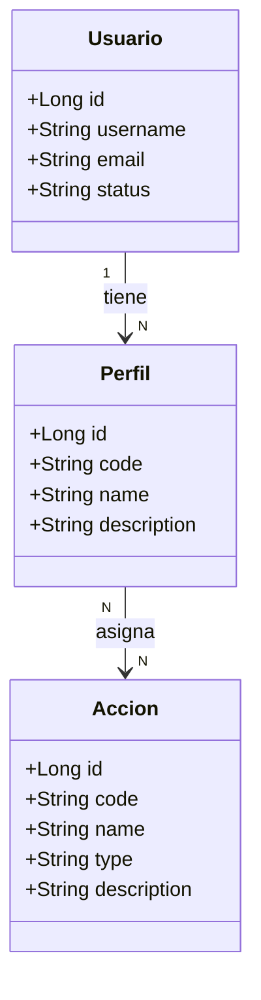

# Seguridad

Documentación funcional de los módulos de administración y seguridad. Estos documentos describen el comportamiento funcional y técnico de las pantallas del área de Seguridad dentro de Administración:

- gestión de usuarios,
- gestión de perfiles,
- catálogo de acciones y permisos del sistema.

## Conceptos clave

| Concepto     | Descripción                                                                |
|--------------|----------------------------------------------------------------------------|
| Usuario      | Identidad autenticada del sistema, asociada a un o varios perfiles.        |
| Perfil       | Agrupación funcional de permisos que define qué puede hacer un usuario.    |
| Acción       | Permiso granular del sistema con código técnico y tipo de operación.       |
| Autorización | Validación de accesos en frontend y backend basada en acciones y perfiles. |


## Modelo de entidades

El módulo de seguridad centraliza la autorización y la identidad del sistema. Las entidades principales son:

- `Usuario`: identifica al sujeto autenticado y puede pertenecer a uno o varios perfiles.
- `Perfil`: agrupa un conjunto de permisos y se asigna a los usuarios para controlar accesos.
- `Acción`: representa un permiso o capacidad del sistema, con un código técnico y un tipo (`READ`, `WRITE`, `EXECUTE`).



### Relación de negocio

- Un usuario puede tener varios perfiles y cada perfil agrupa permisos.
- Una acción se reutiliza como permiso a nivel funcional en la autorización del sistema.
- El catálogo de acciones se gestiona como conjunto semilla, no como CRUD abierto para creación o borrado.

## Seguridad

Permisos principales del módulo:

- `USER_READ`: consulta de usuarios y su estado.
- `USER_WRITE`: creación, edición y baja de usuarios.
- `USER_GRANT`: asignación o cambio del perfil de un usuario (concesión de permisos).
- `PROFILE_READ`: consulta de perfiles y su composición.
- `PROFILE_WRITE`: creación, edición y eliminación de perfiles.
- `PROFILE_GRANT`: concesión o revocación de las acciones asignadas a un perfil.
- `ACTION_READ`: consulta del catálogo de acciones del sistema.
- `ACTION_WRITE`: edición del catálogo de acciones del sistema.

Estos permisos se usan para ocultar o mostrar rutas, menús y acciones en la capa frontend y para validar el acceso en la API con Spring Security. El acceso a perfiles y usuarios se realiza siempre sobre la identidad autenticada del usuario actual y el conjunto de acciones derivadas de sus perfiles.

### Segregación de funciones (concesión de permisos)

Administrar usuarios o perfiles está separado de **conceder permisos**:

- `USER_GRANT` es necesario, además de `USER_WRITE`, para asignar un perfil a un usuario (alta o cambio de perfil).
- `PROFILE_GRANT` es necesario, además de `PROFILE_WRITE`, para modificar las acciones de un perfil (alta con acciones o cambio del conjunto de acciones).

El objetivo es evitar que un administrador con permiso de escritura pueda elevar privilegios por sí mismo (por ejemplo, asignarse el perfil de administrador o añadir acciones a su propio perfil). La comprobación se realiza en la capa de servicio y solo se exige cuando la petición **modifica realmente** los permisos: editar el nombre, la descripción o el email no requiere la autoridad de concesión. Una petición sin autoridad de concesión se rechaza con 403 Forbidden.

## Navegación

```
Administración > Seguridad > Acciones
Administración > Seguridad > Perfiles
Administración > Seguridad > Usuarios
```

## Pantallas

| Pantalla                  | Tipo   | Descripción |
|---------------------------|--------|-------------|
| [Usuarios](./users.md)    | Pagina |             |
| [Perfiles](./profiles.md) | Pagina |             |
| [Acciones](./actions.md)  | Pagina |             |

## Referencias

- [Requisitos](../../../specification/requirements.md)
- [Glosario](../../../specification/glossary.md)
- [Modelo de datos](../../../specification/data-model.md)
- [Autenticación y Gestión de Sesión](../../login/authentication.md)
- [Seguridad (backend)](../../../03-technical/backend/security.md)
- [Módulo Administración](../administration.md)
