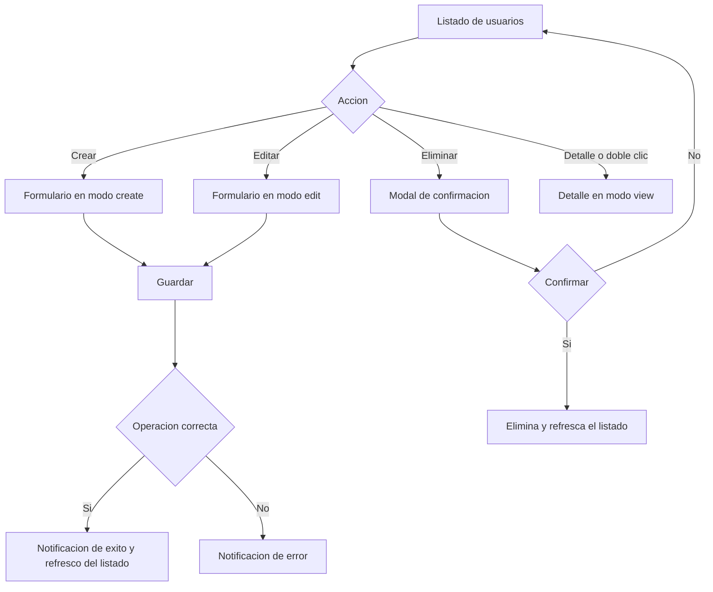
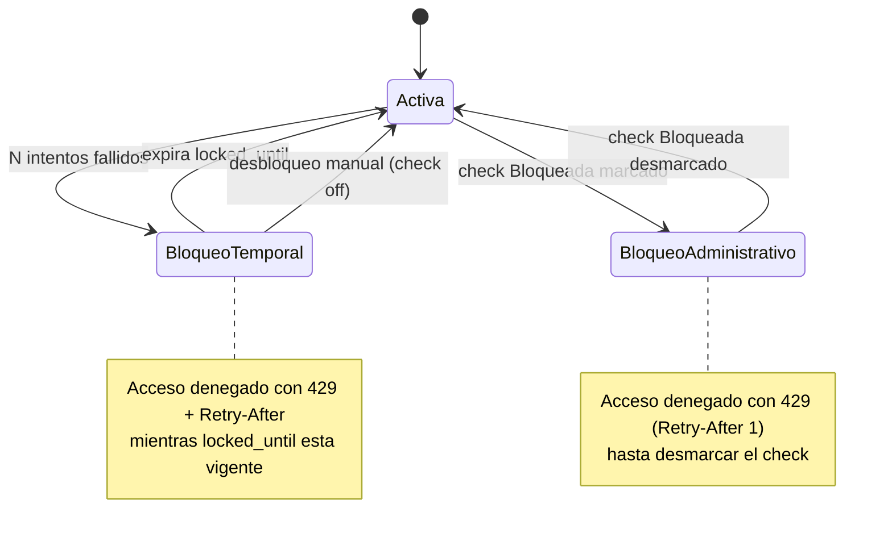

# Usuarios (Gestión de usuarios)

Documentación funcional y técnica de la pantalla de gestión de usuarios, dentro del módulo de Administración > Seguridad. Permite consultar, filtrar, crear, editar y eliminar los usuarios de la aplicación, así como asignarles un perfil y los informes a los que tienen acceso.

- **Ruta frontend:** `/administration/security/users`
- **Componentes:** `UserListComponent` (listado) y `UserFormComponent` (detalle / alta / edición)
- **Endpoint backend base:** `/api/v1/administration/security/users` (`UserController`)
- **Acceso:** `/me` requiere sesión autenticada; el resto del módulo exige `USER_READ` para lectura y `USER_WRITE` para escritura

---

## 1. Requisitos

Identificadores locales de este documento: `RF-USR-*` (requisitos funcionales) y `RNF-USR-*` (requisitos no funcionales).

### 1.1. Requisitos funcionales

#### RF-USR-1: Consulta paginada de usuarios

**Descripción:** el sistema debe permitir consultar los usuarios en un listado paginado y ordenable.

**Criterios de aceptación:**
- AC1.1: El listado muestra las columnas usuario, nombre, apellidos, email, perfil y último acceso.
- AC1.2: Todas las columnas son ordenables (ascendente/descendente).
- AC1.3: La paginación permite navegar entre páginas y cambiar el tamaño de página.

#### RF-USR-2: Búsqueda y filtrado

**Descripción:** el sistema debe permitir filtrar el listado por usuario, nombre y perfil.

**Criterios de aceptación:**
- AC2.1: Los filtros de usuario y nombre aplican coincidencia parcial.
- AC2.2: El filtro de perfil permite seleccionar un perfil concreto o todos.
- AC2.3: Al aplicar un filtro, el listado vuelve a la primera página.
- AC2.4: La acción de limpiar restablece todos los filtros y recarga el listado completo.

#### RF-USR-3: Alta de usuario

**Descripción:** un usuario con permiso de escritura debe poder crear nuevos usuarios.

**Criterios de aceptación:**
- AC3.1: El formulario exige usuario, contraseña y perfil.
- AC3.2: Un alta válida devuelve 201 y el nuevo usuario aparece en el listado.
- AC3.3: El email, cuando se informa, debe tener formato válido.
- AC3.4: Tras el alta correcta se vuelve al listado y se recarga.

#### RF-USR-4: Edición de usuario

**Descripción:** un usuario con permiso de escritura debe poder modificar los datos de un usuario existente.

**Criterios de aceptación:**
- AC4.1: El campo usuario es de solo lectura en edición (identidad inmutable).
- AC4.2: La contraseña no es obligatoria en edición.
- AC4.3: Una edición válida devuelve 200 y el cambio se refleja en el listado.

#### RF-USR-5: Eliminación de usuario

**Descripción:** un usuario con permiso de escritura debe poder eliminar un usuario, con confirmación previa.

**Criterios de aceptación:**
- AC5.1: La eliminación solicita confirmación explícita mediante un modal.
- AC5.2: Una eliminación confirmada devuelve 204 y el usuario desaparece del listado.
- AC5.3: Cancelar la confirmación no elimina el usuario.

#### RF-USR-6: Detalle de usuario

**Descripción:** el sistema debe permitir consultar el detalle de un usuario en modo solo lectura.

**Criterios de aceptación:**
- AC6.1: El detalle se abre seleccionando una fila y pulsando el botón *Detalle* (`btn-detail`), que solo está habilitado cuando hay una fila seleccionada, o mediante doble clic sobre la fila.
- AC6.2: El detalle muestra la información de auditoría (último acceso, creación, última modificación).
- AC6.3: La contraseña se muestra enmascarada.
- AC6.4: Además del detalle administrativo, el usuario autenticado puede consultar y actualizar su propio perfil mediante los endpoints `/me`.

#### RF-USR-7: Exportación a CSV

**Descripción:** el sistema debe permitir exportar el listado filtrado a un fichero CSV.

**Criterios de aceptación:**
- AC7.1: La exportación incluye todos los registros que cumplen los filtros activos, no solo la página visible.
- AC7.2: El fichero descargado sigue el patrón `users_YYYY-MM-DD.csv`.
- AC7.3: Si no hay filas que cumplan los filtros, se notifica que no hay datos que exportar.

#### RF-USR-8: Asignación de informes a un usuario

**Descripción:** un usuario con permiso de escritura debe poder asignar uno o varios informes a un usuario, tanto en el alta como en la edición.

**Criterios de aceptación:**
- AC8.1: El formulario permite seleccionar uno o varios informes mediante el campo *Informes asignados* (`user-reports`).
- AC8.2: Al guardar, los informes seleccionados se persisten junto con el usuario.
- AC8.3: Al abrir el usuario en edición se muestran exactamente los informes asignados.
- AC8.4: Los identificadores de informe inexistentes se rechazan en el backend.

#### RF-USR-9: Estado de bloqueo de la cuenta

**Descripción:** el sistema debe gestionar y exponer el estado de bloqueo de las cuentas, distinguiendo entre el **bloqueo temporal automático** (por intentos fallidos de inicio de sesión) y el **bloqueo administrativo indefinido** (aplicado manualmente desde esta pantalla).

**Criterios de aceptación:**
- AC9.1: Tras `N` intentos de inicio de sesión fallidos consecutivos se activa el bloqueo temporal de la cuenta durante `M` minutos; mientras esté vigente, cualquier intento de acceso (incluso con la contraseña correcta) responde 429 con la cabecera `Retry-After` y el mensaje de cuenta bloqueada temporalmente.
- AC9.2: El estado de bloqueo efectivo de una cuenta es la unión del bloqueo administrativo y del bloqueo temporal vigente, y se evalúa mediante un único criterio (`locked` o `locked_until` futuro).
- AC9.3: El listado muestra la columna *Bloqueada* con un badge de estado (bloqueada / desbloqueada) para cada usuario.
- AC9.4: El listado permite filtrar por estado de bloqueo (todas / bloqueadas / desbloqueadas), considerando bloqueada toda cuenta con bloqueo administrativo o temporal vigente.
- AC9.5: El formulario de usuario ofrece un check *Bloqueada* bidireccional: marcarlo bloquea la cuenta de forma indefinida hasta desmarcarlo; desmarcarlo la desbloquea. En modo detalle el check aparece deshabilitado.
- AC9.6: Al desbloquear una cuenta se limpian también el bloqueo temporal vigente (`locked_until`) y el contador de intentos fallidos (`failed_login_attempts`).
- AC9.7: La exportación CSV incluye una columna con el estado de bloqueo de cada usuario.

#### RF-USR-10: Segregación de funciones en la asignación de perfil

**Descripción:** asignar un perfil a un usuario equivale a concederle los permisos de ese perfil. Por ello, la asignación de perfil debe estar segregada de la mera administración del usuario: un usuario con `USER_WRITE` pero sin `USER_GRANT` no debe poder asignar ni cambiar el perfil de un usuario.

**Criterios de aceptación:**
- AC10.1: Un alta (`POST`) con `profileId` informado exige `USER_GRANT` además de `USER_WRITE`.
- AC10.2: Una edición (`PUT`) que cambia el perfil del usuario exige `USER_GRANT` además de `USER_WRITE`.
- AC10.3: Una edición que no altera el perfil (mismo `profileId` o sin informarlo) no requiere `USER_GRANT`.
- AC10.4: Cuando falta la autoridad de concesión, el backend responde 403 Forbidden y no persiste ningún cambio.

### 1.2. Requisitos no funcionales

- **RNF-USR-1 (Autorización):** el acceso requiere sesión y la acción `USER_READ`; las operaciones de escritura requieren `USER_WRITE` y la asignación de perfil requiere además `USER_GRANT`.
- **RNF-USR-2 (Visibilidad de acciones):** los botones de crear, editar y eliminar solo se muestran a usuarios con `USER_WRITE`.
- **RNF-USR-3 (Seguridad de credenciales):** la contraseña nunca se muestra en claro ni se devuelve en las respuestas del backend.
- **RNF-USR-4 (Idioma):** todos los textos de la pantalla son traducibles (ES / EN) mediante el grupo i18n `users.*`.
- **RNF-USR-5 (Feedback):** toda operación (crear, editar, eliminar, exportar, paginar) informa al usuario mediante notificaciones de progreso, éxito o error.
- **RNF-USR-6 (Persistencia del bloqueo):** el estado de bloqueo se persiste en base de datos (`users.locked`, `users.locked_until`, `users.failed_login_attempts`) para que sea consistente y efectivo en todos los nodos del clúster.
- **RNF-USR-7 (Concesión segregada):** asignar o cambiar el perfil de un usuario requiere `USER_GRANT`, verificado en la capa de servicio, evitando la elevación de privilegios por parte de un administrador con `USER_WRITE`.

---

## 2. Parte funcional

### 2.1. Objetivo

Ofrecer a los administradores una pantalla completa para administrar los usuarios del sistema:

- Consultar el listado paginado y filtrado de usuarios.
- Ver el detalle de un usuario, incluyendo su información de auditoría.
- Consultar y actualizar el propio perfil del usuario autenticado mediante `/me`.
- Crear, editar y eliminar usuarios.
- Asignar un perfil y una lista de informes a cada usuario.
- Bloquear y desbloquear cuentas, y consultar su estado de bloqueo (temporal o administrativo).
- Exportar el listado filtrado a CSV.

### 2.2. Vistas de la pantalla

La pantalla gestiona cuatro modos de vista (`viewMode`) dentro del mismo componente:

| Modo     | Descripción                                               |
|----------|-----------------------------------------------------------|
| `list`   | Listado paginado con barra de filtros y barra de acciones |
| `detail` | Vista de solo lectura de un usuario (incluye auditoría)   |
| `create` | Formulario de alta de usuario                             |
| `edit`   | Formulario de edición de usuario                          |

### 2.3. Patrón visual reutilizable y wireframes

La estructura visual base de esta pantalla se define en [layout.md](../../../03-technical/frontend/layout.md). Ese documento es la fuente única de verdad para los templates `List Screen`, `Form Screen` y `Confirmation Modal`; la documentación funcional de usuarios solo describe cómo se aplica ese patrón a la entidad concreta.

| Tipo de pantalla     | Uso en usuarios                          | Estructura base                                             |
|----------------------|------------------------------------------|-------------------------------------------------------------|
| `List screen`        | Listado principal                        | Cabecera, filtros, tabla, acciones y paginación             |
| `Form screen`        | Alta, edición y consulta en modo lectura | Encabezado, campos, validación, auditoría y pie de acciones |
| `Confirmation modal` | Eliminación                              | Mensaje de confirmación con aceptar/cancelar                |

#### 2.3.1. Wireframe del `List screen`

```text
+---------------------------------------------------------------------+
| Usuarios                                                            |
| [Crear] [Exportar]                                                  |
+---------------------------------------------------------------------+
| Filtro usuario | Filtro nombre | Filtro perfil | Filtro estado | [Buscar] [Limpiar] |
+---------------------------------------------------------------------+
| Usuario | Nombre | Apellidos | Email | Perfil | Bloqueada | Último acceso |
|-------- |--------|-----------|-------|--------|-----------|---------------|
| admin   | Admin  | User      | ...   | ADMIN  | No        | 2026-09-29    |
| tester  | Test   | User      | ...   | USER   | Sí        | 2026-09-28    |
+---------------------------------------------------------------------+
| < 1 2 3 > | Registros por página: 10                                |
+---------------------------------------------------------------------+
```

#### 2.3.2. Wireframe del `Form screen`

```text
+------------------------------------------------------------------+
| Crear usuario / Editar usuario                                   |
+------------------------------------------------------------------+
| Usuario * | [texto]          | Perfil * | [select]               |
| Contraseña | [texto]        | Email    | [texto]                 |
| Nombre    | [texto]         | Apellidos| [texto]                 |
| [ ] Bloqueada | [check bidireccional]                              |
| Informes asignados | [multiselect]                               |
+------------------------------------------------------------------+
| [Guardar] [Cancelar]                                             |
+------------------------------------------------------------------+
```

#### 2.3.3. Wireframe del `Form screen` en modo lectura

```text
+------------------------------------------------------------------+
| Consultar usuario                                                |
| [Volver] [Editar]                                                |
+------------------------------------------------------------------+
| Usuario | [admin]                                                |
| Nombre  | [Admin]                                                |
| Email   | [admin@domain.com]                                     |
| Perfil  | [ADMIN]                                                |
| Bloqueada | [check deshabilitado]                                |
| Informes asignados | [3]                                         |
| Auditoría: Creado 2026-09-01 | Última modificación 2026-09-15    |
+------------------------------------------------------------------+
```

La pantalla de usuarios usa `List screen` para la consulta, `Form screen` para alta y edición, y el mismo `Form screen` en modo solo lectura para la vista de detalle. El patrón visual es el mismo que el de perfiles y acciones, con variaciones en columnas, filtros y campos según la entidad.

### 2.4. Listado

**Columnas de la tabla** (ordenables y reordenables; la columna *Bloqueada* solo es reordenable y redimensionable):

| Columna       | Clave i18n                | Notas                                     |
|---------------|---------------------------|-------------------------------------------|
| Usuario       | `users.fields.username`   | —                                         |
| Nombre        | `users.fields.firstName`  | —                                         |
| Apellidos     | `users.fields.lastName`   | —                                         |
| Email         | `users.fields.email`      | —                                         |
| Perfil        | `users.fields.profile`    | Se muestra como etiqueta (badge)          |
| Bloqueada     | `users.fields.locked`     | Badge de estado (bloqueada / desbloqueada) |
| Último acceso | `users.fields.lastAccess` | Formateado con `localDate`                |

**Filtros disponibles:**

| Filtro             | Tipo                          | `data-testid`      |
|--------------------|-------------------------------|--------------------|
| Usuario            | Texto (coincidencia parcial)  | `filter-username`  |
| Nombre             | Texto (coincidencia parcial)  | `filter-firstName` |
| Perfil             | Selección (todos por defecto) | `filter-profile`   |
| Estado de bloqueo  | Selección (todos por defecto) | `filter-locked`    |

**Barra de acciones:**

| Acción       | Condición de disponibilidad                   | `data-testid` |
|--------------|-----------------------------------------------|---------------|
| Detalle      | Requiere una fila seleccionada                | `btn-detail`  |
| Crear        | Requiere `USER_WRITE`                         | `btn-create`  |
| Editar       | Requiere `USER_WRITE` y una fila seleccionada | `btn-edit`    |
| Eliminar     | Requiere `USER_WRITE` y una fila seleccionada | `btn-delete`  |
| Exportar CSV | Siempre disponible                            | `btn-export`  |

- La selección de una fila alterna (seleccionar / deseleccionar).
- El detalle se abre pulsando el botón *Detalle* con una fila seleccionada o mediante doble clic sobre la fila.
- La exportación a CSV incluye **todos los registros que cumplen los filtros activos**, no solo la página actual.

### 2.4. Identificadores para pruebas (`data-testid`)

| Elemento              | `data-testid`       |
|-----------------------|---------------------|
| Formulario de filtros | `users-filter-form` |
| Filtro de usuario     | `filter-username`   |
| Filtro de nombre      | `filter-firstName`  |
| Filtro de perfil      | `filter-profile`    |
| Filtro de bloqueo     | `filter-locked`     |
| Tabla de usuarios     | `users-table`       |
| Badge de bloqueo      | `user-locked-badge` |
| Check de bloqueo      | `input-locked`      |
| Botón Detalle         | `btn-detail`        |
| Botón Crear           | `btn-create`        |
| Botón Editar          | `btn-edit`          |
| Botón Eliminar        | `btn-delete`        |
| Botón Exportar CSV    | `btn-export`        |

### 2.5. Formulario de usuario

**Campos:**

| Campo              | Obligatorio  | Notas                                                              |
|--------------------|--------------|--------------------------------------------------------------------|
| Usuario            | Sí           | No editable en modo edición (solo alta)                            |
| Contraseña         | Solo en alta | En modo detalle se muestra enmascarada                             |
| Email              | No           | Validación de formato email                                        |
| Nombre             | No           | —                                                                  |
| Apellidos          | No           | —                                                                  |
| Perfil             | Sí           | Selección de un perfil existente                                   |
| Bloqueada          | No           | Check bidireccional de bloqueo administrativo; deshabilitado en detalle |
| Informes asignados | No           | Multi-selección de informes                                        |

**Información de auditoría** (solo en modo detalle, solo lectura): último acceso, fecha de creación y última modificación.

### 2.6. Validaciones funcionales

| Campo      | Regla                                                                                       |
|------------|---------------------------------------------------------------------------------------------|
| Usuario    | Obligatorio en alta; inmutable en edición                                                    |
| Contraseña | Obligatoria únicamente al crear un usuario                                                   |
| Perfil     | Obligatorio                                                                                  |
| Email      | Formato de email cuando se informa                                                           |
| Bloqueada  | Bidireccional: marcarlo bloquea la cuenta indefinidamente; desmarcarlo la desbloquea y limpia el bloqueo temporal y los intentos fallidos |

### 2.7. Diagramas

#### 2.7.1. Flujo de operaciones CRUD



#### 2.7.2. Estados de bloqueo de la cuenta



El estado mostrado en el listado agrega ambos bloqueos: una cuenta aparece como *Bloqueada* si tiene bloqueo administrativo o un bloqueo temporal vigente.

### 2.8. Mensajes y notificaciones

- Las operaciones de crear, editar, eliminar, exportar y paginar muestran notificaciones de progreso, éxito o error mediante el `NotificationService` (claves `notification.*`).
- La eliminación solicita confirmación mediante un modal con el mensaje `users.delete.confirmMessage`, que incluye el nombre del usuario y advierte de que la acción no se puede deshacer.

---

## 3. Parte técnica

### 3.1. Componentes afectados

| Capa     | Elemento               | Responsabilidad                                                                |
|----------|------------------------|--------------------------------------------------------------------------------|
| Frontend | `UserListComponent`    | Listado, filtros, paginación, orden, exportación y orquestación de vistas.     |
| Frontend | `UserFormComponent`    | Alta, edición y detalle de un usuario.                                         |
| Frontend | `UserService`          | Llamadas CRUD y carga de datos de referencia como perfiles e informes.         |
| Frontend | `TpDataTableComponent` | Tabla reutilizable para ordenación, paginación y selección.                    |
| Frontend | `AuthService`          | Comprobación de permisos por acción y acceso según el perfil activo.           |
| Backend  | `UserController`       | Exposición de endpoints CRUD y `/me` para autoservicio del usuario.            |
| Backend  | `UserService`          | Lógica de negocio, validación y persistencia del usuario.                      |
| Domain   | `User`                 | Entidad principal del sistema con perfil, credenciales y relaciones asociadas. |
| Domain   | `User2Report`          | Relación entre usuarios e informes visibles para cada perfil.                  |
| Security | `SecurityConfig`       | Reglas de autorización y protección de rutas del módulo de usuarios.           |

### 3.2. Modelos de datos

#### Frontend (TypeScript)

```typescript
interface UserDTO {
  id: number | null;
  username: string;
  password?: string;
  firstName: string | null;
  lastName: string | null;
  email: string | null;
  profileId: number | null;
  profileName?: string;
  reportIds: number[];
  lastAccess: string | null;
  createdAt: string | null;
  lastModifiedAt: string | null;
  /** Estado de bloqueo efectivo (administrativo o temporal vigente). */
  locked: boolean;
}

interface UserCriteria {
  username?: string;
  firstName?: string;
  lastName?: string;
  email?: string;
  profileId?: number;
  /** Filtro por estado de bloqueo: `true` solo bloqueadas, `false` solo desbloqueadas. */
  locked?: boolean;
}
```

#### Backend DTOs (Java)

```java
public record UserDTO(
    Long id,
    String username,
    String password,
    String firstName,
    String lastName,
    String email,
    OffsetDateTime lastAccess,
    Long profileId,
    String profileName,
    List<Long> reportIds,
    OffsetDateTime createdAt,
    OffsetDateTime lastModifiedAt,
    // null en actualización = no modificar; true = bloquear; false = desbloquear
    Boolean locked
) {}

public record UserCriteria(
    String username,
    String firstName,
    String lastName,
    String email,
    Long profileId,
    Boolean locked
) {}
```

#### Entidades JPA

```java
@Entity
@Table(name = "user")
public class User extends BaseEntity {
    @Column(nullable = false, unique = true)
    private String username;

    @Column(nullable = false)
    private String password;

    @ManyToOne(fetch = FetchType.LAZY)
    @JoinColumn(name = "profile_id")
    private Profile profile;

    /** Bloqueo administrativo indefinido. */
    @Column(name = "locked", nullable = false)
    private boolean locked;

    /** Fin del bloqueo temporal por intentos fallidos. */
    @Column(name = "locked_until")
    private OffsetDateTime lockedUntil;

    @Column(name = "failed_login_attempts", nullable = false)
    private int failedLoginAttempts;

    @OneToMany(mappedBy = "user")
    private List<User2Report> userReports = new ArrayList<>();

    /** Bloqueo efectivo: administrativo o temporal vigente. */
    public boolean isCurrentlyLocked() {
        return locked || (lockedUntil != null && lockedUntil.isAfter(OffsetDateTime.now(ZoneOffset.UTC)));
    }
}
```

### 3.3. Endpoints

Ruta base: `/api/v1/administration/security/users`.

| Método y ruta  | Descripción                                                                                           | Respuesta                         |
|----------------|-------------------------------------------------------------------------------------------------------|-----------------------------------|
| `GET /`        | Listado paginado con filtros (`username`, `firstName`, `lastName`, `email`, `profileId`, `locked`) y `Pageable` | 200 OK con página de usuarios     |
| `GET /count`   | Número de usuarios que cumplen los filtros (incluido `locked`)                                        | 200 OK con el total               |
| `GET /{id}`    | Usuario por identificador                                                                             | 200 OK con el usuario             |
| `POST /`       | Alta de usuario (`id` nulo)                                                                           | 201 Created con el usuario creado |
| `PUT /{id}`    | Actualización de usuario                                                                              | 200 OK con el usuario actualizado |
| `DELETE /{id}` | Eliminación de usuario                                                                                | 204 No Content                    |
| `GET /me`      | Perfil del usuario autenticado                                                                        | 200 OK                            |
| `PUT /me`      | Autoservicio: actualiza nombre, apellidos y email del usuario autenticado                             | 200 OK                            |

Datos de referencia consumidos por el formulario y los filtros:

- Perfiles: `GET /api/v1/administration/security/profiles/references`.
- Informes: `GET /api/v1/reports/all`.

### 3.4. Validaciones

- El formulario valida que el campo `username` sea obligatorio en alta y que el valor no cambie en edición.
- La contraseña es obligatoria solo en creación; si el usuario no la modifica en edición, el backend conserva la existente.
- El `email` se valida con formato de correo cuando se informa, y el `perfil` debe apuntar a una entidad existente en el catálogo.
- Los informes asociados deben pertenecer a registros válidos del sistema; cualquier identificador inexistente se rechaza en backend.
- El campo `locked` es opcional en la actualización: `null` no modifica el estado, `true` bloquea administrativamente la cuenta y `false` la desbloquea (limpiando `locked_until` y `failed_login_attempts`).
- El estado de bloqueo efectivo se resuelve con `locked` o `locked_until` futuro; el filtro `locked` del listado agrega ambos bloqueos.

### 3.5. Exportación

- El botón de exportación funciona igual que en el resto de pantallas del módulo: está siempre disponible y exporta la totalidad de registros que cumplen los filtros activos.
- Para construir el CSV se reutiliza la misma consulta del listado contra los mismos métodos backend (`GET /` y `GET /count`) con los filtros activos.
- La exportación incluye **todos los registros que cumplen los filtros activos**, no solo la página visible en pantalla.
- Si no existen filas coincidentes, la UI informa del caso y evita generar un archivo vacío.
- El CSV incluye una columna con el estado de bloqueo (`Sí`/`No`) además de usuario, nombre, apellidos, email, perfil y último acceso.

### 3.6. Paginación, orden y filtros

- La paginación y el orden se envían como parámetros `page`, `size` y `sort` (formato `campo,dirección`).
- Los filtros vacíos no se envían al backend (`undefined`).

### 3.7. Seguridad y permisos

- El acceso a la administración de usuarios se protege en `SecurityConfig` mediante `GET /api/v1/administration/security/users/**` con `hasAnyAuthority("USER_READ", "USER_WRITE")`, y `POST/PUT/DELETE` con `hasAuthority("USER_WRITE")`.
- Además de `USER_WRITE`, la asignación de perfil exige `USER_GRANT` (segregación de funciones, SEC-07). La comprobación se realiza en `UserService` mediante `GrantAuthorityChecker` y solo se exige cuando se concede un perfil: en el alta si `profileId` está informado y en la edición si el perfil solicitado difiere del actual. Si falta la autoridad se lanza `AccessDeniedException`, que el manejador global traduce a 403 Forbidden.
- Los endpoints `/me` no dependen de una acción de seguridad concreta: requieren autenticación con `authenticated()`.
- Las acciones de crear, editar y eliminar solo se muestran si el usuario posee la acción `USER_WRITE` (`canWrite`).
- El campo `usuario` es inmutable una vez creado (solo editable en alta).
- La contraseña nunca se muestra: en modo detalle aparece enmascarada.
- El bloqueo efectivo de una cuenta (administrativo o temporal) se evalúa en `TemplateUserDetails.isAccountNonLocked()`; Spring Security lanza `LockedException`, que `AuthService` traduce a `AccountLockedException` → 429 con `Retry-After`.

### 3.8. Reglas de comportamiento relevantes

- En **edición**, el campo usuario queda deshabilitado para preservar la identidad de la cuenta.
- En **alta**, la contraseña es obligatoria; en edición no se exige (se conserva si no se cambia según la lógica del backend).
- Tras crear o actualizar con éxito, la aplicación vuelve al listado y lo recarga.
- La eliminación es irreversible y siempre requiere confirmación explícita del usuario.
- El check *Bloqueada* es bidireccional: marcarlo aplica un bloqueo administrativo indefinido y desmarcarlo lo revoca; en modo detalle permanece deshabilitado (solo lectura).
- El desbloqueo manual limpia también el bloqueo temporal vigente y el contador de intentos fallidos, devolviendo la cuenta a su estado activo.
- El bloqueo temporal se activa automáticamente tras `auth.login-attempts.max-attempts` (por defecto 5) intentos fallidos consecutivos y dura `auth.login-attempts.lockout-minutes` (por defecto 15) minutos.

---

## 4. Pruebas

### 4.1. Cobertura unitaria (backend)

La suite actual incluye pruebas específicas del servicio y del controlador que cubren la lógica principal de la pantalla:

| Ubicación                                                                                             | Alcance                                                                                                                                              |
|-------------------------------------------------------------------------------------------------------|------------------------------------------------------------------------------------------------------------------------------------------------------|
| `template/core/src/test/java/org/myorganization/template/core/service/UserServiceTest.java`           | Validaciones de negocio, creación, consulta por ID y username, filtrado por criterios (incluido el estado de bloqueo), actualización (bloquear/desbloquear), borrado, asociaciones con perfiles e informes y segregación de funciones (`USER_GRANT`) |
| `template/core/src/test/java/org/myorganization/template/core/security/GrantAuthorityCheckerTest.java` | Comportamiento del verificador de autoridad de concesión (`GrantAuthorityChecker`)                                                                   |
| `template/webapp/src/test/java/org/myorganization/template/webapp/controller/UserControllerTest.java` | Respuestas HTTP del endpoint, parámetros de consulta (incluido `locked`), autenticación del usuario actual y propagación de excepciones del servicio     |
| `template/webapp/src/test/java/org/myorganization/template/webapp/integration/LoginLockoutIntegrationTest.java` | Bloqueo temporal de la cuenta tras intentos fallidos (429 + `Retry-After`) en un contexto Spring completo con PostgreSQL |
| `template/webapp/src/test/java/org/myorganization/template/webapp/integration/GrantSecurityIntegrationTest.java` | Integración: 403 al asignar un perfil sin `USER_GRANT` y 201 con la autoridad (SEC-07)                                                               |

Estas pruebas cubren el flujo principal de usuarios y complementan la cobertura E2E del frontend, sin reemplazar la validación funcional end-to-end del comportamiento completo de la pantalla.

### 4.2. Cobertura unitaria (frontend)

| Ubicación                     | Alcance                                                                 |
|-------------------------------|-------------------------------------------------------------------------|
| `user-list.component.spec.ts` | Estado de listado, filtros (incluido el de bloqueo), paginación, acciones y columna de bloqueo en la exportación CSV |
| `user-form.component.spec.ts` | Modos del formulario, check de bloqueo bidireccional y emisión de eventos |
| `user.service.spec.ts`        | Construcción de peticiones CRUD y parámetros (incluido `locked`)        |

### 4.3. Cobertura E2E (Playwright)

Ubicación: `dashboard/e2e/tests/administration/users.spec.ts` (Page Object en `dashboard/e2e/pages/users.page.ts`).

| Caso               | Descripción                                            | Resultado esperado                                                                                |
|--------------------|--------------------------------------------------------|---------------------------------------------------------------------------------------------------|
| Listar usuarios    | Acceder a la pantalla tras iniciar sesión              | La tabla es visible, hay al menos una fila y se muestran filtros y el botón de crear              |
| Buscar por usuario | Filtrar por un usuario existente y por uno inexistente | El listado muestra la fila coincidente; con un término sin coincidencias queda vacío              |
| Crear usuario      | Alta desde el formulario con datos válidos             | El backend responde 201, se vuelve al listado y el nuevo usuario aparece al buscarlo              |
| Editar usuario     | Seleccionar un usuario y modificar sus datos           | El campo usuario es de solo lectura, el backend responde 200 y el cambio se refleja en el listado |
| Eliminar usuario   | Seleccionar un usuario y confirmar el borrado          | El backend responde 204 y el usuario deja de aparecer al buscarlo                                 |
| Exportar CSV       | Pulsar el botón de exportar                            | El navegador descarga el fichero `users_YYYY-MM-DD.csv`                                           |
| Asignar informes   | Crear un usuario asignándole dos informes              | El backend responde 201 y al editar el usuario se muestran los dos informes asignados             |
| Bloquear/desbloquear | Marcar y desmarcar el check *Bloqueada* en la edición  | El estado se refleja en el badge del listado y en el filtro por estado de bloqueo                 |
| Bloqueo temporal   | Provocar `N` intentos fallidos consecutivos de login   | El acceso responde 429 con `Retry-After` y el listado muestra la cuenta como bloqueada            |
| Segregación (`USER_GRANT`) | Con un token con `USER_WRITE` pero sin `USER_GRANT`, asignar o cambiar el perfil de un usuario | El alta y el cambio de perfil responden 403; editar sin tocar el perfil responde 200; con `USER_GRANT` el alta responde 201 |

- Cada test inicia sesión con un usuario administrador (acciones `USER_READ` y `USER_WRITE`) y navega directamente a `/administration/security/users`.
- Las suites de autorización y segregación de funciones (`TC-USR-10`, `TC-USR-14`) trabajan por API con tokens de distintos perfiles (con y sin la autoridad de concesión) en lugar de la UI de administración.
- La suite se ejecuta en modo `serial` para evitar contención en el backend al compartir el usuario administrador entre casos.
- Los casos de crear, editar y eliminar generan un `username` único por ejecución para poder reejecutarse sin colisiones; los de editar y eliminar crean previamente su propio usuario para trabajar de forma aislada.

### 4.4. Datos de prueba

Definidos en `dashboard/e2e/fixtures/test-data.ts`: `testUsers.valid` (credenciales del administrador) y `buildNewUser()` (genera los datos de un usuario nuevo con `username` único). Deben ajustarse al entorno de integración (perfil `test`).

### 4.5. Dependencias de ejecución

- Los casos E2E de listar, buscar, crear, editar, eliminar y exportar requieren el backend de integración levantado (por defecto en `http://localhost:8080`) con al menos un perfil de referencia disponible.
- Los casos de creación y edición insertan un registro en el backend por ejecución; el caso de eliminación borra el usuario que él mismo crea.
- La exportación a CSV depende de que existan filas que cumplan los filtros activos; en caso contrario se notifica que no hay datos que exportar.
- El caso de bloqueo temporal (TC-USR-13) depende de la configuración `auth.login-attempts.max-attempts` del backend (por defecto 5, ajustable con `E2E_LOGIN_MAX_ATTEMPTS` en el entorno E2E).

### 4.6. Casos de prueba detallados (TCY-USR)

Catálogo de test cases derivado de los requisitos funcionales de usuarios (`RF-USR-*`, `RNF-USR-*`). Para el marco global de pruebas, variables (`{{BASE_URL_UI}}`, `{{BASE_URL_API}}`, `{{ADMIN_USER}}`, `{{UNIQUE}}`) y modelo de ejecución, consultar el [Plan Maestro de Pruebas](../../../specification/test-case.md).

Precondición del ciclo: usuario administrador `{{ADMIN_USER}}` con `USER_READ` y `USER_WRITE`; al menos un perfil de referencia disponible. Datos de alta tomados de `buildNewUser()`: usuario `e2e_user_{{UNIQUE}}`, contraseña `Test1234!`, email `e2e_user_{{UNIQUE}}@example.com`, nombre `E2E`, apellidos `Test`. Cada caso que crea un usuario lo elimina en el teardown, por lo que todos son independientes.

#### TC-USR-01 · Listado paginado y ordenable

- **Versión:** 1.0 · **Prioridad:** Alta · **Tipo:** Funcional, E2E · **Traza:** RF-USR-1 (AC1.1–AC1.3) · **Independiente:** Sí · **Dependencias:** ninguna
- **Setup:** login con `{{ADMIN_USER}}`.
- **Teardown:** logout.

| # | Acción                                                    | Resultado esperado                                                                           |
|---|-----------------------------------------------------------|----------------------------------------------------------------------------------------------|
| 1 | Navegar a `{{BASE_URL_UI}}/administration/security/users` | `users-table` visible con columnas usuario, nombre, apellidos, email, perfil y último acceso |
| 2 | Pulsar la cabecera de una columna                         | El listado se reordena ascendente; al volver a pulsar, descendente                           |
| 3 | Cambiar de página y de tamaño de página                   | La navegación paginada funciona y recarga los datos                                          |

#### TC-USR-02 · Búsqueda y filtrado

- **Versión:** 1.0 · **Prioridad:** Media · **Tipo:** Funcional · **Traza:** RF-USR-2 (AC2.1–AC2.4) · **Independiente:** Sí · **Dependencias:** ninguna
- **Setup:** login con `{{ADMIN_USER}}` (el propio `admin` sirve como fila existente a buscar).
- **Teardown:** logout.

| # | Acción                                                                                             | Resultado esperado                                                    |
|---|----------------------------------------------------------------------------------------------------|-----------------------------------------------------------------------|
| 1 | En `{{BASE_URL_UI}}/administration/security/users`, escribir `admin` en `filter-username` y buscar | El listado muestra la fila del usuario `admin` y vuelve a la página 1 |
| 2 | Escribir `zzz_inexistente` en `filter-username` y buscar                                           | El listado queda vacío                                                |
| 3 | Pulsar limpiar filtros                                                                             | Se restablecen los filtros y se recarga el listado completo           |

#### TC-USR-03 · Alta de usuario válida

- **Versión:** 1.0 · **Prioridad:** Alta · **Tipo:** Funcional, E2E · **Traza:** RF-USR-3 (AC3.1–AC3.4) · **Independiente:** Sí · **Dependencias:** ninguna
- **Setup:** login con `{{ADMIN_USER}}`; existe al menos un perfil seleccionable.
- **Teardown:** eliminar el usuario `e2e_user_{{UNIQUE}}` (vía UI o `DELETE /api/v1/administration/security/users/{id}`).

| # | Acción                                                                                                                                                          | Resultado esperado                            |
|---|-----------------------------------------------------------------------------------------------------------------------------------------------------------------|-----------------------------------------------|
| 1 | En el listado, pulsar `btn-create`                                                                                                                              | Se abre el formulario en modo alta            |
| 2 | Rellenar usuario `e2e_user_{{UNIQUE}}`, contraseña `Test1234!`, email `e2e_user_{{UNIQUE}}@example.com`, nombre `E2E`, apellidos `Test` y seleccionar un perfil | Formulario válido                             |
| 3 | Guardar                                                                                                                                                         | El backend responde 201; se vuelve al listado |
| 4 | Buscar `e2e_user_{{UNIQUE}}` en `filter-username`                                                                                                               | El nuevo usuario aparece en el listado        |

#### TC-USR-04 · Alta con email con formato inválido

- **Versión:** 1.0 · **Prioridad:** Media · **Tipo:** Negativo · **Traza:** RF-USR-3 (AC3.3) · **Independiente:** Sí · **Dependencias:** ninguna
- **Setup:** login con `{{ADMIN_USER}}`.
- **Teardown:** cancelar el formulario (no se crea nada); logout.

| # | Acción                                                                                                                   | Resultado esperado                                                 |
|---|--------------------------------------------------------------------------------------------------------------------------|--------------------------------------------------------------------|
| 1 | Abrir `btn-create` y rellenar usuario `e2e_user_{{UNIQUE}}`, contraseña `Test1234!`, perfil, y email `correo-sin-arroba` | —                                                                  |
| 2 | Intentar guardar                                                                                                         | El campo email marca error de formato y el guardado no se completa |

#### TC-USR-05 · Edición de usuario (usuario inmutable)

- **Versión:** 1.0 · **Prioridad:** Alta · **Tipo:** Funcional, E2E · **Traza:** RF-USR-4 (AC4.1–AC4.3) · **Independiente:** Sí (crea su propio usuario) · **Dependencias:** ninguna
- **Setup:** login con `{{ADMIN_USER}}`; crear previamente el usuario `e2e_user_{{UNIQUE}}` (vía `POST /api/v1/administration/security/users` o repitiendo TC-USR-03) para editar un registro aislado.
- **Teardown:** eliminar `e2e_user_{{UNIQUE}}`.

| # | Acción                                                         | Resultado esperado                                                                                          |
|---|----------------------------------------------------------------|-------------------------------------------------------------------------------------------------------------|
| 1 | Buscar y seleccionar `e2e_user_{{UNIQUE}}` y pulsar `btn-edit` | Se abre el formulario en modo edición; el campo usuario es de solo lectura; la contraseña no es obligatoria |
| 2 | Cambiar apellidos a `Test-Editado` y guardar                   | El backend responde 200                                                                                     |
| 3 | Volver al listado y buscar el usuario                          | El cambio (`Test-Editado`) se refleja en la fila                                                            |

#### TC-USR-06 · Eliminación con confirmación

- **Versión:** 1.0 · **Prioridad:** Alta · **Tipo:** Funcional, E2E · **Traza:** RF-USR-5 (AC5.1–AC5.3) · **Independiente:** Sí (crea su propio usuario) · **Dependencias:** ninguna
- **Setup:** login con `{{ADMIN_USER}}`; crear previamente `e2e_user_{{UNIQUE}}`.
- **Teardown:** si tras el caso el usuario sigue existiendo (fallo), eliminarlo por API.

| # | Acción                                                  | Resultado esperado                                          |
|---|---------------------------------------------------------|-------------------------------------------------------------|
| 1 | Seleccionar `e2e_user_{{UNIQUE}}` y pulsar `btn-delete` | Se abre el modal de confirmación con el nombre del usuario  |
| 2 | Pulsar cancelar                                         | El modal se cierra y el usuario sigue en el listado         |
| 3 | Repetir y confirmar                                     | El backend responde 204 y el usuario desaparece al buscarlo |

#### TC-USR-07 · Detalle con doble clic y auditoría

- **Versión:** 1.0 · **Prioridad:** Media · **Tipo:** Funcional · **Traza:** RF-USR-6 (AC6.1–AC6.3) · **Independiente:** Sí · **Dependencias:** ninguna
- **Setup:** login con `{{ADMIN_USER}}`.
- **Teardown:** logout.

| # | Acción                                                      | Resultado esperado                                                                           |
|---|-------------------------------------------------------------|----------------------------------------------------------------------------------------------|
| 1 | En el listado, doble clic sobre la fila del usuario `admin` | Se abre el detalle en modo solo lectura                                                      |
| 2 | Observar el contenido                                       | Muestra auditoría (último acceso, creación, última modificación) y la contraseña enmascarada |

#### TC-USR-08 · Autoservicio del perfil propio (/me)

- **Versión:** 1.0 · **Prioridad:** Media · **Tipo:** Funcional, API · **Traza:** RF-USR-6 (AC6.4) · **Independiente:** Sí · **Dependencias:** ninguna
- **Setup:** vía API. Login con `{{ADMIN_USER}}` y obtener token.
- **Teardown:** restaurar los valores originales del usuario (`PUT /me` con los datos previos) para no dejar el perfil alterado.

| # | Acción                                                                                                                                                  | Resultado esperado                           |
|---|---------------------------------------------------------------------------------------------------------------------------------------------------------|----------------------------------------------|
| 1 | `GET {{BASE_URL_API}}/api/v1/administration/security/users/me`                                                                                          | 200 OK con el perfil del usuario autenticado |
| 2 | `PUT {{BASE_URL_API}}/api/v1/administration/security/users/me` con `{ "firstName": "Admin", "lastName": "Autoservicio", "email": "admin@example.com" }` | 200 OK con los datos actualizados            |

#### TC-USR-09 · Exportación CSV filtrada

- **Versión:** 1.0 · **Prioridad:** Media · **Tipo:** Funcional, E2E · **Traza:** RF-USR-7 (AC7.1–AC7.3) · **Independiente:** Sí · **Dependencias:** ninguna
- **Setup:** login con `{{ADMIN_USER}}`.
- **Teardown:** eliminar el fichero descargado; logout.

| # | Acción                                              | Resultado esperado                                                                                                      |
|---|-----------------------------------------------------|-------------------------------------------------------------------------------------------------------------------------|
| 1 | En el listado, sin filtros, pulsar `btn-export`     | El navegador descarga `users_{{TODAY}}.csv` con todos los registros que cumplen los filtros (no solo la página visible) |
| 2 | Filtrar por `zzz_inexistente` y pulsar `btn-export` | Se notifica que no hay datos que exportar y no se genera fichero                                                        |

#### TC-USR-10 · Autorización y visibilidad de acciones

- **Versión:** 1.0 · **Prioridad:** Alta · **Tipo:** Seguridad, API · **Traza:** RNF-USR-1, RNF-USR-2 · **Independiente:** Sí · **Dependencias:** requiere un usuario con `USER_READ` pero sin `USER_WRITE`
- **Setup:** vía API/UI. Preparar un usuario de solo lectura (perfil con `USER_READ` sin `USER_WRITE`) y obtener su token.
- **Teardown:** eliminar el usuario/perfil de prueba creados.

| # | Acción                                                                                 | Resultado esperado                                                 |
|---|----------------------------------------------------------------------------------------|--------------------------------------------------------------------|
| 1 | Con token sin `USER_READ` ni `USER_WRITE`, `GET /api/v1/administration/security/users` | 403 Forbidden                                                      |
| 2 | Con token `USER_READ` (sin `USER_WRITE`), abrir el listado en la UI                    | Los botones `btn-create`, `btn-edit` y `btn-delete` no se muestran |
| 3 | Con ese mismo token, `POST /api/v1/administration/security/users`                      | 403 Forbidden                                                      |

#### TC-USR-11 · Asignación de informes a un usuario

- **Versión:** 1.0 · **Prioridad:** Media · **Tipo:** Funcional, E2E · **Traza:** RF-USR-8 (AC8.1–AC8.3) · **Independiente:** Sí · **Dependencias:** ninguna
- **Setup:** login con `{{ADMIN_USER}}`; existen al menos dos informes asignables (`GET /api/v1/reports/all`) y un perfil seleccionable.
- **Teardown:** eliminar el usuario `e2e_user_{{UNIQUE}}` (vía UI o `DELETE /api/v1/administration/security/users/{id}`).

| # | Acción                                                                                                                                       | Resultado esperado                                                          |
|---|----------------------------------------------------------------------------------------------------------------------------------------------|-----------------------------------------------------------------------------|
| 1 | En el listado, pulsar `btn-create` y rellenar usuario `e2e_user_{{UNIQUE}}`, contraseña `Test1234!`, email, nombre, apellidos y perfil        | Se abre el formulario en modo alta con los datos informados                 |
| 2 | En *Informes asignados* (`user-reports`), abrir el selector de informes, marcar los dos primeros informes y aceptar                          | El selector se cierra y los dos informes quedan añadidos al usuario         |
| 3 | Guardar                                                                                                                                      | El backend responde 201; se vuelve al listado                               |
| 4 | Buscar `e2e_user_{{UNIQUE}}`, seleccionarlo y pulsar `btn-edit`                                                                              | El formulario de edición muestra exactamente los dos informes asignados     |

#### TC-USR-12 · Bloqueo y desbloqueo administrativo de una cuenta

- **Versión:** 1.0 · **Prioridad:** Alta · **Tipo:** Funcional, E2E · **Traza:** RF-USR-9 (AC9.3–AC9.7) · **Independiente:** Sí (crea su propio usuario) · **Dependencias:** ninguna
- **Setup:** login con `{{ADMIN_USER}}`; crear previamente `e2e_user_{{UNIQUE}}` (vía `POST /api/v1/administration/security/users` o repitiendo TC-USR-03) para operar sobre un registro aislado.
- **Teardown:** eliminar `e2e_user_{{UNIQUE}}`.

| # | Acción                                                                                        | Resultado esperado                                                                        |
|---|-----------------------------------------------------------------------------------------------|-------------------------------------------------------------------------------------------|
| 1 | Buscar `e2e_user_{{UNIQUE}}` y observar la columna *Bloqueada*                                 | El badge (`user-locked-badge`) muestra la cuenta como desbloqueada                         |
| 2 | Seleccionar el usuario, pulsar `btn-edit` y marcar el check `input-locked`; guardar           | El backend responde 200; se vuelve al listado                                              |
| 3 | Buscar `e2e_user_{{UNIQUE}}`                                                                   | El badge muestra la cuenta como bloqueada                                                  |
| 4 | En el filtro de estado (`filter-locked`) seleccionar *Bloqueadas* y buscar                    | El listado incluye la fila de `e2e_user_{{UNIQUE}}`                                        |
| 5 | En el filtro de estado seleccionar *Desbloqueadas* y buscar                                   | El listado no incluye la fila de `e2e_user_{{UNIQUE}}`                                     |
| 6 | Volver al filtro *Todas*, buscar el usuario, abrir su edición y desmarcar el check; guardar   | El backend responde 200; se vuelve al listado                                              |
| 7 | Buscar `e2e_user_{{UNIQUE}}` y abrir su detalle con doble clic                                 | El badge vuelve a mostrar la cuenta como desbloqueada y el check `input-locked` está deshabilitado |

#### TC-USR-13 · Bloqueo temporal de cuenta por intentos fallidos

- **Versión:** 1.0 · **Prioridad:** Alta · **Tipo:** Seguridad, Funcional, E2E · **Traza:** RF-USR-9 (AC9.1–AC9.4), RNF-USR-6 · **Independiente:** Sí (crea su propio usuario) · **Dependencias:** ninguna
- **Setup:** login con `{{ADMIN_USER}}`; crear previamente un usuario con credenciales conocidas (`e2e_user_{{UNIQUE}}` / `Test1234!`). `N` = `auth.login-attempts.max-attempts` (por defecto 5; en E2E, `E2E_LOGIN_MAX_ATTEMPTS`).
- **Teardown:** eliminar `e2e_user_{{UNIQUE}}` (el borrado elimina también el estado de bloqueo asociado).

| # | Acción                                                                                                              | Resultado esperado                                                                            |
|---|---------------------------------------------------------------------------------------------------------------------|-----------------------------------------------------------------------------------------------|
| 1 | Realizar `N` intentos de login por API con contraseña incorrecta para `e2e_user_{{UNIQUE}}`                          | Cada intento responde 401 Unauthorized                                                        |
| 2 | Realizar un login por API con la contraseña **correcta**                                                            | Responde 429 Too Many Requests con cabecera `Retry-After`                                     |
| 3 | Iniciar sesión en la UI con `{{ADMIN_USER}}`, buscar `e2e_user_{{UNIQUE}}` y observar la columna *Bloqueada*        | El badge (`user-locked-badge`) muestra la cuenta como bloqueada                               |
| 4 | En el filtro de estado (`filter-locked`) seleccionar *Bloqueadas* y buscar                                          | El listado incluye la fila de `e2e_user_{{UNIQUE}}`                                           |

#### TC-USR-14 · Segregación de funciones en la asignación de perfil (`USER_GRANT`)

- **Versión:** 1.0 · **Prioridad:** Alta · **Tipo:** Seguridad, API · **Traza:** RF-USR-10 (AC10.1–AC10.4), RNF-USR-7 · **Independiente:** Sí · **Dependencias:** requiere tokens con distintos permisos
- **Setup:** vía API. Preparar: (a) token con `USER_WRITE` sin `USER_GRANT`; (b) token con `USER_WRITE` y `USER_GRANT`. Obtener el id de un perfil de referencia (`GET /api/v1/administration/security/profiles/references`).
- **Teardown:** eliminar el usuario creado en el paso 4 (`DELETE /api/v1/administration/security/users/{id}`).

| # | Acción                                                                                                                            | Resultado esperado                                                       |
|---|-----------------------------------------------------------------------------------------------------------------------------------|--------------------------------------------------------------------------|
| 1 | Con token (a), `POST /api/v1/administration/security/users` con usuario nuevo y `profileId` informado                             | 403 Forbidden; no se crea el usuario                                     |
| 2 | Con token (a), `PUT /api/v1/administration/security/users/{id}` cambiando `profileId` a uno distinto del actual                   | 403 Forbidden; el perfil del usuario no cambia                           |
| 3 | Con token (a), `PUT /api/v1/administration/security/users/{id}` sin alterar el perfil (mismo `profileId`)                          | 200 OK (editar sin tocar el perfil no requiere `USER_GRANT`)             |
| 4 | Con token (b), `POST /api/v1/administration/security/users` con usuario nuevo y `profileId` informado                             | 201 Created; el usuario se crea con el perfil indicado                   |

---

## Referencias

- [Plan Maestro de Pruebas](../../../specification/test-case.md)
- [Requisitos](../../../specification/requirements.md)
- [Glosario](../../../specification/glossary.md)
- [Modelo de datos](../../../specification/data-model.md)
- [Módulo Seguridad](./security.md)
- [Autenticación y Gestión de Sesión](../../login/authentication.md)
- [Seguridad (backend)](../../../03-technical/backend/security.md)
- [API (backend)](../../../03-technical/backend/api.md)
- [Diseño (frontend)](../../../03-technical/frontend/design-system.md)
