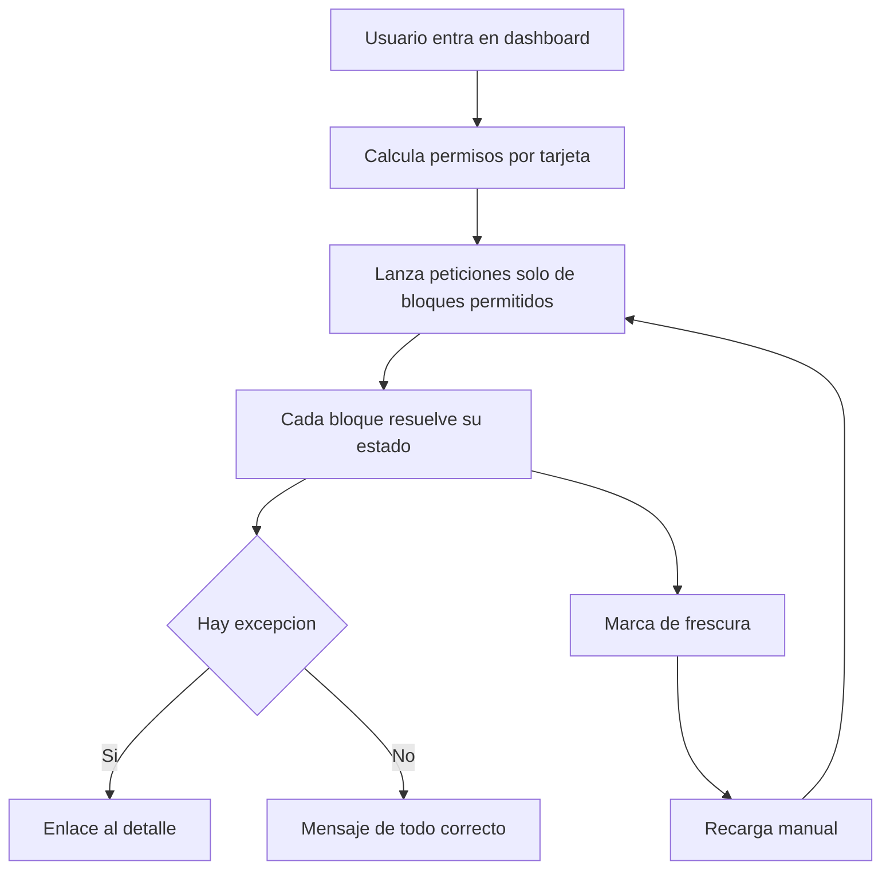
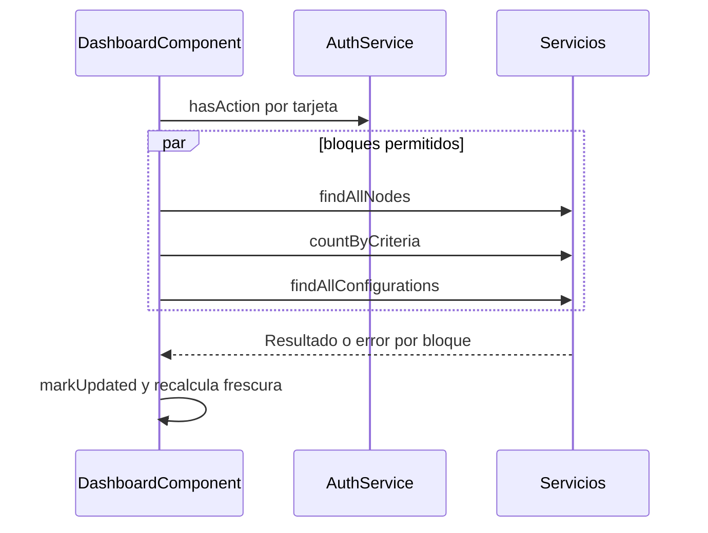

# Dashboard (página de inicio)

Documentación funcional y técnica del dashboard, la página de inicio de la aplicación. Ofrece al administrador u operador un vistazo al estado del sistema (nodos del cluster, interfaces en error, usuarios) con datos reales, estados independientes por bloque, excepciones navegables e indicación de frescura.

- **Ruta:** `/dashboard` (destino de la redirección por defecto tras el login)
- **Componente:** `DashboardComponent` (`features/dashboard/`)
- **Acceso:** acción `DASHBOARD_READ`; cada tarjeta exige además su propio permiso de lectura
- **Estado de la implementación:** *bridge* (puente). Cada bloque se carga de forma independiente desde endpoints existentes hasta que exista el endpoint de resumen `GET /dashboard/stats`
- **Especificación de origen:** [requirements](../../../.kiro/specs/dashboard-stats/requirements.md), [design](../../../.kiro/specs/dashboard-stats/design.md) y [tasks](../../../.kiro/specs/dashboard-stats/tasks.md)

---

## 1. Requisitos

Identificadores locales de este documento: `RF-DSH-*` (funcionales) y `RNF-DSH-*` (no funcionales). Se corresponden con `RF-1..10` y `RNF-1..5` de la especificación de origen, y reflejan el comportamiento realmente implementado.

### 1.1. Requisitos funcionales

#### RF-DSH-1: Datos reales, sin valores inventados

**Criterios de aceptación:**
- AC1.1: Usuarios, nodos e interfaces proceden del backend; no hay cifras hardcodeadas.
- AC1.2: No se muestra tendencia ni porcentaje de comparación (no existe dato real que lo respalde).
- AC1.3: No se muestra la tarjeta de informes generados (el backend no dispone de histórico de ejecuciones). El histórico de ejecuciones de informes es un evolutivo aparte.

#### RF-DSH-2: Tarjeta de usuarios

**Criterios de aceptación:**
- AC2.1: Muestra el total de usuarios (`UserService.countByCriteria({})`).
- AC2.2: Solo se consulta y se muestra con `USER_READ` o `USER_WRITE`.

#### RF-DSH-3: Tarjeta de nodos del cluster

**Criterios de aceptación:**
- AC3.1: Muestra `activos / total`, considerando activos los nodos con estado `ACTIVE`.
- AC3.2: Con todos los nodos activos, muestra el mensaje de operativo (`stat-cluster-nodes-ok`) y estilo de éxito.
- AC3.3: Con algún nodo inactivo, muestra un enlace de aviso con el número de nodos degradados que navega a `/administration/cluster/nodes`.
- AC3.4: Solo se consulta y se muestra con `CLUSTER_NODE_READ` o `CLUSTER_NODE_WRITE`.

#### RF-DSH-4: Tarjeta de interfaces

**Criterios de aceptación:**
- AC4.1: Muestra el total de interfaces configuradas (`InterfaceService.findAllConfigurations`).
- AC4.2: Si hay interfaces con estado `ERROR`, muestra un enlace con su número que navega a `/interfaces/configuration`; si no hay ninguna, muestra el mensaje de sin errores.
- AC4.3: Solo se consulta y se muestra con `INTERFACES_READ`.

#### RF-DSH-5: Estados por bloque

**Criterios de aceptación:**
- AC5.1: Cada tarjeta gestiona de forma independiente los estados cargando, error y dato disponible.
- AC5.2: En error se muestra el valor `-` y un mensaje; el fallo de un bloque no afecta a los demás.
- AC5.3: Los estados no dependen solo del color: se refuerzan con icono y texto.

#### RF-DSH-6: Permisos por tarjeta

**Criterios de aceptación:**
- AC6.1: Sin el permiso de lectura de una tarjeta, no se realiza su petición y no se pinta su contenido.
- AC6.2: La columna de la tarjeta oculta se conserva vacía, de modo que no se recoloca el resto de la rejilla.
- AC6.3: Los permisos coinciden con los que acepta el backend para cada `GET` (incluidas las acciones `*_WRITE`).

#### RF-DSH-7: Panel Estado del sistema

**Criterios de aceptación:**
- AC7.1: Muestra el entorno desde `environment.environmentName`.
- AC7.2: Con permiso de nodos, muestra el hostname del nodo máster (`master === true`) y su uptime derivado de `startedAt`, con formato `Xd Yh Zm`.
- AC7.3: Si no hay máster o no hay fecha de arranque, muestra `-`.
- AC7.4: La versión de la aplicación no se muestra en el panel (se publica en el pie del layout).

#### RF-DSH-8: Frescura y recarga

**Criterios de aceptación:**
- AC8.1: Tras la primera carga correcta se muestra «actualizado ahora» o «actualizado hace N minutos».
- AC8.2: La etiqueta se recalcula cada 30 s sin nuevas peticiones.
- AC8.3: El botón de recarga relanza las peticiones de todos los bloques permitidos y actualiza la marca de frescura.

#### RF-DSH-9: Jerarquía de la información

**Criterios de aceptación:**
- AC9.1: Las señales de salud (nodos e interfaces) usan estilos de éxito o aviso; las métricas de contexto (usuarios) no.
- AC9.2: Con todo sano, la zona de salud no usa colores de alarma; la excepción destaca por escasez.
- AC9.3: El estado del sistema queda como zona subordinada bajo las tarjetas.

### 1.2. Requisitos no funcionales

- **RNF-DSH-1 (Rendimiento):** carga con `OnPush` y signals; peticiones independientes en paralelo. El endpoint agregado `GET /dashboard/stats` queda como evolución.
- **RNF-DSH-2 (Seguridad):** no se expone ningún dato sensible, solo agregados y metadatos de estado; los permisos reflejan los de `SecurityConfig`.
- **RNF-DSH-3 (Idioma):** textos bajo el grupo i18n `dashboard.*`, simétrico en ES y EN.
- **RNF-DSH-4 (Dependencias):** no se añaden dependencias nuevas.
- **RNF-DSH-5 (Accesibilidad):** estados con icono y texto, spinners con `output`, botón de recarga con `aria-label`.

### 1.3. Requisitos de la especificación de origen no implementados

| Origen      | Requisito                                  | Situación                                                         |
|-------------|--------------------------------------------|-------------------------------------------------------------------|
| RF-3        | KPI de informes generados                  | Retirado: sin histórico de ejecuciones no es calculable           |
| RF-10       | «Último acceso» real en la cabecera        | Retirado de la cabecera                                           |
| RF-6        | Versión en el panel de estado              | No se muestra; la versión está en el pie del layout               |
| RNF-1       | Endpoint único `GET /dashboard/stats`      | Pendiente; se usan los endpoints existentes                       |
| RF-7        | Interfaces en error prefiltradas por estado | El enlace va a `/interfaces/configuration` sin filtro `status`   |

---

## 2. Parte funcional

### 2.1. Objetivo

Que el usuario vea, al entrar en la aplicación, si el sistema está sano y a dónde ir cuando algo no lo está.

### 2.2. Contenido de la pantalla

| Zona                | Contenido                                                  | Permiso de lectura                 |
|---------------------|------------------------------------------------------------|------------------------------------|
| Cabecera            | Título, frescura y botón de recarga                        | `DASHBOARD_READ`                   |
| Tarjeta usuarios    | Total de usuarios                                          | `USER_READ` o `USER_WRITE`         |
| Tarjeta nodos       | Activos / total y enlace a nodos degradados                | `CLUSTER_NODE_READ` o `CLUSTER_NODE_WRITE` |
| Tarjeta interfaces  | Total y enlace a interfaces en error                       | `INTERFACES_READ`                  |
| Estado del sistema  | Entorno, nodo máster y uptime (máster y uptime con permiso de nodos) | `DASHBOARD_READ` |

### 2.3. Flujo

### 2.4. Estados de cada tarjeta

| Estado     | Condición                           | Presentación                                      |
|------------|-------------------------------------|---------------------------------------------------|
| Cargando   | Petición en vuelo                   | Spinner y texto `common.loading`                  |
| Error      | La petición falla                   | Valor `-` y mensaje en rojo con icono             |
| Dato       | Respuesta correcta                  | Valor, y señal de éxito o enlace de aviso         |

### 2.5. Identificadores para pruebas (`data-testid`)

| Elemento                              | `data-testid`                                       |
|---------------------------------------|-----------------------------------------------------|
| Título / frescura / recarga           | `dashboard-title` / `dashboard-freshness` / `dashboard-reload` |
| Tarjeta y valor de usuarios           | `stat-users` / `stat-users-value` / `stat-users-error` |
| Tarjeta y valor de nodos              | `stat-cluster-nodes` / `stat-cluster-nodes-value`   |
| Nodos operativos / enlace degradados  | `stat-cluster-nodes-ok` / `stat-cluster-nodes-link` |
| Tarjeta y valor de interfaces         | `stat-interfaces` / `stat-interfaces-value`         |
| Interfaces sin error / enlace de error | `stat-interfaces-ok` / `stat-interfaces-error-link` |
| Panel de estado                       | `system-status`, `system-environment`, `system-master`, `system-uptime` |

### 2.6. Mensajes e internacionalización

Claves en `es.json` y `en.json` bajo `dashboard.*`: `title`, `header.{updatedNow|updatedAgo|reload}`, `stats.*` (totales, errores de carga, `allOperational`, `nodesDegraded`, `withError`, `noInterfaceErrors`) y `systemStatus.{title|environment|masterNode|uptime}`. La simetría se verifica con `translation-completeness.property.spec.ts`.

---

## 3. Parte técnica

### 3.1. Componentes afectados

| Capa     | Elemento                                   | Responsabilidad                                                             |
|----------|--------------------------------------------|-----------------------------------------------------------------------------|
| Frontend | `DashboardComponent`                       | Vista y estado por signals; `OnPush`; carga independiente por bloque.       |
| Frontend | `dashboard.routes.ts`                      | Ruta de la feature (carga diferida).                                        |
| Frontend | `ClusterService.findAllNodes`              | Nodos, máster y fecha de arranque.                                          |
| Frontend | `UserService.countByCriteria`              | Total de usuarios.                                                          |
| Frontend | `InterfaceService.findAllConfigurations`   | Total de interfaces y estado de cada una.                                   |
| Frontend | `AuthService.hasAction`                    | Permisos por tarjeta.                                                       |
| Frontend | `environment.environmentName`              | Entorno mostrado.                                                           |

El componente no usa `HttpClient`; no hay cambios de backend en la implementación puente.

### 3.2. Reglas de cálculo

| Dato                | Regla                                                                                 |
|---------------------|---------------------------------------------------------------------------------------|
| Nodos activos       | Nodos con `status === 'ACTIVE'`; inactivos = total − activos                          |
| Todo operativo      | `totalNodes > 0` y ningún inactivo                                                    |
| Máster              | Primer nodo con `master === true`                                                     |
| Uptime              | Minutos entre `startedAt` del máster y ahora, como `Xd Yh Zm`                         |
| Interfaces en error | Configuraciones con `status === 'ERROR'`                                              |
| Frescura            | Minutos enteros desde la última carga correcta; tic de 30 s (`FRESHNESS_TICK_MS`)     |

### 3.3. Secuencia

### 3.4. Seguridad y permisos

La ruta exige `DASHBOARD_READ` mediante `actionGuard`. Los permisos de cada tarjeta se evalúan al construir el componente y coinciden con las reglas `GET` de `SecurityConfig`. Ver [seguridad del backend](../../03-technical/backend/security.md).

---

## 4. Pruebas

### 4.1. Cobertura unitaria (backend)

No aplica: la implementación puente no introduce cambios de backend.

### 4.2. Cobertura unitaria (frontend)

| Ubicación                       | Alcance                                                                                                            |
|---------------------------------|--------------------------------------------------------------------------------------------------------------------|
| `dashboard.component.spec.ts`   | Peticiones por permiso, tarjetas ocultas con hueco, autoridades `*_WRITE`, cálculo de nodos/máster/uptime, silencio con todo activo, usuarios e interfaces en error, ausencia de tarjeta de informes, aislamiento de fallos, estado de error de nodos, frescura y recarga |

### 4.3. Cobertura E2E (Playwright)

Sin cobertura E2E específica del dashboard. Los casos `TC-DSH-*` se ejecutan hoy de forma manual o con los tests unitarios; ver §4.6.

### 4.4. Datos de prueba

`testUsers.valid` en `dashboard/e2e/fixtures/test-data.ts` (administrador con todos los permisos de lectura).

### 4.5. Dependencias de ejecución

Backend de integración levantado con al menos un nodo de cluster y una interfaz configurada.

### 4.6. Casos de prueba detallados (TCY-DSH)

Para variables (`{{BASE_URL_UI}}`, `{{ADMIN_USER}}`) y modelo de ejecución, consultar el [Plan Maestro de Pruebas](../../specification/test-case.md). Los casos son independientes y hacen su propio login.

#### TC-DSH-01 · Carga inicial con datos reales

- **Versión:** 1.0 · **Prioridad:** Alta · **Tipo:** Funcional · **Traza:** RF-DSH-1, RF-DSH-2, RF-DSH-3, RF-DSH-4 · **Independiente:** Sí · **Dependencias:** ninguna
- **Setup:** login con `{{ADMIN_USER}}`.
- **Teardown:** logout.

| # | Acción                                  | Resultado esperado                                                                    |
|---|-----------------------------------------|---------------------------------------------------------------------------------------|
| 1 | Abrir `/dashboard`                      | Se ven `stat-users`, `stat-cluster-nodes` y `stat-interfaces` con valores numéricos   |
| 2 | Comparar con los listados               | Los totales coinciden con los de usuarios, nodos e interfaces                         |
| 3 | Buscar una tarjeta de informes          | No existe                                                                             |

#### TC-DSH-02 · Nodos degradados con enlace

- **Versión:** 1.0 · **Prioridad:** Alta · **Tipo:** Funcional · **Traza:** RF-DSH-3 (AC3.3) · **Independiente:** Sí · **Dependencias:** al menos un nodo en estado distinto de `ACTIVE`
- **Setup:** login con `{{ADMIN_USER}}`.
- **Teardown:** logout.

| # | Acción                                         | Resultado esperado                                         |
|---|------------------------------------------------|------------------------------------------------------------|
| 1 | Abrir `/dashboard`                             | `stat-cluster-nodes-link` indica los nodos degradados      |
| 2 | Pulsar `stat-cluster-nodes-link`               | Navega a `/administration/cluster/nodes`                   |

#### TC-DSH-03 · Interfaces en error con enlace

- **Versión:** 1.0 · **Prioridad:** Alta · **Tipo:** Funcional · **Traza:** RF-DSH-4 (AC4.2) · **Independiente:** Sí · **Dependencias:** al menos una interfaz con estado `ERROR`
- **Setup:** login con `{{ADMIN_USER}}`.
- **Teardown:** logout.

| # | Acción                                         | Resultado esperado                                           |
|---|------------------------------------------------|--------------------------------------------------------------|
| 1 | Abrir `/dashboard`                             | `stat-interfaces-error-link` muestra el número de errores    |
| 2 | Pulsar `stat-interfaces-error-link`            | Navega a `/interfaces/configuration`                         |

#### TC-DSH-04 · Sistema sano sin alarmas

- **Versión:** 1.0 · **Prioridad:** Media · **Tipo:** Funcional · **Traza:** RF-DSH-9 (AC9.2), RF-DSH-3 (AC3.2), RF-DSH-4 · **Independiente:** Sí · **Dependencias:** todos los nodos `ACTIVE` y ninguna interfaz en `ERROR`
- **Setup:** login con `{{ADMIN_USER}}`.
- **Teardown:** logout.

| # | Acción                 | Resultado esperado                                                                         |
|---|------------------------|--------------------------------------------------------------------------------------------|
| 1 | Abrir `/dashboard`     | Se ven `stat-cluster-nodes-ok` y `stat-interfaces-ok`; no hay enlaces de aviso             |

#### TC-DSH-05 · Permisos por tarjeta

- **Versión:** 1.0 · **Prioridad:** Alta · **Tipo:** Seguridad · **Traza:** RF-DSH-6, RNF-DSH-2 · **Independiente:** Sí · **Dependencias:** usuario con `DASHBOARD_READ` y sin `INTERFACES_READ` ni `CLUSTER_NODE_READ`
- **Setup:** login con ese usuario.
- **Teardown:** logout.

| # | Acción                        | Resultado esperado                                                                                       |
|---|-------------------------------|----------------------------------------------------------------------------------------------------------|
| 1 | Abrir `/dashboard`            | No aparecen `stat-interfaces` ni `stat-cluster-nodes`; en el panel de estado no aparecen máster ni uptime |
| 2 | Revisar la actividad de red   | No se lanzan las peticiones de nodos ni de interfaces                                                    |

#### TC-DSH-06 · Aislamiento de errores

- **Versión:** 1.0 · **Prioridad:** Media · **Tipo:** Funcional · **Traza:** RF-DSH-5 · **Independiente:** Sí · **Dependencias:** ninguna
- **Setup:** login con `{{ADMIN_USER}}`; interceptar la petición de interfaces para devolver 500.
- **Teardown:** retirar la intercepción; logout.

| # | Acción                 | Resultado esperado                                                                    |
|---|------------------------|---------------------------------------------------------------------------------------|
| 1 | Abrir `/dashboard`     | La tarjeta de interfaces muestra `-` y el mensaje de error; usuarios y nodos muestran datos |

#### TC-DSH-07 · Panel Estado del sistema

- **Versión:** 1.0 · **Prioridad:** Media · **Tipo:** Funcional · **Traza:** RF-DSH-7 · **Independiente:** Sí · **Dependencias:** un nodo máster con fecha de arranque
- **Setup:** login con `{{ADMIN_USER}}`.
- **Teardown:** logout.

| # | Acción                 | Resultado esperado                                                                                   |
|---|------------------------|------------------------------------------------------------------------------------------------------|
| 1 | Abrir `/dashboard`     | `system-environment` muestra el entorno; `system-master` el hostname del máster; `system-uptime` el formato `Xd Yh Zm` |

#### TC-DSH-08 · Frescura y recarga

- **Versión:** 1.0 · **Prioridad:** Media · **Tipo:** Funcional · **Traza:** RF-DSH-8 · **Independiente:** Sí · **Dependencias:** ninguna
- **Setup:** login con `{{ADMIN_USER}}`.
- **Teardown:** logout.

| # | Acción                           | Resultado esperado                                                        |
|---|----------------------------------|---------------------------------------------------------------------------|
| 1 | Abrir `/dashboard`               | `dashboard-freshness` indica «actualizado ahora»                          |
| 2 | Esperar más de un minuto         | La etiqueta pasa a «actualizado hace N minutos»                           |
| 3 | Pulsar `dashboard-reload`        | Se relanzan las peticiones y la etiqueta vuelve a «actualizado ahora»     |

---

## Referencias

- [Layout](../../03-technical/frontend/layout.md) y [Layout (funcional)](../layout/layout.md)
- [Cluster · Nodos](../administration/cluster/cluster-nodes.md)
- [Configuración de interfaces](../interfaces/configuration/configuration.md)
- [Usuarios](../administration/security/users.md)
- [Internacionalización](../../03-technical/frontend/internacionalizacion.md)
- [Plan Maestro de Pruebas](../../specification/test-case.md)
- [Glosario](../../specification/glossary.md)
