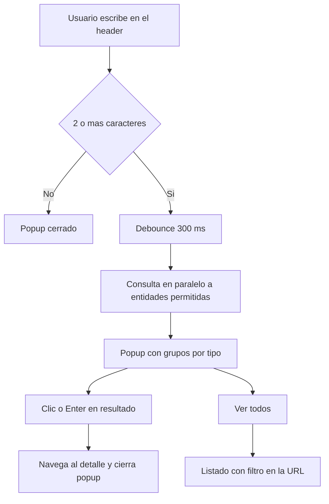
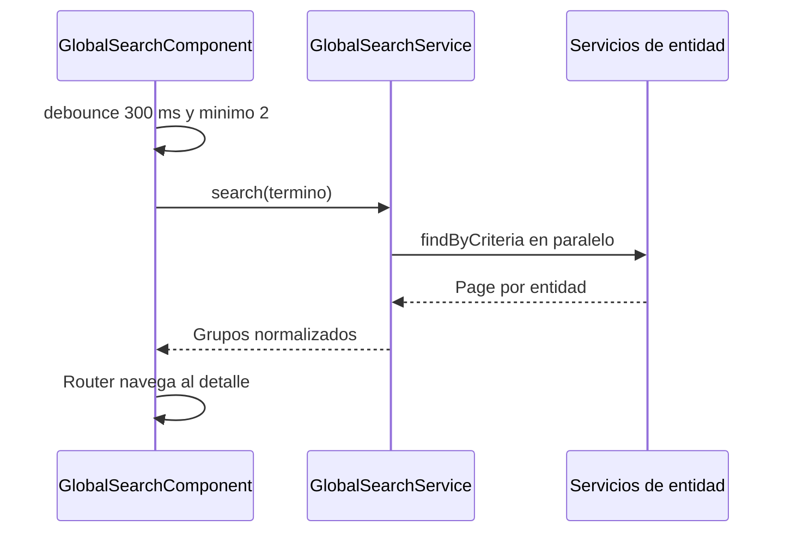

# Buscador global (header)

Documentación funcional y técnica del buscador global del header. Permite buscar desde un único campo, de forma transversal, en usuarios, parámetros e interfaces, mostrar los resultados agrupados por tipo en un popup y navegar al detalle o al listado filtrado.

- **Ubicación:** barra superior (`layout.component.html`), sustituye al antiguo input decorativo `.header-search`
- **Componente:** `GlobalSearchComponent` (`core/layout/global-search/`)
- **Servicio:** `GlobalSearchService` (`core/services/global-search.service.ts`, facade)
- **Endpoint nuevo:** `GET /api/v1/interfaces/configuration/search`
- **Acceso:** sesión autenticada; cada entidad solo se consulta si el usuario tiene su permiso de lectura o escritura
- **Especificación de origen:** [requirements](../../../.kiro/specs/global-search/requirements.md), [design](../../../.kiro/specs/global-search/design.md) y [tasks](../../../.kiro/specs/global-search/tasks.md)

---

## 1. Requisitos

Identificadores locales de este documento: `RF-GSR-*` (funcionales) y `RNF-GSR-*` (no funcionales). El detalle completo de cada requisito está en la especificación de origen (`RF-1..6`, `RNF-1..5`); aquí se resume.

### 1.1. Requisitos funcionales

#### RF-GSR-1: Activación de la búsqueda

**Criterios de aceptación:**
- AC1.1: La búsqueda se lanza al escribir, con debounce de 300 ms.
- AC1.2: Con menos de 2 caracteres no se lanza ninguna petición ni se abre el popup.
- AC1.3: La coincidencia es parcial e insensible a mayúsculas.

#### RF-GSR-2: Búsqueda multi-entidad con permisos

**Criterios de aceptación:**
- AC2.1: Se consultan en paralelo las entidades permitidas (usuarios por `username`, parámetros por `code`, interfaces por `name`), con `size = 5`.
- AC2.2: Las entidades sin permiso no se consultan ni se muestran.

#### RF-GSR-3: Popup de resultados agrupados

**Criterios de aceptación:**
- AC3.1: Los resultados se agrupan por tipo, con encabezado y contador de coincidencias.
- AC3.2: Cada resultado muestra texto principal y secundario (perfil, tipo o protocolo).
- AC3.3: Si hay más coincidencias que el límite, el grupo ofrece *Ver todos*, que abre el listado con el filtro aplicado.

#### RF-GSR-4: Navegación

**Criterios de aceptación:**
- AC4.1: Activar un resultado navega al detalle mediante deep-linking por query params (`view`/`id`, o `code` en parámetros).
- AC4.2: El popup se cierra tras navegar.

#### RF-GSR-5: Estados y degradación elegante

**Criterios de aceptación:**
- AC5.1: Se muestran los estados de carga, vacío y error parcial.
- AC5.2: Si una entidad falla, se muestran las demás y el grupo fallido indica el error.

#### RF-GSR-6: Cierre del popup

**Criterios de aceptación:**
- AC6.1: El popup se cierra con `Escape`, clic fuera, al navegar y al vaciar el campo.
- AC6.2: Al cerrar con teclado, el foco vuelve al campo.

### 1.2. Requisitos no funcionales

- **RNF-GSR-1 (Accesibilidad):** patrón *Combobox ARIA* (`role="combobox"`, `aria-expanded`, `aria-controls`, `aria-activedescendant`), popup `role="listbox"`, opciones `role="option"`, navegación con ↑/↓/Enter/Escape y región `aria-live="polite"` para la carga.
- **RNF-GSR-2 (Rendimiento):** debounce, `switchMap` para descartar respuestas obsoletas, `forkJoin` en paralelo y límite de resultados por entidad.
- **RNF-GSR-3 (Seguridad):** los permisos del facade coinciden con los de `actionGuard`; no se exponen datos sensibles.
- **RNF-GSR-4 (Idioma):** textos bajo el grupo i18n `globalSearch.*`, simétrico en ES y EN.
- **RNF-GSR-5 (Dependencias):** no se añaden dependencias nuevas.

---

## 2. Parte funcional

### 2.1. Objetivo

Dar acceso rápido a registros de varios módulos sin navegar antes a cada listado.

### 2.2. Entidades buscables

| Entidad    | Campo buscado | Detalle (ruta y query params)                         | Permisos (cualquiera)                             |
|------------|---------------|-------------------------------------------------------|---------------------------------------------------|
| Usuarios   | `username`    | `/administration/security/users?view=detail&id={id}`  | `USER_READ`, `USER_WRITE`                         |
| Parámetros | `code`        | `/administration/parameters?view=detail&code={code}`  | `SYSTEM_PARAMETER_READ`, `SYSTEM_PARAMETER_WRITE` |
| Interfaces | `name`        | `/interfaces/configuration?view=detail&id={id}`       | `INTERFACES_READ`                                 |

### 2.3. Flujo

### 2.4. Estados del popup

| Estado        | Condición                                   | Clave i18n                 |
|---------------|---------------------------------------------|----------------------------|
| Cargando      | Peticiones en vuelo                         | `globalSearch.loading`     |
| Vacío         | Ninguna entidad con coincidencias           | `globalSearch.empty`       |
| Error parcial | Una entidad falla; las demás se muestran    | `globalSearch.groupError`  |
| Resultados    | Al menos un grupo con coincidencias         | `globalSearch.groups.*`    |

### 2.5. Identificadores para pruebas (`data-testid`)

| Elemento                 | `data-testid`                                |
|--------------------------|----------------------------------------------|
| Campo de búsqueda        | `input-global-search`                        |
| Popup                    | `global-search-popup`                        |
| Región de carga (live)   | `global-search-live`                         |
| Indicador de carga       | `global-search-loading`                      |
| Estado vacío             | `global-search-empty`                        |
| Grupo / contador / error | `global-search-group-{type}` / `global-search-count-{type}` / `global-search-error-{type}` |
| Resultado                | `global-search-result`                       |
| Ver todos                | `global-search-see-all-{type}`               |

`{type}` es `user`, `parameter` o `interface`.

### 2.6. Mensajes e internacionalización

Claves en `es.json` y `en.json`: `globalSearch.placeholder`, `globalSearch.groups.{user|parameter|interface}`, `globalSearch.seeAll`, `globalSearch.empty`, `globalSearch.loading`, `globalSearch.groupError`. La simetría se verifica con `translation-completeness.property.spec.ts`.

---

## 3. Parte técnica

### 3.1. Componentes afectados

| Capa      | Elemento                                         | Responsabilidad                                                                 |
|-----------|--------------------------------------------------|---------------------------------------------------------------------------------|
| Frontend  | `GlobalSearchComponent`                          | Vista: campo, debounce, popup, teclado, estados y navegación. No usa `HttpClient`. |
| Frontend  | `GlobalSearchService`                            | Facade: filtra por permisos, `forkJoin`, `catchError` por entidad, normaliza.   |
| Frontend  | `global-search.model.ts`                         | `SearchEntityType`, `SearchResultItem`, `SearchResultGroup`.                    |
| Frontend  | `InterfaceService.findConfigurationsByCriteria`  | Cliente del nuevo endpoint (`InterfaceConfigCriteria`).                         |
| Frontend  | `layout.component.html`                          | Integra el componente en la barra superior.                                     |
| Backend   | `InterfaceCriteria`, `InterfaceRepository`, `InterfaceService.findByCriteria` | Criterios y consulta paginada (`JpaSpecificationExecutor`). |
| Backend   | `InterfaceController`                            | Expone `GET /configuration/search`.                                             |

### 3.2. Endpoint nuevo

`GET /api/v1/interfaces/configuration/search` con `page`, `size`, `name`, `protocol`, `status` y `sort`. `name` y `protocol` son parciales e insensibles a mayúsculas; `status` es exacto. Respuesta 200 con `Page<InterfaceDTO>`. Requiere `INTERFACES_READ` (regla `GET /api/v1/interfaces/**` en `SecurityConfig`). `GET /configuration` no cambia. Ver [configuración de interfaces](../interfaces/configuration/configuration.md#33-endpoints) y [API](../../03-technical/backend/api.md).

### 3.3. Filtros de listado desde la URL

Para que *Ver todos* preseleccione el filtro, los listados leen query params en `restoreViewFromParams`: `username` (usuarios), `code` (parámetros) y `name` (configuración de interfaces). En parámetros, `code` solo actúa como filtro si no hay `view`; con `view=detail|edit` identifica el registro. Ver [filtros de listados](../../03-technical/frontend/list-filters.md).

### 3.4. Secuencia

### 3.5. Seguridad y permisos

El facade usa `AuthService.hasAction` con cualquiera de las acciones de la ruta (incluidas `*_WRITE`). Cualquier cambio de permisos de rutas debe reflejarse en el facade.

---

## 4. Pruebas

### 4.1. Cobertura unitaria (backend)

`InterfaceServiceTest` (criterios) e `InterfaceControllerTest` (endpoint `search`).

### 4.2. Cobertura unitaria (frontend)

| Ubicación                          | Alcance                                                                  |
|------------------------------------|--------------------------------------------------------------------------|
| `global-search.service.spec.ts`    | Permisos, paralelismo, normalización y error parcial                     |
| `global-search.component.spec.ts`  | Debounce, grupos, estados, navegación, cierre y ARIA/teclado             |
| `interface.service.spec.ts`        | Petición de `findConfigurationsByCriteria`                               |

### 4.3. Cobertura E2E (Playwright)

Ubicación: `dashboard/e2e/tests/global-search/global-search.spec.ts` (Page Object `dashboard/e2e/pages/global-search.page.ts`). Escribe el `username` del administrador, comprueba popup, grupos y resultados, abre el primero y verifica la URL con `view=detail` y el popup cerrado.

### 4.4. Datos de prueba

`testUsers.valid` en `dashboard/e2e/fixtures/test-data.ts`; el propio administrador es el registro a buscar.

### 4.5. Dependencias de ejecución

Requiere backend de integración levantado y un usuario con `USER_READ`.

### 4.6. Casos de prueba detallados (TCY-GSR)

Para variables (`{{BASE_URL_UI}}`, `{{ADMIN_USER}}`) y modelo de ejecución, consultar el [Plan Maestro de Pruebas](../../specification/test-case.md). Los casos son independientes y hacen su propio login.

#### TC-GSR-01 · Búsqueda y navegación al detalle

- **Versión:** 1.0 · **Prioridad:** Alta · **Tipo:** Funcional, E2E · **Traza:** RF-GSR-1, RF-GSR-3, RF-GSR-4 · **Independiente:** Sí · **Dependencias:** ninguna
- **Setup:** login con `{{ADMIN_USER}}`.
- **Teardown:** logout.

| # | Acción                                                  | Resultado esperado                                              |
|---|---------------------------------------------------------|-----------------------------------------------------------------|
| 1 | Escribir `admin` en `input-global-search`               | Tras ~300 ms se abre `global-search-popup` con grupos por tipo   |
| 2 | Pulsar `global-search-result` del grupo de usuarios     | Se navega a una URL con `view=detail` y el popup se cierra      |

#### TC-GSR-02 · Mínimo de caracteres

- **Versión:** 1.0 · **Prioridad:** Media · **Tipo:** Funcional · **Traza:** RF-GSR-1 (AC1.2) · **Independiente:** Sí · **Dependencias:** ninguna
- **Setup:** login con `{{ADMIN_USER}}`.
- **Teardown:** logout.

| # | Acción                                  | Resultado esperado                                  |
|---|-----------------------------------------|-----------------------------------------------------|
| 1 | Escribir un solo carácter               | No se lanza ninguna petición y el popup no se abre  |
| 2 | Escribir `zzz_inexistente`              | El popup muestra `global-search-empty`              |

#### TC-GSR-03 · Respeto de permisos

- **Versión:** 1.0 · **Prioridad:** Alta · **Tipo:** Seguridad · **Traza:** RF-GSR-2 (AC2.2), RNF-GSR-3 · **Independiente:** Sí · **Dependencias:** requiere un usuario sin `INTERFACES_READ`
- **Setup:** login con ese usuario.
- **Teardown:** logout.

| # | Acción                                           | Resultado esperado                                              |
|---|--------------------------------------------------|-----------------------------------------------------------------|
| 1 | Buscar un término que coincida con una interfaz  | No aparece el grupo `global-search-group-interface`             |

#### TC-GSR-04 · Degradación elegante

- **Versión:** 1.0 · **Prioridad:** Media · **Tipo:** Funcional · **Traza:** RF-GSR-5 (AC5.2) · **Independiente:** Sí · **Dependencias:** ninguna
- **Setup:** login con `{{ADMIN_USER}}`; interceptar `GET /api/v1/interfaces/configuration/search` para devolver 500.
- **Teardown:** retirar la intercepción; logout.

| # | Acción                           | Resultado esperado                                                                      |
|---|----------------------------------|-----------------------------------------------------------------------------------------|
| 1 | Buscar `admin`                   | Se muestran los grupos de usuarios y parámetros; el de interfaces muestra `global-search-error-interface` |

#### TC-GSR-05 · Teclado y accesibilidad

- **Versión:** 1.0 · **Prioridad:** Media · **Tipo:** Funcional, Accesibilidad · **Traza:** RNF-GSR-1, RF-GSR-6 · **Independiente:** Sí · **Dependencias:** ninguna
- **Setup:** login con `{{ADMIN_USER}}`.
- **Teardown:** logout.

| # | Acción                                  | Resultado esperado                                                                              |
|---|-----------------------------------------|-------------------------------------------------------------------------------------------------|
| 1 | Buscar `admin` y pulsar ↓               | El campo (`role="combobox"`) actualiza `aria-activedescendant` y la opción tiene `aria-selected="true"` |
| 2 | Pulsar `Escape`                         | El popup se cierra y el foco vuelve a `input-global-search`                                     |

#### TC-GSR-06 · Ver todos con filtro en la URL

- **Versión:** 1.0 · **Prioridad:** Media · **Tipo:** Funcional · **Traza:** RF-GSR-3 (AC3.3) · **Independiente:** Sí · **Dependencias:** más de 5 coincidencias en alguna entidad
- **Setup:** login con `{{ADMIN_USER}}`.
- **Teardown:** logout.

| # | Acción                                         | Resultado esperado                                                               |
|---|------------------------------------------------|----------------------------------------------------------------------------------|
| 1 | Buscar un término común y pulsar *Ver todos*   | Se abre el listado con el query param (`username`, `code` o `name`) y el filtro precargado |

---

## Referencias

- [Layout (barra superior)](../../03-technical/frontend/layout.md)
- [Filtros de listados](../../03-technical/frontend/list-filters.md)
- [Internacionalización](../../03-technical/frontend/internacionalizacion.md)
- [Configuración de interfaces](../interfaces/configuration/configuration.md)
- [Plan Maestro de Pruebas](../../specification/test-case.md)
- [Glosario](../../specification/glossary.md)
