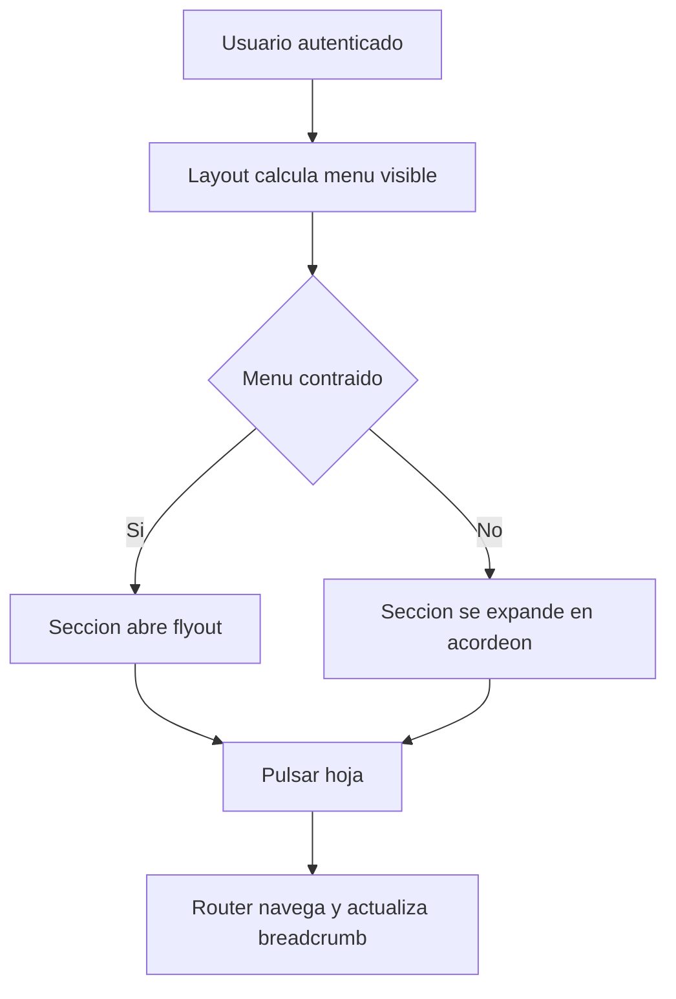
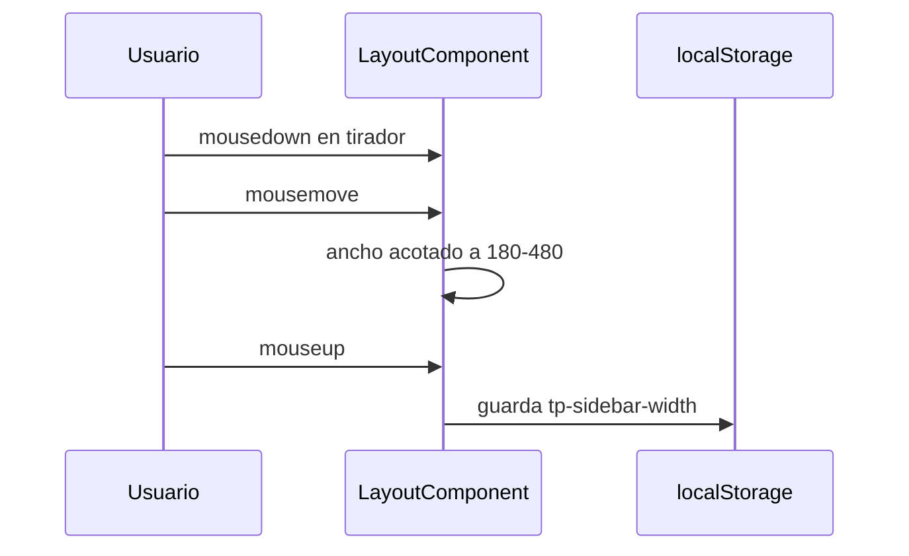

# Layout de la aplicación

Documentación funcional y técnica del layout: la estructura visual que envuelve todas las pantallas autenticadas (menú lateral, barra superior, breadcrumb, área de contenido y pie). Este documento recoge los requisitos y las pruebas; el diseño visual, los wireframes y los patrones de pantalla están en [Layout (técnico)](../../03-technical/frontend/layout.md).

- **Componente:** `LayoutComponent` (`core/layout/`)
- **Subcomponente:** `GlobalSearchComponent` (ver [Buscador global](../global-search/global-search.md))
- **Acceso:** toda ruta autenticada se renderiza dentro del `router-outlet` del layout
- **Persistencia local:** `localStorage` (`tp-sidebar-collapsed`, `tp-sidebar-width`)

---

## 1. Requisitos

Identificadores locales de este documento: `RF-LAY-*` (funcionales) y `RNF-LAY-*` (no funcionales).

### 1.1. Requisitos funcionales

#### RF-LAY-1: Estructura de la página

**Criterios de aceptación:**
- AC1.1: El layout contiene menú lateral (`nav`), cabecera (`header`, `role="banner"`), breadcrumb, contenido (`main`) y pie (`footer`, `role="contentinfo"`).
- AC1.2: Existe un enlace de salto al contenido principal (`#tp-main-content`), visible al recibir foco.

#### RF-LAY-2: Menú según permisos

**Criterios de aceptación:**
- AC2.1: Cada elemento del menú se muestra solo si el usuario tiene alguna de sus acciones requeridas.
- AC2.2: Una sección padre es visible si al menos uno de sus hijos lo es.
- AC2.3: Sin acciones no se muestra ningún elemento; con todas, se muestran todos.
- AC2.4: El menú incluye Dashboard, Informes (según los informes del usuario), Interfaces y Administración (Seguridad, Parámetros, Auditoría y Cluster).

#### RF-LAY-3: Secciones desplegables en acordeón

**Criterios de aceptación:**
- AC3.1: Pulsar una sección la expande o contrae y refleja `aria-expanded`.
- AC3.2: Al abrir una sección se cierran las demás ramas, conservando abiertos sus ancestros.
- AC3.3: Al pulsar una hoja de primer nivel se cierran todas las secciones; al pulsar una hoja anidada se mantienen abiertos sus ancestros.
- AC3.4: Se admiten tres niveles (p. ej. Administración › Seguridad › Usuarios).

#### RF-LAY-4: Menú lateral contraíble

**Criterios de aceptación:**
- AC4.1: El menú arranca expandido y un botón lo contrae o expande (`aria-expanded`).
- AC4.2: El estado se guarda en `localStorage` y se restaura al iniciar.
- AC4.3: Contraído, los elementos muestran su texto como `title`, y una sección pulsada se abre como flyout sin expandir el menú.
- AC4.4: El flyout se cierra con clic fuera, con `Escape` y tras pulsar una hoja.
- AC4.5: Contraído, una rama con descendiente activo se señala (`has-active-child`), incluso en subrutas de detalle.

#### RF-LAY-5: Ancho ajustable del menú

**Criterios de aceptación:**
- AC5.1: En escritorio, arrastrar el tirador modifica el ancho siguiendo el ratón.
- AC5.2: El ancho se limita al rango 180–480 px.
- AC5.3: Al soltar se guarda el ancho; un ancho guardado válido se restaura al iniciar.
- AC5.4: El doble clic en el tirador restablece el ancho por defecto (260 px).
- AC5.5: No se puede redimensionar con el menú contraído.

#### RF-LAY-6: Menú móvil

**Criterios de aceptación:**
- AC6.1: En móvil, un botón de hamburguesa abre y cierra el menú.
- AC6.2: Con el menú móvil abierto se muestra un fondo (`sidebar-backdrop`) que lo cierra al pulsarlo.

#### RF-LAY-7: Barra superior

**Criterios de aceptación:**
- AC7.1: Contiene el buscador global, el panel de notificaciones y el menú de usuario.
- AC7.2: El panel de notificaciones muestra el mensaje de sin notificaciones.
- AC7.3: El menú de usuario muestra iniciales, nombre completo, enlace a *Mi perfil*, enlace a *Configuración* (solo con `SYSTEM_PARAMETER_READ` o `SYSTEM_PARAMETER_WRITE`) y la opción de cerrar sesión.

#### RF-LAY-8: Cierre de sesión

**Criterios de aceptación:**
- AC8.1: Cerrar sesión redirige a `/login`.
- AC8.2: La redirección se produce también si la petición de logout falla.

#### RF-LAY-9: Breadcrumb

**Criterios de aceptación:**
- AC9.1: Se construye a partir de la URL (sin query params), con los ancestros enlazados y la página actual como activa (`aria-current="page"`).
- AC9.2: Admite títulos personalizados, como el nombre del informe en el detalle de un informe.

#### RF-LAY-10: Pie de página

**Criterios de aceptación:**
- AC10.1: Muestra título de la aplicación, versión (de `package.json`) y entorno.
- AC10.2: Muestra el año actual y el titular configurado (`applicationOwner`).

### 1.2. Requisitos no funcionales

- **RNF-LAY-1 (Accesibilidad):** landmarks semánticos, `aria-label` en navegación, botones de alternancia con `aria-expanded`, enlace de salto y elementos interactivos con `data-testid`.
- **RNF-LAY-2 (Idioma):** textos bajo `layout.*` y `menu.*`, simétricos en ES y EN.
- **RNF-LAY-3 (Responsive):** comportamiento diferenciado en escritorio (menú fijo, contraíble y redimensionable) y móvil (menú superpuesto con fondo).
- **RNF-LAY-4 (Seguridad):** la visibilidad del menú es solo de experiencia de usuario; la autorización real la imponen `actionGuard` y el backend.
- **RNF-LAY-5 (Dependencias):** no se añaden dependencias nuevas.

---

## 2. Parte funcional

### 2.1. Objetivo

Dar una navegación y un marco homogéneos a todas las pantallas, adaptados a los permisos del usuario y al dispositivo.

### 2.2. Estructura del menú

| Elemento          | Ruta                       | Acciones requeridas (cualquiera) |
|-------------------|----------------------------|----------------------------------|
| Dashboard         | `/dashboard`               | `DASHBOARD_READ`                 |
| Informes          | Detalle por informe        | `REPORT_READ`                    |
| Interfaces        | Monitor y configuración    | `INTERFACES_READ`                |
| Administración    | Sección                    | Unión de las de sus hijos        |
| › Seguridad       | Usuarios, perfiles, acciones | `USER_*`, `PROFILE_*`, `ACTION_READ` |
| › Parámetros      | `/administration/parameters` | `SYSTEM_PARAMETER_READ`, `SYSTEM_PARAMETER_WRITE` |
| › Auditoría       | `/administration/audit`    | `SYSTEM_LOG_READ`                |
| › Cluster         | Nodos y bloqueos           | `CLUSTER_NODE_*`, `CLUSTER_LOCK_READ` |

### 2.3. Flujo de navegación

### 2.4. Valores de persistencia y límites

| Clave en `localStorage` | Valor                         | Por defecto |
|-------------------------|-------------------------------|-------------|
| `tp-sidebar-collapsed`  | `true` o `false`              | `false`     |
| `tp-sidebar-width`      | Entero entre 180 y 480        | 260         |

### 2.5. Identificadores para pruebas (`data-testid`)

| Elemento                                | `data-testid`                          |
|-----------------------------------------|----------------------------------------|
| Alternar menú (escritorio / móvil)      | `btn-sidebar-toggle` / `btn-mobile-menu` |
| Fondo del menú móvil                    | `sidebar-backdrop`                     |
| Tirador de ancho                        | `sidebar-resize-handle`                |
| Sección y hoja del menú                 | `nav-toggle-{labelKey}` / `nav-{labelKey}` |
| Notificaciones                          | `btn-notifications`                    |
| Menú de usuario, perfil, configuración, logout | `btn-user-menu`, `link-user-profile`, `link-user-configuration`, `btn-logout` |
| Pie: versión y titular                  | `footer-version` / `footer-owner`      |
| Buscador global                         | `input-global-search`                  |

### 2.6. Mensajes e internacionalización

Claves en `es.json` y `en.json`: `layout.skipToContent`, `layout.sidebar.{navigation|menu|expand|collapse|resize}`, `layout.header.{notifications|noNotifications}`, `layout.user.{profile|configuration|logout}`, `menu.*` y `app.title`.

---

## 3. Parte técnica

### 3.1. Componentes afectados

| Capa     | Elemento                       | Responsabilidad                                                                     |
|----------|--------------------------------|-------------------------------------------------------------------------------------|
| Frontend | `LayoutComponent`              | Estructura, menú, breadcrumb, estado del menú, redimensionado y logout.             |
| Frontend | `GlobalSearchComponent`        | Buscador de la cabecera.                                                            |
| Frontend | `AuthService`                  | Usuario actual, `hasAction` y logout.                                               |
| Frontend | `ReportService` (informes del usuario) | Alimenta los hijos del menú Informes y el título del breadcrumb.            |
| Frontend | `environment` y `package.json` | Entorno, titular y versión del pie.                                                 |

### 3.2. Reglas de estado

| Estado                | Origen                                           | Efecto                                              |
|-----------------------|--------------------------------------------------|-----------------------------------------------------|
| `sidebarCollapsed`    | Señal con persistencia                           | Clase `sidebar-collapsed` y flyout                  |
| `sidebarWidth`        | Señal con persistencia y límites                 | Ancho del menú y margen del contenido               |
| `mobileMenuOpen`      | Señal                                            | Menú superpuesto y fondo                            |
| Secciones abiertas    | Conjunto de claves (acordeón)                    | Ramas expandidas                                    |
| `computedNavItems`    | Estructura fija más informes del usuario         | Árbol de navegación                                 |

### 3.3. Secuencia de redimensionado

### 3.4. Seguridad y permisos

El layout oculta opciones según `AuthService.hasAction`, pero no autoriza. Las rutas se protegen con `actionGuard` y los endpoints con `SecurityConfig`. Ver [seguridad](../../03-technical/backend/security.md).

---

## 4. Pruebas

### 4.1. Cobertura unitaria (backend)

No aplica.

### 4.2. Cobertura unitaria (frontend)

| Ubicación                            | Alcance                                                                                                                      |
|--------------------------------------|------------------------------------------------------------------------------------------------------------------------------|
| `layout.component.spec.ts`           | Landmarks y `data-testid`, menú y jerarquía, acordeón, flyout, rama activa, persistencia del menú, versión, entorno y titular del pie, menú móvil, breadcrumb y logout |
| `layout.component.behavior.spec.ts`  | Redimensionado (arrastre, límites, persistencia, doble clic, menú contraído), restauración de ancho y estado, logout con fallo, fondo móvil y breadcrumb |
| `layout.component.property.spec.ts`  | Propiedad: la visibilidad del menú coincide con las acciones del usuario (hijos, padres, sin acciones, todas, una sola)       |
| `global-search.component.spec.ts`    | Ver [Buscador global](../global-search/global-search.md#42-cobertura-unitaria-frontend)                                      |

### 4.3. Cobertura E2E (Playwright)

Sin cobertura E2E específica del layout; el login y el resto de ciclos lo atraviesan. Los casos `TC-LAY-*` se validan con los tests unitarios y de forma manual.

### 4.4. Datos de prueba

`testUsers.valid` en `dashboard/e2e/fixtures/test-data.ts`.

### 4.5. Dependencias de ejecución

Backend de integración levantado. Para `TC-LAY-02` se necesita un usuario con un subconjunto de permisos.

### 4.6. Casos de prueba detallados (TCY-LAY)

Para variables (`{{BASE_URL_UI}}`, `{{ADMIN_USER}}`) y modelo de ejecución, consultar el [Plan Maestro de Pruebas](../../specification/test-case.md). Los casos son independientes y hacen su propio login.

#### TC-LAY-01 · Estructura y pie de página

- **Versión:** 1.0 · **Prioridad:** Media · **Tipo:** Funcional, Accesibilidad · **Traza:** RF-LAY-1, RF-LAY-10, RNF-LAY-1 · **Independiente:** Sí · **Dependencias:** ninguna
- **Setup:** login con `{{ADMIN_USER}}`.
- **Teardown:** logout.

| # | Acción                         | Resultado esperado                                                                   |
|---|--------------------------------|--------------------------------------------------------------------------------------|
| 1 | Abrir `/dashboard`             | Hay cabecera, menú, breadcrumb, contenido y pie                                      |
| 2 | Revisar `footer-version`       | Muestra título, versión y entorno                                                    |
| 3 | Revisar `footer-owner`         | Muestra el año actual y el titular                                                   |
| 4 | Pulsar Tab                     | Aparece el enlace de salto al contenido                                              |

#### TC-LAY-02 · Menú según permisos

- **Versión:** 1.0 · **Prioridad:** Alta · **Tipo:** Seguridad · **Traza:** RF-LAY-2, RNF-LAY-4 · **Independiente:** Sí · **Dependencias:** usuario con un subconjunto de permisos
- **Setup:** login con ese usuario.
- **Teardown:** logout.

| # | Acción                          | Resultado esperado                                                         |
|---|---------------------------------|----------------------------------------------------------------------------|
| 1 | Revisar el menú                 | Solo aparecen los elementos cuyas acciones tiene el usuario                |
| 2 | Revisar una sección padre       | Es visible porque al menos un hijo lo es                                   |
| 3 | Comparar con el administrador   | El administrador ve todos los elementos                                    |

#### TC-LAY-03 · Acordeón del menú

- **Versión:** 1.0 · **Prioridad:** Media · **Tipo:** Funcional · **Traza:** RF-LAY-3 · **Independiente:** Sí · **Dependencias:** ninguna
- **Setup:** login con `{{ADMIN_USER}}`.
- **Teardown:** logout.

| # | Acción                                           | Resultado esperado                                                   |
|---|--------------------------------------------------|----------------------------------------------------------------------|
| 1 | Pulsar la sección Administración                 | Se expande y `aria-expanded` pasa a `true`                           |
| 2 | Pulsar Seguridad                                 | Aparecen Usuarios, Perfiles y Acciones                               |
| 3 | Pulsar la sección Interfaces                     | Administración se cierra                                             |
| 4 | Pulsar Dashboard                                 | Todas las secciones se cierran                                       |

#### TC-LAY-04 · Menú contraído y persistencia

- **Versión:** 1.0 · **Prioridad:** Media · **Tipo:** Funcional · **Traza:** RF-LAY-4 · **Independiente:** Sí · **Dependencias:** ninguna
- **Setup:** login con `{{ADMIN_USER}}`; `localStorage` sin `tp-sidebar-collapsed`.
- **Teardown:** logout; restaurar `localStorage`.

| # | Acción                                  | Resultado esperado                                                     |
|---|-----------------------------------------|------------------------------------------------------------------------|
| 1 | Pulsar `btn-sidebar-toggle`             | El menú se contrae y `aria-expanded` es `false`                        |
| 2 | Pulsar la sección Administración        | Se abre como flyout sin expandir el menú                               |
| 3 | Pulsar `Escape`                         | El flyout se cierra                                                    |
| 4 | Recargar la página                      | El menú sigue contraído                                                |

#### TC-LAY-05 · Ancho ajustable

- **Versión:** 1.0 · **Prioridad:** Baja · **Tipo:** Funcional · **Traza:** RF-LAY-5 · **Independiente:** Sí · **Dependencias:** viewport de escritorio
- **Setup:** login con `{{ADMIN_USER}}`; menú expandido.
- **Teardown:** doble clic en el tirador; logout.

| # | Acción                                               | Resultado esperado                                           |
|---|------------------------------------------------------|--------------------------------------------------------------|
| 1 | Arrastrar `sidebar-resize-handle` hacia la derecha   | El menú se ensancha hasta un máximo de 480 px                |
| 2 | Arrastrarlo hacia la izquierda más allá del mínimo   | El ancho se detiene en 180 px                                |
| 3 | Recargar la página                                   | Se mantiene el ancho                                         |
| 4 | Doble clic en el tirador                             | Vuelve a 260 px                                              |

#### TC-LAY-06 · Menú móvil

- **Versión:** 1.0 · **Prioridad:** Media · **Tipo:** Funcional, Responsive · **Traza:** RF-LAY-6, RNF-LAY-3 · **Independiente:** Sí · **Dependencias:** viewport móvil
- **Setup:** login con `{{ADMIN_USER}}`.
- **Teardown:** logout.

| # | Acción                               | Resultado esperado                                         |
|---|--------------------------------------|------------------------------------------------------------|
| 1 | Pulsar `btn-mobile-menu`             | El menú se abre y aparece `sidebar-backdrop`               |
| 2 | Pulsar `sidebar-backdrop`            | El menú y el fondo se cierran                              |

#### TC-LAY-07 · Menú de usuario

- **Versión:** 1.0 · **Prioridad:** Media · **Tipo:** Funcional · **Traza:** RF-LAY-7 · **Independiente:** Sí · **Dependencias:** ninguna
- **Setup:** login con `{{ADMIN_USER}}`.
- **Teardown:** logout.

| # | Acción                                  | Resultado esperado                                                       |
|---|-----------------------------------------|--------------------------------------------------------------------------|
| 1 | Abrir `btn-user-menu`                   | Se ven `link-user-profile`, `link-user-configuration` y `btn-logout`     |
| 2 | Abrir `btn-notifications`               | Se muestra el mensaje de sin notificaciones                              |
| 3 | Pulsar `link-user-profile`              | Navega a `/administration/security/user-me`                              |

#### TC-LAY-08 · Cierre de sesión

- **Versión:** 1.0 · **Prioridad:** Alta · **Tipo:** Funcional, Seguridad · **Traza:** RF-LAY-8 · **Independiente:** Sí · **Dependencias:** ninguna
- **Setup:** login con `{{ADMIN_USER}}`; opcionalmente interceptar la petición de logout para devolver 500.
- **Teardown:** retirar la intercepción.

| # | Acción                         | Resultado esperado                                    |
|---|--------------------------------|-------------------------------------------------------|
| 1 | Pulsar `btn-logout`            | Redirige a `/login`                                   |
| 2 | Repetir con la petición fallida | Redirige igualmente a `/login`                       |

#### TC-LAY-09 · Breadcrumb

- **Versión:** 1.0 · **Prioridad:** Baja · **Tipo:** Funcional · **Traza:** RF-LAY-9 · **Independiente:** Sí · **Dependencias:** ninguna
- **Setup:** login con `{{ADMIN_USER}}`.
- **Teardown:** logout.

| # | Acción                                           | Resultado esperado                                                             |
|---|--------------------------------------------------|--------------------------------------------------------------------------------|
| 1 | Navegar a Administración › Seguridad › Usuarios  | El breadcrumb muestra los ancestros enlazados y Usuarios como página actual    |
| 2 | Pulsar un ancestro                               | Navega a su ruta                                                               |
| 3 | Abrir el detalle de un informe                   | El último segmento muestra el nombre del informe                               |

---

## Referencias

- [Layout (técnico)](../../03-technical/frontend/layout.md)
- [Navegación](../../03-technical/frontend/navigation.md)
- [Buscador global](../global-search/global-search.md)
- [Dashboard](../dashboard/dashboard.md)
- [Internacionalización](../../03-technical/frontend/internacionalizacion.md)
- [Plan Maestro de Pruebas](../../specification/test-case.md)
- [Glosario](../../specification/glossary.md)
