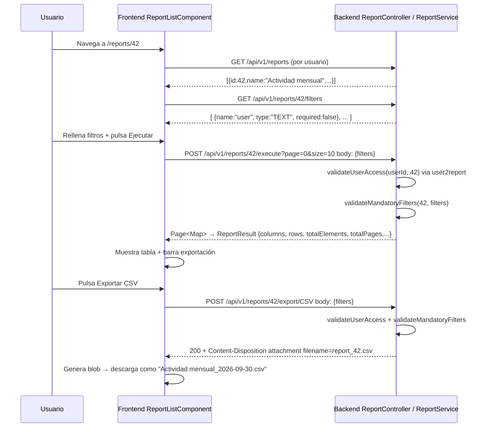

# Informes

Documentación funcional y técnica del módulo de Informes. Permite a los usuarios autorizados ejecutar los informes asignados, con filtros dinámicos por informe, paginación servidor y exportación en múltiples formatos. Además, proporciona un componente reutilizable de selección multiple para asignar informes a usuarios desde mantenimientos.

- **Ruta principal (ejecución):** `/reports/:id` (carga `ReportListComponent`).
- **Componente reutilizable:** `TpReportSelectedListComponent` (`<tp-report-selected-list>`), usado en formularios de mantenimiento de usuarios.
- **Endpoint backend base:** `/api/v1/reports` (`ReportController`).
- **Acceso:** requiere sesión. El módulo y el catálogo (menú, `GET /api/v1/reports/**`) exigen `REPORT_READ`; ejecutar o exportar (`POST /api/v1/reports/**`) requiere además `REPORT_EXECUTE`. La visibilidad de cada informe en el menú y las operaciones `/{id}/filters`, `execute` y `export` validan que el usuario tenga el informe asignado vía `user2report`.

---

## 1. Requisitos

Identificadores locales: `RF-RPT-*` (funcionales) y `RNF-RPT-*` (no funcionales). La autenticación se especifica en [requirements.md](../../specification/requirements.md).

### 1.1. Requisitos funcionales

#### RF-RPT-1: Carga de metadatos y definición de filtros

**Descripción:** al acceder a `/reports/:id`, el sistema carga los metadatos del informe y sus filtros dinámicos sin ejecutar automáticamente la consulta de datos.

**Criterios de aceptación:**

- AC1.1: La cabecera muestra `report.name` y `report.description`.
- AC1.2: Se renderiza una barra de filtros con un control por filtro, según `type`: `TEXT`, `NUMBER`, `DATE`, `SELECT`.
- AC1.3: La tabla de resultados y la barra de exportación aparecen vacías hasta que el usuario pulse *Ejecutar*.
- AC1.4: Si el usuario no tiene el informe asignado en `user2report`, `findByUser` no lo devuelve y el componente queda con `report = null` (sin cabecera, sin ejecución).

#### RF-RPT-2: Filtros dinámicos y obligatorios

**Descripción:** cada informe declara sus propios filtros (obligatorios u opcionales) y el sistema debe validar los obligatorios antes de ejecutar/exportar.

**Criterios de aceptación:**

- AC2.1: `TEXT`/`NUMBER` → `<input>`; `DATE` → `<input type="date">`; `SELECT` → `<select>` con opción vacía `common.all`.
- AC2.2: Los filtros `required=true` se marcan visualmente con asterisco rojo y usan el atributo `required` HTML5.
- AC2.3: *Limpiar* restablece todos los valores a `''`, resetea resultados y vuelve a página 0.
- AC2.4: Si faltan filtros obligatorios, el submit HTML5 bloquea la ejecución y el backend devolvería `ValidationException` de alcanzarse.

#### RF-RPT-3: Ejecución con paginación en servidor

**Descripción:** el usuario pulsa *Ejecutar* y se obtienen resultados paginados del lado del servidor, con navegación y selección de tamaño de página.

**Criterios de aceptación:**

- AC3.1: `POST /api/v1/reports/{id}/execute` con body `filters` y query params `page` / `size` (default `page=0`, `size=10`).
- AC3.2: El backend valida `validateUserAccess` y `validateMandatoryFilters` antes de ejecutar.
- AC3.3: Muestra spinner + notificación `notification.progress` mientras dura la ejecución.
- AC3.4: Renderiza tabla con `ReportResult.columns` como cabeceras y `ReportResult.rows` como filas; si está vacío, `common.noData`.
- AC3.5: Paginador del footer:
  - Anterior / Siguiente y hasta 5 números de página alrededor de la actual.
  - Tamaños de página: 5, 10, 20, 50.
  - Etiqueta `common.pagination.showing` (from/to/total).
- AC3.6: Cualquier cambio de página o tamaño dispara una nueva ejecución servidor con los mismos filtros.

#### RF-RPT-4: Exportación en formatos PDF / XLSX / CSV / TXT

**Descripción:** tras una ejecución exitosa, el usuario puede exportar los resultados con los mismos filtros, en cualquiera de los 4 formatos.

**Criterios de aceptación:**

- AC4.1: La barra de exportación (PDF, XLSX, CSV, TXT) solo aparece si `hasExecuted() == true`.
- AC4.2: Cada botón dispara `POST /api/v1/reports/{id}/export/{format}` con los filtros actuales.
- AC4.3: Backend devuelve bytes con `Content-Type` apropiado y `Content-Disposition: attachment; filename="report_{id}.{ext}"`.
- AC4.4: Frontend renombra la descarga a `${report.name}_YYYY-MM-DD.${format.toLowerCase()}`.
- AC4.5: CSV y TXT están implementados. PDF y XLSX lanzan `ReportExportException: "Export format PDF/XLSX not yet implemented"`; frontend muestra `notification.export.error`.
- AC4.6: Progresos y resultados se notifican (`notification.export.progress`, `notification.export.success`, `notification.export.error`).

#### RF-RPT-5: Selección multiple de informes (componente CVA)

**Descripción:** `<tp-report-selected-list>` gestiona una lista de informes asignados (por ejemplo, en el formulario de usuario) y permite añadirlos mediante un modal paginado servidor.

**Criterios de aceptación:**

- AC5.1: Implementa `ControlValueAccessor` y su valor es `number[]` (IDs de informes).
- AC5.2: Muestra listado de seleccionados vía `tp-data-list` con filtro cliente y botón de eliminar por fila.
- AC5.3: Botón *Añadir* abre un modal con búsqueda servidor y paginación.
- AC5.4: El modal consulta `GET /api/v1/reports/search?name=&page=&size=`.
- AC5.5: Soporta selección multiple y "Seleccionar/Deseleccionar todos de la página".
- AC5.6: Confirmar modal sobreescribe el valor CVA con los IDs seleccionados.
- AC5.7: Cualquier cambio dispara `onTouched()` y `onChange()`.

#### RF-RPT-6: Control de acceso por usuario en el catálogo y los filtros

**Descripción:** la lectura del módulo de informes se separa de su ejecución. El acceso al catálogo (`/all`, `/search`) y a la definición de filtros (`/{id}/filters`), la visibilidad en el menú lateral y la ejecución/exportación quedan restringidos al usuario autenticado y a los informes que tenga asignados.

**Criterios de aceptación:**

- AC6.1: El acceso al módulo y al catálogo (`GET /api/v1/reports/**`) exige la autoridad `REPORT_READ`; ejecutar o exportar (`POST /api/v1/reports/**`) exige `REPORT_EXECUTE`.
- AC6.2: `GET /api/v1/reports` devuelve únicamente los informes asignados al usuario (`user2report`).
- AC6.3: `GET /api/v1/reports/{id}/filters` valida la asignación del informe al usuario y responde `403 Forbidden` (`AccessDeniedException`) si no está asignado.
- AC6.4: El menú lateral solo muestra los informes asignados al usuario; la sección requiere `REPORT_READ`.

### 1.2. Requisitos no funcionales

- **RNF-RPT-1 (Autorización):**
  - `GET /api/v1/reports/**` requiere autoridad `REPORT_READ` y `POST /api/v1/reports/**` requiere `REPORT_EXECUTE` (definidas en `SecurityConfig.java`).
  - `execute`, `export` y `getFilters` validan además la asignación vía `user2report` → `AccessDeniedException` si no existe.
- **RNF-RPT-2 (Integridad de filtros):** doble validación (HTML5 required en formulario + `validateMandatoryFilters` backend) antes de consultar datos.
- **RNF-RPT-3 (Paginación servidor):** resultados, búsqueda modal y ejecuciones usan siempre `Pageable`; no se emula paginación en cliente.
- **RNF-RPT-4 (i18n):** textos de la pantalla bajo claves `reports.*`, `common.*` y `selected-reports.*`.
- **RNF-RPT-5 (Sesión):** `ReportController.getAuthenticatedUserId()` resuelve el usuario a partir del `Authentication` de Spring Security y consulta `UserService.findByUsername`.
- **RNF-RPT-6 (Feedback):** `NotificationService` informa de progreso, éxito y error en ejecuciones y exportaciones.
- **RNF-RPT-7 (Codificación exportación):**
  - CSV UTF-8 sin BOM; campos con `,`, `"` o `\n` se entrecomillan y doblan comillas internas.
  - TXT UTF-8 con cabecera y separador `---`.
  - PDF y XLSX reservados para integraciones reales (placeholder con `ReportExportException`).
- **RNF-RPT-8 (Mínimo privilegio):** la lectura del catálogo se separa de la ejecución mediante la acción `REPORT_READ`, de modo que un usuario con permiso de ejecución no pueda enumerar informes ni definiciones de filtros que no le han sido asignados (SEC-08).

---

## 2. Parte funcional

### 2.1. Objetivo

Pantalla paramétrica común para ejecutar cualquier informe y exportarlo en varios formatos, más un componente reutilizable CVA para asignar informes en mantenimientos.

### 2.2. Vistas de la pantalla

#### Vista de ejecución (`ReportListComponent`)

Ruta `/reports/:id`. Flujo:

1. Cabecera (nombre y descripción del informe).
2. Barra de filtros dinámica + botones *Limpiar* / *Ejecutar*.
3. Barra de exportación (solo post-ejecución).
4. Tabla de resultados paginada servidor.

#### Vista de selección multiple (`TpReportSelectedListComponent`)

Integrable en formularios. Cuenta con:

1. Listado de informes asignados, filtrado cliente y opción de quitar.
2. Botón *Añadir* → modal paginado servidor con búsqueda y selección multiple.

### 2.3. Patrón visual reutilizable y wireframes

#### Pantalla de ejecución de informe

```text
┌─────────────────────────────────────────────────────────────────────────────┐
│ Nombre del informe (h1)                                                     │
│ Descripción breve del informe                                               │
├─────────────────────────────────────────────────────────────────────────────┤
│ [Filtro 1 *] [Filtro 2] [Fecha desde ▾] [Sección ▾]   [Limpiar] [Ejecutar] │
├─────────────────────────────────────────────────────────────────────────────┤
│ [PDF] [XLSX] [CSV] [TXT]                                           (solo tras ejecutar) │
├─────────────────────────────────────────────────────────────────────────────┤
│ columna A │ columna B │ columna C │ …                                       │
│─────────────────────────────────────────────────────────────────────────────│
│ A1        │ B1        │ C1        │ …                                       │
│ A2        │ B2        │ C2        │ …                                       │
├─────────────────────────────────────────────────────────────────────────────┤
│ Mostrando 1–10 de 234           < 1 2 3 4 5 >      Tamaño página [10 ▾]    │
└─────────────────────────────────────────────────────────────────────────────┘
```

#### Modal de selección multiple de informes

```text
┌──────────────────────────────────────────────────────────────────────────┐
│ Seleccionar informes                                            [x]     │
├──────────────────────────────────────────────────────────────────────────┤
│ 🔍 [ Buscar por nombre ... ]                                              │
├──────────────────────────────────────────────────────────────────────────┤
│  │ Nombre                       │ Descripción                             │
│──┼──────────────────────────────┼─────────────────────────────────────────│
│☑ │ Informe de actividad mensual │ Agrupación mensual por usuario         │
│☐ │ Informe de errores           │ Errores de interfaces y jobs           │
│  │ …                            │ …                                      │
├──────────────────────────────────────────────────────────────────────────┤
│ Mostrando 1–5 de 23      < 1 2 3 4 5 >          Tamaño página [5 ▾]      │
├──────────────────────────────────────────────────────────────────────────┤
│ 2 seleccionados                                        [Cancelar] [Aceptar] │
└──────────────────────────────────────────────────────────────────────────┘
```

### 2.4. Identificadores para pruebas (`data-testid`)

| Elemento                                                          | data-testid                                                                                                                  |
|-------------------------------------------------------------------|------------------------------------------------------------------------------------------------------------------------------|
| Formulario de filtros                                             | `report-filter-form`                                                                                                         |
| Input de filtro con nombre `name`                                 | `report-filter-${name}`                                                                                                      |
| Botón Ejecutar                                                    | `report-execute-btn`                                                                                                         |
| Botón Limpiar                                                     | `report-clear-btn`                                                                                                           |
| Exportar PDF / XLSX / CSV / TXT                                   | `report-export-pdf` / `xlsx` / `csv` / `txt`                                                                                 |
| Tabla de resultados                                               | `report-results-table`                                                                                                       |
| Tamaño página (resultados)                                        | `report-page-size`                                                                                                           |
| Modal `tp-report-selected-list`                                       | `${testId}-modal`                                                                                                            |
| Buscar modal / fila id / paginación / tamaño / cancelar / aceptar | `${testId}-modal-search` / `-modal-row-${id}` / `-modal-pagination` / `-modal-page-size` / `-modal-cancel` / `-modal-accept` |

### 2.5. Diagramas

#### 2.5.1. Flujo de ejecución y exportación



---

## 3. Parte técnica

### 3.1. Componentes afectados

| Capa     | Componente                                   | Propósito                                                                        |
|----------|----------------------------------------------|----------------------------------------------------------------------------------|
| Frontend | `ReportListComponent`                        | Pantalla de ejecución paramétrica y consulta de resultados.                      |
| Frontend | `TpReportSelectedListComponent`                 | CVA reutilizable de selección múltiple para informes asignados.                  |
| Frontend | `ReportService` (TS)                         | Cliente HTTP para `/reports`, filtros y exportación.                             |
| Backend  | `ReportController`                           | Exposición de endpoints `/api/v1/reports` para listado, ejecución y exportación. |
| Backend  | `ReportService`                              | Listado, asignación, ejecución y exportación de informes.                        |
| Backend  | `ReportRepository` y `User2ReportRepository` | Acceso a datos para informes y relaciones usuario–informe.                       |
| Domain   | `Report`                                     | Entidad principal con metadatos del informe.                                     |
| Domain   | `User2Report`                                | Relación N:M entre usuarios e informes.                                          |
| Security | `SecurityConfig`                             | `GET /api/v1/reports/**` requiere `REPORT_READ`; `POST` requiere `REPORT_EXECUTE`. |

### 3.2. Modelos de datos

#### Frontend (TypeScript)

```typescript
// report.model.ts
export type ExportFormat = 'PDF' | 'XLSX' | 'CSV' | 'TXT';

export interface Report {
  id: number;
  name: string;
  description: string;
}

export interface ReportFilter {
  name: string;
  label: string;
  type: 'TEXT' | 'NUMBER' | 'DATE' | 'SELECT';
  required: boolean;
  options?: string[];
}

export interface ReportResult {
  columns: string[];
  rows: Record<string, string>[];
  totalElements: number;
  totalPages: number;
  size: number;
  number: number;
}
```

#### Backend DTOs (Java)

```java
public record ReportDTO(
    Long id,
    String name,
    String description,
    OffsetDateTime createdAt,
    OffsetDateTime lastModifiedAt
) {}

public record ReportFilterDTO(String name, String type, boolean required) {}

public enum ExportFormat { PDF, XLSX, CSV, TXT }
```

#### Entidades JPA

```java
@Entity @Table(name = "report")
public class Report extends BaseEntity {
    @Column(nullable = false) private String name;
    private String description;
    @OneToMany(mappedBy = "report") private List<User2Report> userReports = new ArrayList<>();
}

@Entity @Table(name = "user2report")
public class User2Report {
    @EmbeddedId private User2ReportPK id;
    @ManyToOne(fetch = LAZY) @MapsId("userId")  @JoinColumn(name = "user_id") private User user;
    @ManyToOne(fetch = LAZY) @MapsId("reportId") @JoinColumn(name = "report_id") private Report report;
}
```

### 3.3. Endpoints

| Método HTTP | Ruta                                       | Descripción                                                                                            |
|-------------|--------------------------------------------|--------------------------------------------------------------------------------------------------------|
| `GET`       | `/api/v1/reports`                          | Lista informes asignados al usuario autenticado (vía `user2report`)                                    |
| `GET`       | `/api/v1/reports/all`                      | Todos los informes (administración y carga de caché en CVA)                                            |
| `GET`       | `/api/v1/reports/search?name=&page=&size=` | Búsqueda paginada servidor                                                                             |
| `GET`       | `/api/v1/reports/{id}/filters`             | Definición de filtros de un informe (valida la asignación del usuario; 403 si no está asignado)        |
| `POST`      | `/api/v1/reports/{id}/execute?page=&size=` | Ejecución paginada servidor; body: `Map<String,Object>` de filtros                                     |
| `POST`      | `/api/v1/reports/{id}/export/{format}`     | Exportación; body: mismos filtros; respuesta `application/octet` con `Content-Disposition: attachment` |

Autorización (SEC-08): todas las rutas `GET /api/v1/reports/**` exigen `REPORT_READ` y todas las `POST /api/v1/reports/**` exigen `REPORT_EXECUTE`. `/{id}/filters`, `execute` y `export` requieren además que el informe esté asignado al usuario (`user2report`); de lo contrario responden `403 Forbidden`.

### 3.4. Validaciones

- `ReportService.validateUserAccess(userId, reportId)`: busca en `user2report`; si no hay asignación lanza `AccessDeniedException("User does not have access to report with id: ...")`. Se invoca desde `getFilters`, `execute` y `export` (SEC-08).
- `ReportService.getFilters(reportId, userId)`: comprueba la existencia del informe (`EntityNotFoundException` / 404) y valida la asignación al usuario antes de devolver la definición de filtros.
- `ReportService.validateMandatoryFilters(reportId, filters)`: itera las definiciones de filtros (helper privado `loadFilterDefinitions`) y si falta alguno `required=true` → `ValidationException("Missing mandatory filters: a, b")`.
- HTML5 `required` en los inputs del formulario frontend refuerza la validación cliente.

### 3.5. Exportación

- **CSV**: `id,name,description` como cabecera; escapes de valores. Nombre backend `report_42.csv`.
- **TXT**: bloque `Report: ... / Description: ... / --- / No data available (placeholder implementation)`.
- **PDF / XLSX**: plantilla actual lanza `ReportExportException("Export format PDF not yet implemented")`.
- Frontend renombra a `${report.name}_YYYY-MM-DD.csv` (fecha local del navegador).

---

## 4. Pruebas

### 4.1. Cobertura unitaria (backend)

| Ubicación                                                                                          | Alcance                                                                                                                                                                  |
|----------------------------------------------------------------------------------------------------|--------------------------------------------------------------------------------------------------------------------------------------------------------------------------|
| `core/src/test/java/org/myorganization/template/core/service/ReportServiceTest.java`               | `findByUser`, `findAll`, `findAll(name, pageable)`, `getFilters` (asignación, `AccessDeniedException` y `EntityNotFoundException`), `execute` (control de acceso y filtros obligatorios), `export` (CSV/TXT OK, PDF/XLSX no implementados) |
| `webapp/src/test/java/org/myorganization/template/webapp/controller/ReportControllerTest.java`     | Endpoints `/all`, `/search`, `/filters` (con usuario y `403` si no hay acceso), `/execute`, `/export/*` con validación de estados 200, 403 y 404                          |
| `webapp/src/test/java/org/myorganization/template/webapp/security/AuthorizationEnforcementProperties.java` | `Property 5`: 403 Forbidden en `/api/v1/reports/**` GET sin `REPORT_READ` y en POST sin `REPORT_EXECUTE` (SEC-08)                                                  |
| `webapp/src/test/java/org/myorganization/template/webapp/integration/ReportAccessIntegrationTest.java` | Integración (Testcontainers + PostgreSQL): catálogo (`/all`, `/search`) con/sin `REPORT_READ`, filtros con/sin asignación y ejecución con/sin `REPORT_EXECUTE`                                             |
| `webapp/src/test/java/org/myorganization/template/webapp/security/JwtTokenProvider*Test.java`      | Verificación de claims y autorización con acciones de informes                                                                                                          |

### 4.2. Cobertura unitaria (frontend)

| Ubicación                                                                                | Alcance                                                                                                     |
|------------------------------------------------------------------------------------------|-------------------------------------------------------------------------------------------------------------|
| `dashboard/src/app/core/services/report.service.spec.ts`                                 | Endpoints `findUserReports`, `findAll`, `search`, `getFilters`, `execute` y `export`                        |
| `dashboard/src/app/features/reports/components/report-selected-list/report-selected-list.component.spec.ts` | Ciclo CVA, modal de selección, paginación, búsqueda, selección multiple y emisión de `onChange`/`onTouched` |

### 4.3. Cobertura E2E (Playwright)

Ubicación: `dashboard/e2e/tests/reports/reports.spec.ts` (Page Object en `dashboard/e2e/pages/report.page.ts`).

| Caso                       | Descripción                                                               | Resultado esperado                                                                                                            |
|----------------------------|---------------------------------------------------------------------------|-------------------------------------------------------------------------------------------------------------------------------|
| Estado inicial             | Navegar a `/reports/1` tras iniciar sesión                                | Título y descripción visibles; formulario y botones presentes; tabla y botones de exportación ocultos antes de ejecutar       |
| Ejecución y resultados     | Pulsar botón *Ejecutar*                                                   | Carga datos vía `POST /execute`, muestra tabla de resultados con filas y activa la barra de exportación (PDF, XLSX, CSV, TXT) |
| Limpieza de filtros        | Pulsar botón *Limpiar* tras ejecutar                                      | Restablece valores de filtros y oculta la tabla de resultados y barra de exportación                                          |
| Cambio de tamaño de página | Cambiar selector de tamaño de página (p. ej. a 5)                         | Dispara nueva petición paginada al servidor y actualiza la tabla                                                              |
| Exportación CSV y TXT      | Exportar a CSV y TXT                                                      | El navegador descarga los ficheros con el formato `Informe de actividad mensual_YYYY-MM-DD.csv` y `.txt`                      |
| Navegación lateral         | Desplegar menú lateral "Informes" y pulsar "Informe de actividad mensual" | Navega a `/reports/1` y carga el informe correspondiente                                                                      |
| Control de acceso (SEC-08) | Sin `REPORT_READ`: `GET /reports/all` y `/reports/search` con solo `REPORT_EXECUTE` | `403 Forbidden`                                                                                                    |
| Control de acceso (SEC-08) | Con `REPORT_READ`: `GET /reports/all` y `/reports/search`                 | `200 OK`                                                                                                                      |
| Control de acceso (SEC-08) | `GET /reports/{id}/filters` con `REPORT_READ` sin asignación / con asignación | `403 Forbidden` / `200 OK`                                                                                                 |
| Control de acceso (SEC-08) | `POST /reports/1/execute` con solo `REPORT_READ` / con `REPORT_EXECUTE` + asignación | `403 Forbidden` / `200 OK`                                                                                          |
| Control de acceso (SEC-08) | Menú lateral con `REPORT_READ` sin informes / con el informe `1` asignado | Sección visible sin hijos / el informe "Informe de actividad mensual" aparece como entrada                              |

### 4.4. Datos de prueba

Los datos semilla para informes y asignaciones al usuario administrador se encuentran en `domain/src/main/resources/db/changelog/data/v1.0.0/20250117-seed-local-reports.xml`.

### 4.5. Dependencias de ejecución

- Base de datos con tabla `report` y `user2report` pobladas (seed `20250117-seed-local-reports.xml`).
- JWT con autoridad `REPORT_READ` para acceder a la ruta y al catálogo, y `REPORT_EXECUTE` para ejecutar/exportar.
- Backend de integración levantado (perfil `test`) para las llamadas a `/api/v1/reports/**`.

### 4.6. Casos clave (matriz)

| Caso                                                       | Resultado esperado                                                            |
|------------------------------------------------------------|-------------------------------------------------------------------------------|
| Usuario sin `REPORT_READ` accede a `GET /api/v1/reports/**` (`/all`, `/search`) | 403 Forbidden                                                       |
| Usuario con `REPORT_READ` accede a `GET /api/v1/reports/**` | 200 OK                                                                       |
| Usuario sin `REPORT_EXECUTE` ejecuta/exporta (`POST`)      | 403 Forbidden                                                                 |
| Usuario sin `user2report` consulta `GET /{id}/filters`     | `AccessDeniedException` / 403                                                 |
| Usuario sin `user2report` ejecuta `POST /{id}/execute`     | `AccessDeniedException` / 403                                                 |
| Faltan filtros obligatorios en `execute`                   | `ValidationException` (filtros faltantes)                                     |
| Ejecutar informe                                           | 200 + `ReportResult {columns, rows, totalElements, totalPages, size, number}` |
| Cambiar `resultSize` a 50 tras ejecutar                    | Nueva llamada `/execute?size=50&page=0`                                       |
| Cambiar página `resultPage=2`                              | `/execute?page=2&size=actual`                                                 |
| Exportar CSV                                               | `text/csv` + `Content-Disposition: attachment; filename="report_{id}.csv"`    |
| Exportar PDF/XLSX                                          | `ReportExportException`; frontend notificación error                          |
| Modal: buscar nombre                                       | `/search?name=` + `page=0` y actualiza `modalReports` y `modalTotalElements`  |
| Modal: "seleccionar página"                                | Marca/desmarca todos los IDs de `modalReports` en `modalSelectedIds`          |
| Confirmar modal                                            | `selectedIds` actualizado, `onChange` emitido, modal cerrado                  |

### 4.7. Casos de prueba detallados (TCY-RPT)

Catálogo de test cases derivado de los requisitos funcionales de informes (`RF-RPT-*`, `RNF-RPT-*`). Para el marco global de pruebas, variables (`{{BASE_URL_UI}}`, `{{BASE_URL_API}}`, `{{ADMIN_USER}}`, `{{TODAY}}`) y modelo de ejecución, consultar el [Plan Maestro de Pruebas](../../specification/test-case.md).

Precondición del ciclo: usuario con `REPORT_READ` (y `REPORT_EXECUTE` para ejecutar/exportar) y al menos un informe asignado vía `user2report` (seed `20250117-seed-local-reports.xml`); el informe de referencia es el de id `1` ("Informe de actividad mensual"). Cada caso incluye su propio login con `{{ADMIN_USER}}`.

#### TC-RPT-01 · Carga de metadatos y filtros sin ejecución automática

- **Versión:** 1.0 · **Prioridad:** Alta · **Tipo:** Funcional · **Traza:** RF-RPT-1 (AC1.1–AC1.3) · **Independiente:** Sí · **Dependencias:** ninguna
- **Setup:** login con `{{ADMIN_USER}}`; el usuario tiene asignado el informe `1`.
- **Teardown:** logout.

| # | Acción                                              | Resultado esperado                                                                                                                   |
|---|-----------------------------------------------------|--------------------------------------------------------------------------------------------------------------------------------------|
| 1 | Navegar a `{{BASE_URL_UI}}/reports/1`               | Cabecera con `report.name` y `report.description` visibles                                                                           |
| 2 | Observar la barra de filtros (`report-filter-form`) | Se renderiza un control por filtro según su `type` (TEXT/NUMBER → input, DATE → input date, SELECT → select con opción `common.all`) |
| 3 | Observar la tabla y la barra de exportación         | `report-results-table` y los botones `report-export-*` permanecen ocultos hasta pulsar *Ejecutar*                                    |

#### TC-RPT-02 · Informe no asignado al usuario

- **Versión:** 1.0 · **Prioridad:** Media · **Tipo:** Negativo, Seguridad · **Traza:** RF-RPT-1 (AC1.4), RNF-RPT-1 · **Independiente:** Sí · **Dependencias:** ninguna
- **Setup:** login con `{{ADMIN_USER}}`; identificar un `id` de informe **no** asignado al usuario (p. ej. uno inexistente o no relacionado en `user2report`).
- **Teardown:** logout.

| # | Acción                                               | Resultado esperado                                                                                                      |
|---|------------------------------------------------------|-------------------------------------------------------------------------------------------------------------------------|
| 1 | Navegar a `{{BASE_URL_UI}}/reports/<id-no-asignado>` | `findByUser` no devuelve el informe; el componente queda con `report = null` (sin cabecera ni posibilidad de ejecución) |

#### TC-RPT-03 · Validación de filtros obligatorios

- **Versión:** 1.0 · **Prioridad:** Alta · **Tipo:** Negativo · **Traza:** RF-RPT-2 (AC2.2, AC2.4), RNF-RPT-2 · **Independiente:** Sí · **Dependencias:** ninguna
- **Setup:** login con `{{ADMIN_USER}}`; informe `1` con al menos un filtro `required=true`.
- **Teardown:** logout.

| # | Acción                                                                        | Resultado esperado                                                                                                                                                   |
|---|-------------------------------------------------------------------------------|----------------------------------------------------------------------------------------------------------------------------------------------------------------------|
| 1 | Navegar a `{{BASE_URL_UI}}/reports/1` y dejar vacío un filtro `required=true` | El filtro se marca con asterisco rojo y atributo HTML5 `required`                                                                                                    |
| 2 | Pulsar `report-execute-btn`                                                   | El submit HTML5 bloquea la ejecución; no se envía `/execute`. (Si la validación se saltara, el backend respondería `ValidationException` con los filtros faltantes.) |

#### TC-RPT-04 · Limpiar filtros

- **Versión:** 1.0 · **Prioridad:** Media · **Tipo:** Funcional · **Traza:** RF-RPT-2 (AC2.3) · **Independiente:** Sí · **Dependencias:** ninguna
- **Setup:** login con `{{ADMIN_USER}}`.
- **Teardown:** logout.

| # | Acción                                                                                | Resultado esperado                                                                                                                            |
|---|---------------------------------------------------------------------------------------|-----------------------------------------------------------------------------------------------------------------------------------------------|
| 1 | Navegar a `{{BASE_URL_UI}}/reports/1`, rellenar filtros y pulsar `report-execute-btn` | Se muestran resultados en `report-results-table`                                                                                              |
| 2 | Pulsar `report-clear-btn`                                                             | Todos los filtros vuelven a `''`, los resultados se resetean, la paginación vuelve a página 0 y se ocultan la tabla y la barra de exportación |

#### TC-RPT-05 · Ejecución con paginación en servidor

- **Versión:** 1.0 · **Prioridad:** Alta · **Tipo:** Funcional, E2E · **Traza:** RF-RPT-3 (AC3.1–AC3.5) · **Independiente:** Sí · **Dependencias:** ninguna
- **Setup:** login con `{{ADMIN_USER}}`; informe `1` con datos.
- **Teardown:** logout.

| # | Acción                                                                                                              | Resultado esperado                                                                                                             |
|---|---------------------------------------------------------------------------------------------------------------------|--------------------------------------------------------------------------------------------------------------------------------|
| 1 | Navegar a `{{BASE_URL_UI}}/reports/1`, rellenar los filtros obligatorios (si los hay) y pulsar `report-execute-btn` | Se invoca `POST /api/v1/reports/1/execute?page=0&size=10` con el body de filtros; se muestra spinner y `notification.progress` |
| 2 | Observar los resultados                                                                                             | `report-results-table` muestra columnas y filas de `ReportResult`; si viene vacío, muestra `common.noData`                     |
| 3 | Observar el paginador                                                                                               | Muestra anterior/siguiente, hasta 5 números de página y la etiqueta `common.pagination.showing` (from/to/total)                |

#### TC-RPT-06 · Cambio de página y tamaño re-ejecuta

- **Versión:** 1.0 · **Prioridad:** Media · **Tipo:** Funcional · **Traza:** RF-RPT-3 (AC3.6) · **Independiente:** No del todo · **Dependencias:** reutiliza el flujo de TC-RPT-05 (ejecución previa dentro del mismo caso)
- **Setup:** login con `{{ADMIN_USER}}`; ejecutar primero el informe (pasos de TC-RPT-05) para tener resultados paginables. El caso incluye esa ejecución en el paso 1, por lo que sigue siendo autoejecutable.
- **Teardown:** logout.

| # | Acción                                                                                | Resultado esperado                                             |
|---|---------------------------------------------------------------------------------------|----------------------------------------------------------------|
| 1 | Navegar a `{{BASE_URL_UI}}/reports/1`, rellenar filtros y pulsar `report-execute-btn` | Se muestran resultados (precondición interna)                  |
| 2 | Cambiar `report-page-size` a 50                                                       | Nueva llamada `/execute?size=50&page=0` con los mismos filtros |
| 3 | Navegar a la página 3 del paginador                                                   | Nueva llamada `/execute?page=2&size=50`                        |

#### TC-RPT-07 · Exportación CSV / TXT

- **Versión:** 1.0 · **Prioridad:** Alta · **Tipo:** Funcional, E2E · **Traza:** RF-RPT-4 (AC4.1–AC4.6), RNF-RPT-7 · **Independiente:** Sí (incluye la ejecución previa) · **Dependencias:** ninguna
- **Setup:** login con `{{ADMIN_USER}}`.
- **Teardown:** logout; eliminar los ficheros descargados del directorio de descargas.

| # | Acción                                                                                | Resultado esperado                                                                                                |
|---|---------------------------------------------------------------------------------------|-------------------------------------------------------------------------------------------------------------------|
| 1 | Navegar a `{{BASE_URL_UI}}/reports/1`, rellenar filtros y pulsar `report-execute-btn` | La barra de exportación (`report-export-pdf/xlsx/csv/txt`) aparece                                                |
| 2 | Pulsar `report-export-csv`                                                            | Se invoca `POST /api/v1/reports/1/export/CSV`; el navegador descarga `Informe de actividad mensual_{{TODAY}}.csv` |
| 3 | Pulsar `report-export-txt`                                                            | Se descarga el fichero `.txt` con cabecera y separador `---`                                                      |

#### TC-RPT-08 · Exportación PDF / XLSX no implementada

- **Versión:** 1.0 · **Prioridad:** Baja · **Tipo:** Negativo · **Traza:** RF-RPT-4 (AC4.5) · **Independiente:** Sí (incluye la ejecución previa) · **Dependencias:** ninguna
- **Setup:** login con `{{ADMIN_USER}}`.
- **Teardown:** logout.

| # | Acción                                                                                                           | Resultado esperado                                                                                                                                             |
|---|------------------------------------------------------------------------------------------------------------------|----------------------------------------------------------------------------------------------------------------------------------------------------------------|
| 1 | Navegar a `{{BASE_URL_UI}}/reports/1`, ejecutar el informe y pulsar `report-export-pdf` (o `report-export-xlsx`) | El backend lanza `ReportExportException` ("Export format PDF/XLSX not yet implemented"); el frontend muestra `notification.export.error` y no descarga fichero |

#### TC-RPT-09 · Acceso sin autoridad al módulo de informes

- **Versión:** 1.1 · **Prioridad:** Alta · **Tipo:** Seguridad, API · **Traza:** RNF-RPT-1 · **Independiente:** Sí · **Dependencias:** requiere disponer de tokens de usuarios **sin** `REPORT_READ` y **sin** `REPORT_EXECUTE`
- **Setup:** vía API. Obtener (a) un access token sin `REPORT_READ` (puede tener otras acciones) y (b) un access token con `REPORT_READ` pero sin `REPORT_EXECUTE`.
- **Teardown:** si se crearon usuarios para la prueba, eliminarlos.

| # | Acción                                                                   | Resultado esperado |
|---|--------------------------------------------------------------------------|--------------------|
| 1 | `GET {{BASE_URL_API}}/api/v1/reports/all` con el token (a)               | 403 Forbidden      |
| 2 | `GET {{BASE_URL_API}}/api/v1/reports/search` con el token (a)            | 403 Forbidden      |
| 3 | `POST {{BASE_URL_API}}/api/v1/reports/1/execute` con el token (b)        | 403 Forbidden      |
| 4 | `POST {{BASE_URL_API}}/api/v1/reports/1/export/CSV` con el token (b)     | 403 Forbidden      |

#### TC-RPT-10 · Componente de selección múltiple de informes (CVA)

- **Versión:** 1.1 · **Prioridad:** Media · **Tipo:** Funcional · **Traza:** RF-RPT-5 (AC5.1–AC5.7) · **Independiente:** Sí · **Dependencias:** ninguna
- **Setup:** login con `{{ADMIN_USER}}`; navegar al formulario de alta de usuario donde se integra `<tp-report-selected-list>` (`{{BASE_URL_UI}}/administration/security/users` → *Crear*).
- **Teardown:** cancelar el formulario sin guardar; logout.

| # | Acción                                                                  | Resultado esperado                                                                                                                 |
|---|-------------------------------------------------------------------------|------------------------------------------------------------------------------------------------------------------------------------|
| 1 | Abrir el modal de selección de informes con *Añadir*                    | Se abre el modal con búsqueda servidor (`GET /api/v1/reports/search?name=&page=&size=`) y paginación                               |
| 2 | Escribir un nombre en el buscador del modal y usar "Seleccionar página" | Se marcan/desmarcan los IDs de los informes de la página actual                                                                    |
| 3 | Confirmar el modal (*Aceptar*)                                          | El valor del CVA (`number[]`) se sobrescribe con los IDs seleccionados; se emiten `onChange()` y `onTouched()`; el modal se cierra |

#### TC-RPT-11 · Control de acceso por usuario al catálogo, filtros y menú (SEC-08)

- **Versión:** 1.0 · **Prioridad:** Alta · **Tipo:** Seguridad, API, E2E · **Traza:** RF-RPT-6 (AC6.1–AC6.4), RNF-RPT-1, RNF-RPT-8 · **Independiente:** Sí · **Dependencias:** requiere tokens de usuarios con perfiles específicos (`REPORT_READ` con/sin informe asignado, `REPORT_EXECUTE` sin `REPORT_READ`)
- **Setup:** vía API con `{{ADMIN_USER}}`. Preparar: (a) perfil con `REPORT_READ` y usuario sin informes asignados; (b) usuario con `REPORT_READ` y el informe `1` asignado (`reportIds: [1]`); (c) usuario con `REPORT_EXECUTE` y el informe `1` asignado.
- **Teardown:** eliminar los usuarios y perfiles creados; logout.

| # | Acción                                                                                          | Resultado esperado                                                                                  |
|---|-------------------------------------------------------------------------------------------------|-----------------------------------------------------------------------------------------------------|
| 1 | `GET /api/v1/reports/all` y `/search` con el token (c) (solo `REPORT_EXECUTE`)                  | `403 Forbidden` (la lectura del catálogo exige `REPORT_READ`)                                       |
| 2 | `GET /api/v1/reports/all` y `/search` con el token (a)                                          | `200 OK`                                                                                            |
| 3 | `GET /api/v1/reports` con el token (b) / con el token (a)                                       | Devuelve el informe `1` / no devuelve informes                                                      |
| 4 | `GET /api/v1/reports/1/filters` con el token (a) / con el token (b)                             | `403 Forbidden` / `200 OK`                                                                          |
| 5 | `POST /api/v1/reports/1/execute` con el token (b) / con el token (c)                            | `403 Forbidden` (falta `REPORT_EXECUTE`) / `200 OK`                                                 |
| 6 | Menú lateral con el token (a) / con el token (b)                                                | La sección "Informes" aparece sin hijos / aparece el informe "Informe de actividad mensual"         |

---

## Documentación relacionada

- [Plan Maestro de Pruebas](../../specification/test-case.md)
- [Requisitos](../../specification/requirements.md)
- [Glosario](../../specification/glossary.md)
- [Modelo de datos](../../specification/data-model.md)
- [Autenticación y Gestión de Sesión](../login/authentication.md)
- [Seguridad (backend)](../../03-technical/backend/security.md)
- [API (backend)](../../03-technical/backend/api.md)
- [Diseño (frontend)](../../03-technical/frontend/design-system.md)
